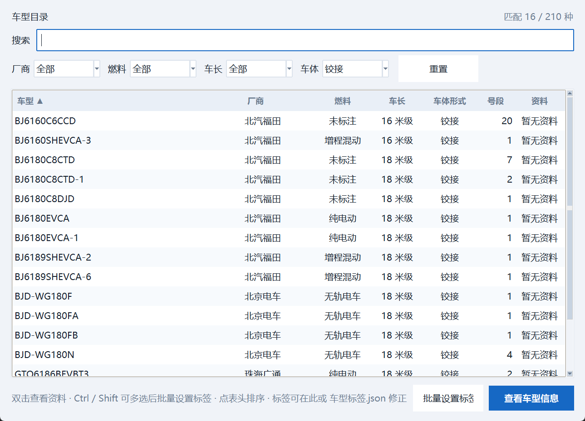

# 变更记录

本文件按版本记录每次迭代做了什么、为什么做，以及验证方式。

## 迭代 V17 · 按反馈返工：不要把整块收起来，实时信息放车型下面

用户反馈上一版改坏了三处，逐条修：

1. **"展开后又恢复成原样，还收不回来"** —— 真 bug：`fit_window()` 只长不缩，
   卡片 `grid_remove()` 之后窗口还是原来那么高，看着就是没收起来（还留一大片空白）。
   **做法改掉**：不再整块折叠卡片。
2. **"收起来太短了不好看，你只收没用的就行，可以留几个按钮"** —— 改成：
   「快查工具」和「数据管理」两张卡片**一直显示**；数据管理卡重排成 2 列 × 3 行（车型目录 / 管理号段 /
   数据体检 / 地铁编号查询 / 我的记录 / 线路查询 / 区属公交 都在明面上），
   只把**联网查询、线路资料**这两项收进卡片底部的 **「更多联网工具 ▾」**。整卡高度从 7 行降到 5 行。
3. **"实时情况放车型底下，放到页面最底下不好看"** —— 实时那一行从底部状态栏挪到**车型正下方**：

   ```
   现在 886 开往 北京蟒山森林公园 · 昌平西关环岛东 · 距站 11132 米 · 21:26:54　｜　最近跑 886（2020.8–2026.9）
   ```

   （上面这句是这次截图时**真联网**拿到的实时结果）

顺带：状态栏恢复只显示操作提示，不再兼职显示联网信息；`_sync_online_status`/`toggle_more_tools` 留成占位，
避免以后再有人误接。

实测：窗口 **1396px**（屏幕 1600，留出任务栏），内容请求 1420；`--net-check` → 「联网功能正常」；
EXE 重打包（10-11 21:27）+ 双冒烟通过；截图 `截图\主界面.png` 更新（真实联网结果）。

## 迭代 V16 · 主界面瘦身一半 + 按钮分级/删重复 + 文案面向公交迷

用户这轮提了四件事，逐条做完并量了数：

### 一、"主界面太长了，电脑快装不下" → 窗口高度 **1405px → 762px**

先量清楚：主窗口**请求高度 1443px**（屏幕 1600），三块卡片是竖着堆的（查询卡 ~500 + 区间查询/拍车日志卡 ~500 + 数据管理卡 ~210）。
所以不是"我新加的那两行"撑的，是整个布局本来就顶到屏幕边（在小屏上会被裁掉）。

修法（按用户说的"少用的收起来、常用的留着"）：
- **常用**留着：输入自编号 → 车型结果卡 → 提示行 → 操作按钮 → 历史/状态栏；
- **少用**默认折叠：`号段区间查询 / 拍车日志` 与 **`数据管理`（车型目录/号段管理/我的记录/数据体检/标签/备份/联网/线路资料）**，
  收在一个 **「更多工具 ▾」** 按钮后面（点一下展开、再点收起，窗口高度跟着变）；
- **关键细节**：折叠必须发生在"算窗口高度"**之前**，否则窗口还是按全展开的高度开出来（我第一次就踩了，量出来 1405 才发现）。

实测：内容请求 **1443 → 728**，窗口 **1405 → 762**（截图 `截图\主界面.png`）。

### 二、"按钮太乱、分级要合理、废物按钮直接删"

先用脚本**数了一遍每个窗口的按钮数**（找出最乱的），再动手：

| 窗口 | 改前 | 改后 |
| --- | --- | --- |
| 联网查询 | 9 个（含「清空缓存」+ 3 个散按钮） | **6 个**：查这辆车 / 查这条线 / 现在在哪 / 写入线路数据 / 复制导出▾ / 关闭 |
| 线路资料 | 8 个（4 个同级按钮挤一行） | **5 个**：查询 / 写入线路数据 / 更多▾ / 复制导出▾ / 关闭 |
| 我的记录 | 14 个（线路页签一排 8 个） | **8 个**（三个页签合计）：导入 / 手工编辑 / 导出 / **检查▾**（该刷新了、校验线路号）/ **删除▾**（删除导入的、删除网上查的、清空全部）|
| 区属公交 | 12 个 | **6 个** |

**真删掉的"废物按钮"**：区属公交的「重载数据」（和「重新载入」是同一个动作）、区属公交的「数据文件夹」（设置里已有「打开程序文件夹」）、
联网查询的「清空缓存」（设置 → 联网里已有）。原则：同一个动作只留一个入口，维护类动作归到设置。

### 三、"语言要规范，面向一般公交迷，不要写和上个版本比去掉了什么"

- 写脚本扫出 **39 处"开发者腔"** 并替换：`这一版只显示结果…`（版本对比，删）、`环境变量 BPT_NO_NETWORK`、
  `服务端`（→"第三方数据"/"站牌"）、`内部编号`、`（目录文件：xxx.json）`、`只补空字段` 等；
- 状态栏不再写 `服务端每个查询约 6 秒、首次连接约 20 秒`，改成**显示上次实际耗时**（"上次查询 0.3s"）——
  服务端快慢会变，写死数字一定会过时（这几轮它就从 6.4 秒变成 0.3 秒）；
- **加了测试护栏** `test_no_developer_jargon_in_ui_strings`：扫描所有界面字符串字面量，出现
  `这一版 / 环境变量 / 服务端 / 内部编号 / 接口 / 试验 / 重构 / 线程` 之类直接红灯（注释和 docstring 不管，那是给维护者看的）。

### 四、联网信息进状态栏（不再占窗口高度）

上一轮加的"现在在哪 / 最近跑哪条线"原本是结果卡下面的一行，这轮改成写进**底部状态栏**：
`自编号 31688 → BJ6127C8BTF　现在 886 开往 北京蟒山森林公园 · 军都度假村 · 距站 490 米 · 08:55:03　｜　最近跑 877（2023.7–2026.9）`
失败时只补一句短的分类：`联网没查到（连接被拒绝）`（不再塞整句异常）。

### 五、验证

- 测试 **294 → 295 全绿**（新增开发者腔护栏；主界面联网那 4 条用例改成读状态栏）；
- 实测：主界面 1405 → **762px**；按钮表如上（脚本数的可见按钮，不是估计）；
- `北京公交车型查询器.exe --net-check` → 「联网功能正常」；重打包 + 双冒烟（正常 + `BPT_NO_NETWORK=1` 离线）通过；
- 截图更新：`截图\主界面.png`、`联网查询.png`、`线路资料.png`、`我的记录.png`、`区属公交.png`。

## 迭代 V15 · 「连不上」排查：服务端其实好好的 + 三处改进

用户连续两次看到 `WinError 10061 由于目标计算机积极拒绝`，问"是不是连不上了"。查下来的结论和顺手做的改进：

### 一、实测结论：服务端没坏，而且快了一个数量级

```
TCP 建连 0.09~0.13s（3 次全通，解析到 52.220.103.169）
HTTPS 请求 /sse → HTTP 200（0.28~0.31s）
MCP 握手 0.9~2.6s        ← 之前是 19~26 秒
886 线路号 0.26~0.3s      ← 之前 6.4 秒
31688 车辆历史 2.0s ｜ 886 用过的车 3.0s ｜ 805 站点表 0.26s ｜ 805 发车时刻 2.3s
```

**连 EXE 自己也通了**（见下面新增的自检：退出码 0）。顺带发现：站点根目录现在会 302 到
**AWS Cognito 登录页**（网页端加了登录），而 **MCP 接口仍不需要登录**——早几轮我实测时它还是
http↔https 死循环重定向，所以"这站只有 API"的说法现在要改成"网页端要登录，API 照旧开放"。

**排除了一个很像的原因**：以为 `urlopen` 走了系统代理（裸 socket 通、urlopen 被拒是典型的代理症状）。
实测环境变量和 Windows 注册表**都没有代理**，走不走代理两条路都 200 ✓ 所以不是这个。

### 二、三处改进（都是这次"连不上"暴露出来的）

1. **失败自动重试一次**：连接类失败（被拒/超时/断了）换一个会话重试一次再报错——
   用户看到的是"点一下查出来了"，而不是"又连不上"。协议错误不重试（重试也一样）。
   重试过程写进 `联网日志.txt`（第1次/第2次）。
2. **标题不再误导**：以前连接失败时标题写「没有查到这条线路」✗ 用户会以为线路号错了。
   现在分成「查询没成功（没连上联网服务）」和「没有查到这条线路」两种情况。
3. **错误文案说清原因和出路**：10061 → 「连接被拒绝：可能是服务端一时没在听，或者本机网络/防火墙/VPN 拦了它」；
   超时 → 「等超时了：网络慢或被拦」；DNS → 提示检查域名解析。都带一句"过一会儿重试即可"。
4. **界面标出程序构建时间**（`程序构建 2026-10-11 12:34`）：用户能一眼看出"我跑的是不是新版"
   （这次两张截图的状态栏都缺我近期加的字样，说明跑的是旧副本）。

### 三、新增自检开关：`北京公交车型查询器.exe --net-check`

联网失败时，光看界面分不清"服务端问题"还是"本机把它拦了"。这个开关按顺序报：

```
① 域名解析 bjbus.jinzihao.me → 52.220.103.169
② 裸 TCP 连接 443（不走代理）→ 通了 0.09s
③ HTTPS 请求（走 urllib，会读系统代理）→ 系统代理：（没有）→ 成功 HTTP 200
④ MCP 握手 + 查一次线路号 → 握手 1.0s，查 886：0.3s
结论：联网功能正常。
```

哪一步失败就直接告诉你那一层的问题（DNS / 防火墙拦了 TCP / 代理 / 协议），并给出对应的处理方向。

### 四、验证

- 测试 **287 → 290 全绿**（新增：错误文案的原因提示、失败时标题不能说"没有查到这条线路"、
  连接类失败重试一次/协议错误不重试）；
- `python BPT_BusDigitalNumber.py --net-check` 与**重打包后的 EXE** 各跑一遍，都通过（退出码 0）；
- EXE 重打包 + 双冒烟（正常 + `BPT_NO_NETWORK=1` 离线）。

## 迭代 V14 · 线路查询里离线看服务端首末站（收尾）


「线路查询」左表加了一列 **「服务端首末站（本地目录）」**：显示这条线的两个方向首末站，
**来自 `线路目录.json`，不联网、0 秒**（上下行显示成 `A ↔ B`，只有一个方向就 `A → B`，目录里没有就 `—`）。
底部汇总会写「其中 N 条能对上服务端首末站」；**还没有目录时给一句可操作提示**
（去「线路资料（联网）」点一次「更新线路目录」），而不是留一片空白。
目录文件在别处更新过（点了「更新线路目录」）会自动重读。

实测（用夹具目录跑真窗口）：

```
('886', '北京蟒山森林公园 ↔ 德胜门西', '2 种车型', '3 辆')
('919', '地铁北土城站 → 体育场小区', '1 种车型', '1 辆')
汇总：共 2 条线路 · 记录总数 3　其中 2 条能对上服务端首末站
```

测试 **286 → 287 全绿**（新增：有/无本地目录两种情况的显示与提示）；EXE 重打包 + 双冒烟。

## 迭代 V13 · 交互时序猎取（干净）+ 两处"开着窗口用旧数据" + 一处措辞违规

### 一、交互时序探针（4 个场景）

| 场景 | 结果 |
| --- | --- |
| 同一辆车在**两条线**上都有记录，查它 → 提示行要两条都显示 | ✓ 实测「我记过：919（2023.5–2024.1） · 现在还在跑、886（2020.8–2022.3）」 |
| **删掉线路数据后立刻再查**同一辆车 → 「我记过」必须消失 | ✓ 立即消失（查的是实时 `app.lines`，不是缓存） |
| 反复开关「我的记录」（导入相关） | ✓ 线程数 1 → 1，无异常 |
| **连续快速切换**筛选（含空串/超长/切来源） | ✓ 无异常 |

结论：时序没问题，如实记录（第 1 条我第一次还探错了控件名，是提示行不是表格——探针自己也会错，得看真输出）。

### 二、但顺手查出两处"开着窗口用旧数据"（真 bug，已修）

1. **`LineQueryWindow` 没有 `on_data_changed`**：它构造时 `self.links = list(app.lines)` 快照了一份，
   于是开着它的时候在「线路资料」里点「写入线路数据」、或在「我的记录」里导入新记录，
   **它一直显示旧数据**。修法：加 `on_data_changed({"all","lines"})` → 重新取一份并刷新。
2. **`LineManagerWindow`（编辑器）整份覆盖**：它也是拿打开时那份拷贝在编辑，保存时 `save_lines(self.links)`
   **整份覆盖**文件 ✗ 于是"打开线路管理 → 别处写入联网数据 → 在线路管理里保存"会**静默丢掉**联网写入的记录。
   修法：打开时记一个轻量指纹（`_lines_fingerprint`），保存前比对，不同就提示"线路数据在别处被改过，
   继续保存会整份覆盖"，用户拒绝则不写文件。

### 三、一处措辞违规（用户早就要求过，我复发了）

交互探针的输出里看到主窗口提示行写着「**属于** 31590-31779」——用户明确要求过不要用「属于」
（记录只能说明"记过"，程序不该替用户断言归属）。改成「**号段** 31590-31779」，
并把 `使用说明.md` 里引用旧文案的那一行一起改掉；测试从"断言含属于"改成"断言含号段且不含属于"，
这样以后再复发会直接红。

### 四、验证

- 测试 **284 → 286 全绿**（新增：线路查询随数据变化刷新、线路管理保存前提示覆盖）；
- 上表时序实测；EXE 重打包 + 双冒烟（正常 + `BPT_NO_NETWORK=1` 离线）。

## 迭代 V12 · 先证明"不是 bug"再动手 + 离线看首末站

### 一、查 `MyRecordsWindow` 的 760ms：结论是**不用改**

上一轮量到"打开我的记录要 841ms"。用 cProfile + 单控件基准量了一遍：

```
单控件创建成本：ttk.Entry 0.7ms / Button 0.3ms / Label 0.2ms / tk.Text 0.1ms   ← 控件本身很快
MyRecordsWindow 第 1 次开：770 ms
                 第 2 次开： 19 ms
                 第 3 次开： 16 ms
LineQueryWindow 第 1/2 次：25 / 16 ms      CatalogWindow 第 1/2 次：48 / 19 ms
空线路数据时开「我的记录」：16 ms
```

**这是"每进程只付一次"的首次 Tk/ttk 主题初始化成本**（哪个窗口先开谁付），不是每次开窗的代价，
和数据量也无关。所以**不改**——如实记录这次"查了但不需要改"的结论，避免为了产出做无谓重构。

### 二、新功能：用本地线路目录**离线**看首末站（不用再等 6 秒）

上几轮拉下来的 `线路目录.json` 里**每条线路都有首末站**。现在打开「线路资料（联网）」查任意线路号时：

1. **先用本地目录把两个方向的首末站填进表格**（0 秒、离线可用）；
2. 再联网查更详细的数据（用过的车/站点/实时），查到就覆盖；
3. **联网失败也不许把它冲掉**——断网时你依然能看到首末站，并且能直接「保存线路资料」写进 `线路资料.json`；
4. 记进资料的日期用的是**目录的更新日期**（不是今天），不会把旧数据标成新的。

### 三、做这个功能时抓到的两个交互 bug（都是"顺序"问题）

1. `query()` 里"先清空表格"那句在**填充之后**执行 → 刚填好的首末站被自己清掉。改成先清、再填；
2. `_poll()` 里有**两处** `dir_table.set_rows`：一处是我加了守卫的（联网没返回方向时保留本地数据），
   另一处无条件的又把表清空 → 守卫形同虚设。删掉重复的那处。
   这两处都是"测试写下去才暴露"的，正好说明给交互加测试的价值。

### 四、验证

- 测试 **283 → 284 全绿**（新增：断网时首末站来自本地目录、不被联网失败冲掉、且能离线保存）；
- 上表实测（单控件成本 / 第 1 次 vs 第 2 次开窗）；EXE 重打包 + 双冒烟（正常 + `BPT_NO_NETWORK=1` 离线）。

## 迭代 V11 · 清掉最后一处泄漏 + 量出一个 34 倍的性能问题

### 一、清掉上一轮记下的残留（内联对话框的 trace）

上一轮定位到"区属公交批量录车牌"那个内联对话框每开一次留 1 条 Tcl 命令。根因是它用了**局部**
`StringVar` + `trace_add`，不挂在 `self` 上，所以 `WindowMixin` 的清理够不着。
修法：记住 `trace_add` 返回的名字，"录进去 / 取消 / Esc"三条出口统一走 `close_window()`
先 `trace_remove` 再销毁。加了一条测试（真的去点那个「取消」按钮，断言反复开 3 次不涨 Tcl 命令）。

**泄漏复测**：4 轮 × 33 个窗口，Tcl 命令 **+1 且不再增长**（上一轮修完是 +1/轮稳定，现在是"只多 1 条、
之后完全持平"）。

### 二、边界测试：号段表 / 线路 / 地铁 / 区属公交全空时

把所有能构造的窗口在**空数据**下都开一遍并调用 `refresh / on_data_changed`：
**22 个窗口零失败**（其余 12 处是"需要额外参数的窗口"——空数据下本来就无从打开，属预期）。
结论：数据缺失时不会崩，如实记录。

### 三、量出来的性能问题：线路查询是 O(线路 × 记录)

拿 1000 条线路记录压一遍界面层：

```
LineQueryWindow 构造+刷新: 539 ms    ← 每次刷新 516ms（搜索框每敲一个字卡半秒）
MyRecordsWindow 构造:      841 ms（一次性）
CatalogWindow 刷新:        6 ms
健康检查(1000 条):         8 ms
数据层各函数:              全部 ≤ 4 ms
```

`LineQueryWindow.refresh_lines()` 原来是「**每条线路都重扫一遍全部记录**」：
`models_for_line(links, name)` + `numbers_for_line(links, name)` 各扫 1000 条 × 1000 条线路 = 10⁶ 次。

修法：先按线路**归并一次**（O(记录)），再按名字取数量。

**实测对比**：刷新 **516ms → 15ms（快 34 倍）**，构造 539ms → 36ms。
加了性能护栏测试（1000 条记录刷新必须 < 250ms，超了就红）。

### 四、验证

- 测试 **281 → 283 全绿**（新增：内联对话框 trace 必须释放、线路查询 1000 条性能护栏）；
- 上表实测数据；EXE 重打包 + 双冒烟（正常 + `BPT_NO_NETWORK=1` 离线）。

## 迭代 V10 · 猎到两个真泄漏（窗口 + Tcl 命令）

这一轮把"长跑健壮性"当成 bug 猎场，结果**真的抓到两个**，而且是会随使用时间累积的那种。

### 一、先验证一个"可能没事"的怀疑：查询中关窗口

怀疑点：联网窗口/线路资料窗口的 `after` 轮询会在窗口销毁后继续跑，撞上已销毁的控件抛异常
（→ 弹"程序出错"）。写了探针跑 6 个场景（查车/查线/查实时/更新目录/查询中/站名搜索时关窗），
**0 异常**。原因：Tkinter 的 `Misc.destroy()` 会把该窗口注册的 `after` 命令一并删除，
定时器随之取消——所以是"构造上安全"。这条如实记录（怀疑 → 验证 → 没问题）。

### 二、真泄漏之一：构造中途出错的窗口会留在屏幕上

反复开关 33 个窗口做测量时发现：**每轮多出 4 个不消失的子窗口**（`MetroBatchWindow` /
`MetroLineCatalogWindow` / `MetroRangeManagerWindow` / `TagEditorWindow`）。查下去发现
它们是在 `__init__` 里访问 `parent.app` 抛异常——**真实调用点传的父窗口是对的，所以不是线上 bug**；
但暴露了一个普适缺陷：`super().__init__(parent)` 一执行，Tk 里就真的多了一个顶层窗口，
之后 `__init__` 里任何一行抛异常，**那个空窗口会永远留着**。

修法：`WindowMixin.__init_subclass__` 给每个窗口的 `__init__` 自动套一层守卫——构造抛异常时
先把半成品窗口销毁再往上抛。加了一条测试（故意在 `setup_dialog` 之后抛异常，断言不留窗口）。

### 三、真泄漏之二（更要紧）：StringVar 的 trace 命令永远删不掉

修完上面那个，还剩 **+12 个 Tcl 命令/轮**在线性增长。逐个窗口测出 5 个"漏"：
`CatalogWindow(+6)`、`SpotLogWindow(+3)`、`RangeManagerWindow(+2)`、`LineQueryWindow(+1)`、`MyRecordsWindow(+1)`
——共同点是**都有搜索框**。最后查明根因：

```
var.trace_add("write", 回调)
  → 在 Tcl 里注册一条命令
  → tkinter 把 Python 回调存进解释器的 _tclCommands
  → 回调闭包持有窗口，窗口持有变量
  → 环形引用，而其中一环（Tcl 命令）是 Python GC 看不见的
  → 变量永不回收，Variable.__del__ 永不执行，那条 Tcl 命令永远留着
```

修法：`WindowMixin.destroy()` 之前调 `release_variables()`——把窗口上所有 `tk.Variable` 的
trace 摘掉（`trace_info` + `trace_remove`）并丢掉引用。**这是这一轮最有价值的修复**：
用户反复开关搜索窗口（正常使用就是这样）以前会一直涨。

### 四、实测对比（8 轮 × 33 个窗口 = 264 次开关）

| 指标 | 修之前 | 修之后 |
| --- | --- | --- |
| Tk 命令 | **+97**（+12/轮，线性不收敛） | **+1**（第 1 轮后完全持平） |
| 残留子窗口 | **+32**（+4/轮） | **+0** |
| Python 对象 | **+4887** | **−119**（不涨反降） |

### 五、验证

- 测试 **279 → 281 全绿**（新增：半成品窗口必须销毁、反复开关窗口 Tcl 命令不得线性增长）；
- 8 轮泄漏测量（上表）；EXE 重打包 + 双冒烟（正常 + `BPT_NO_NETWORK=1` 离线）；
- 如实记录残留：还有一个**非 WindowMixin 的**小对话框（区属公交批量录入那个）会留 1 条 Tcl 命令，
  量级是"每次 1 条"，留着下一轮清（已在探针里定位到具体行）。

## 迭代 V9 · 异常审计（干净）+ 线路号批量校验 + 最后一个工具接完

### 一、异常审计：6 处静默吞异常，逐个看过，都是故意的

写了 AST 审计找 `except` 里"宽泛 + 静默"的组合（最会藏 bug 的写法，上一轮的 `except tk.TclError`
没抓到 `RuntimeError` 就是这一类）。结果：

```
BPT_BusDigitalNumber.py: 设置读取(238) · 错误弹窗兜底(261) · 热键注册(471/499) · DPI 回退(1916) · 控制台代码页(10272)
bpt_online.py:           缓存写不进去(548)
```

逐个看过：**都是故意的降级**（注释里也写了原因），且失败路径都有别的方式对外表达
（热键注册失败靠 `registered=False` 反映、缓存写失败不影响查询）。**结论：干净。**
这条如实记录，没有为了产出去"修"不该修的地方。

### 二、新功能：用本地线路目录批量校验你的线路号

基于上一轮的 `线路目录.json`（2830 条 / 1460 个线路号），「我的记录 → 线路」多一个 **「🔍 校验线路号」**：

- 把你 `线路.json` 里**服务端目录里没有**的线路号挑出来（可能是记错号，也可能这条线不在服务端数据集里）；
- 对每个可疑号给出**「你是不是想记」**（错一个字符也能猜到，例如 `884 → 886`）；
- **没有本地目录时什么都不报**——绝不能拿空目录把用户自己的记录误判成错的；
- 只提示、**不碰数据**；要改就去「线路管理」。

### 三、服务端 14 个工具全部接完

最后一个 `query_bus_journey_time_by_route_id_and_stop_names_or_ids` 接上了：
**同一条线上从 A 站到 B 站，每辆车花了多久**（实测 886「德胜门西 → 昌平东关」当天 9 趟，
31705 是 4005 秒 → 界面显示「1 小时 6 分」）。

界面：「④ 实时」页签新增 **「从上面的站到「到」那站要多久」**（复用已有的两个站名输入框）。
这是**最后一个**未接工具——至此服务端 14 个工具**全部**实测并接入（含两个按需调用的）。

### 四、验证

- 测试 **275 → 279 全绿**（新增：两站耗时解析与时长格式化、窗口完整链路、线路号校验、记录窗口校验提示）；
- 真实数据：线路目录 2830 条；两站耗时实测 4005 秒（德胜门西→昌平东关）；
- EXE 重打包 + 双冒烟（正常 + `BPT_NO_NETWORK=1` 离线）。

## 迭代 V8 · 脏输入扫雷（结论：干净）+ 服务端线路目录本地化

### 一、先把"找 bug"做彻底：两层脏输入轰击

**数据层**（18 组脏输入 × 40 多个函数：空串/全角/emoji/SQL 片段/超长/非法日期/坏 JSON/空文件/把目录当文件…）：
只有 2 处异常，且都是**故意的可读错误**（`线路.json` 是空文件或坏 JSON 时抛 `DataError`，文案是"先当作没有线路数据"）。
**没有发现崩溃**。

**界面层**（25 个窗口 × 12 组脏输入：把垃圾塞进所有搜索/过滤/输入变量，再把 `refresh* / show* / reload* / on_data_changed` 全部叫一遍）：
**零崩溃**（4 处"构造失败"是我探针的锅——地铁那几个窗口收的是父窗口而不是 app）。

结论如实记录：**这两层目前是干净的**，没有为了"有产出"去编 bug。

### 二、新增：服务端线路目录本地化（打错号不用再白等 6 秒）

服务端有个 `query_route_list`，一次给**全量线路目录**。实测：

```
拉线路目录: 28.0s -> 2830 条（线路号去重后 1460 个），存本地
886 有 → 德胜门西 ↔ 北京蟒山森林公园
887 有 → 南口北站 ↔ 地铁回龙观站（注意：887 在真实数据里是真线路，不是 886 的错字）
9999 没有 → 不瞎猜
重新读回: 2830 条
```

- 新文件 **`线路目录.json`**（用户数据、gitignore、**不进备份目录**——随时能重拉）；
- 「线路资料（联网）」多一个 **「更新线路目录」** 按钮（28 秒的拉取，我给它单独设了 90 秒超时）；
- 之后**输入线路号会先用本地目录提示**：有这条线就顺带显示首末站；没有就提示"可能不在服务端数据集里"，
  并能**猜错字**（前缀 → 包含 → 只差一个字符，且要求 ≥2 字符 + 首字符相同，否则单字查询会乱匹配）；
- 目录里**内部 id 不写进你的数据**（只用它做"认不认/首末站"的判断）。

### 三、验证

- 测试 **272 → 275 全绿**（新增：线路目录解析与补全、往返与坏文件容错、窗口用本地目录给提示）；
- 真实数据验证见上（2830 条 / 1460 个线路号 / 28s / 存读一致）；
- 本轮还修掉自己两个小问题：补全对"887→886"这类**错一个字符**的情况原本找不出来（加了第三层匹配）、
  以及单字查询把这一层放太松（收紧成"≥2 字符且首字符相同"）。

## 迭代 V7 · 线程安全审计（又抓一个静默失效的 bug）+ 两处功能补齐

### 一、把"工作线程绝不碰 Tk"做成静态审计 —— 又抓到一处

上一轮修了联网查询线程里的 `winfo_exists()`。这一轮写了 AST 审计脚本，把所有
`threading.Thread(target=…)` 的入口函数（含内部嵌套函数）扫一遍，看有没有 Tk 调用：

```
线程入口: ['_run', '_work', 'work']
_run()（全局热键）定义在 L448：可疑调用 1 处 → L467 self.widget.after_idle
其余 7 处线程入口：0 处
```

**全局热键线程**里直接 `self.widget.after_idle(self.callback)`：Tkinter 不是线程安全的，
这行会抛 `RuntimeError: main thread is not in main loop`，而原来的 `except tk.TclError`
**抓不到它** → 热键**静默失效**（窗口化 EXE 里连报错都看不到）。

- 修法：热键线程只往 `queue` 里塞事件，**主线程用 `after(200, self._poll)` 轮询**再回调；
- 并把这条不变量**变成测试**：`ThreadSafetyTests.test_worker_threads_never_touch_tk`
  用 AST 检查所有线程入口（以及 `test_hotkey_thread_only_queues` 检查热键类），
  以后谁再往线程里写 Tk 调用，测试直接红。

### 二、补上"只有数据层、没有界面"的空档：网上查的记录该刷新了

V2 写了 `online_stale()`（哪些网上查来的记录超过 N 天没更新），但一直没接到界面上。
现在「我的记录 → 线路」多一个 **「⟳ 哪些网上查的该刷新了」**：列出超过 30 天的记录
（线路 / 车型 / 时间范围 / 车辆数），并写清两条出路——用「线路资料（联网）」重查后
「写入线路数据」刷新，或者「✕ 删除网上查的」一键清掉（自己记的不会动）。

### 三、车型目录：新增「线路」列 + 按线路筛选（一直延后的 A4）


- **「线路」列**：这个车型在你线路数据里跑过多少条线（数字可点表头排序）；
- **「线路」筛选**：下拉直接列出你线路数据里的线路名，选中就只剩跑过这条线的车型
  —— 等于"**某条线用过哪些车型**"；
- 线路数据变了（导入/联网写入/删除）会自动刷新，下拉里失效的选项会回到「全部」。

### 四、验证

- 测试 **269 → 272 全绿**（新增：线程 Tk 审计、热键线程只入队、车型目录线路列与筛选）；
- 截图 `截图\车型目录.png` 更新（线路列实测显示 2）；
- 文档链接自检通过；EXE 重打包 + 双冒烟（正常 + `BPT_NO_NETWORK=1` 离线）。

## 联网 V6 · 找 bug（又抓到一个"偶发连不上"的真凶）+ 发车时刻 / 场站出车

用户说"看看还有没有什么 bug、还能加什么功能"。这一轮先做 bug 猎取，再补两个功能。

### 一、抓到的真凶：三个超时全都用错了（同一族 bug）

`connect_timeout_sec`（默认 8 秒）是**建连**的上限，但之前被拿去等三种**服务端回应**，而实测：
服务端建会话 **6.5 秒**、initialize **19 秒**、每个工具调用 **6.4 秒**。于是：

| 位置 | 原来 | 后果 | 现在 |
| --- | --- | --- | --- |
| `connect()` 等 initialize | `connect_timeout` 8s | **偶发"等了太久，对方没有回应"** ← 这一轮探针就真撞上了 | `timeout_sec`（45s） |
| `SSETransport.open()` 等会话地址 | `connect_timeout` 8s | 只剩 1.5 秒余量，网络稍慢就**"没有给出会话地址"** | 新的 `session_timeout`（30s） |
| `SSETransport.post()` 递请求 | `connect_timeout` 8s | 服务端忙时递不上去 | 新的 `post_timeout`（30s） |

三处都补了回归测试（`test_transport_timeouts_have_margin`、`test_connect_waits_longer_than_the_tcp_timeout`）。
**这是这一轮最有价值的发现**：它不是"偶尔网络不好"，是我把上限设小了，用户会看到莫名其妙的连接失败。

### 二、把服务端 14 个工具全部过了一遍

前几轮验证了 10 个；这一轮补齐：

```
query_route_list                              → 全量线路目录（168KB：{内部id: {number, from, to}}）
query_schedules_by_route_id(805)              → 每辆车 depart/arrive 时刻（111 个班次）
query_route_depot(805)                        → 每辆车从哪个场站、几点出车（40 条）
query_bus_journey_time_...(需要两个站名)        → 仍未接（参数组合多，本轮没接，如实记录）
```

### 三、新功能（④ 实时 页签）

- **「每辆车几点发车」**：886 路当天 **111 个班次**（发车时间/发车站 → 到达时间/到达站）；
- **「车从哪个场站出车」**：886 路 **40 条出车记录**（实测车从**军都度假村 / 昌平东关**出车，开往北京蟒山森林公园）——拍车时知道去哪儿等车；
- 两者都按天缓存（线路班次一天内不变），实测第二次查询 **0.00s（来源=缓存）**。

### 四、验证

- 测试 **266 → 269 全绿**（新增：超时余量回归、慢握手回归、发车/场站解析）；
- 真连实测：握手+线路号 25.8s（**之前这一步会偶发超时**）、发车时刻 6.9s、场站 6.7s、缓存命中 0.00s；
- 顺手修掉测试被拖慢的问题（把"故意不回包"的用例的 `timeout_sec` 调小，45s → 1s，套件从 56s 回到 11.6s）。

## 联网 V5 · 实时数据 + 冒烟硬化

### 一、开工门禁：实时类三个接口实测

```
某车轨迹 query_bus_track_record_by_bus_id(31688)  7.6s  30 秒一条，共 250KB
    样例：{"time":"2026-10-10 08:54:33","line_name":"886 开往 北京蟒山森林公园",
           "stop_name":"军都度假村","distance_m":239,"arrived":false,"occupancy":1}
到站   query_bus_arrivals_...(805, 德胜门西)        6.7s  [{bus_id, time, occupancy}]
时刻表 query_route_timetable(805)                  6.7s  制表符表格：车号 + 每站「时间,拥挤度,距离」
```

三个全通。

### 二、做好的部分

- **「这辆车现在在哪（实时）」**（联网查询窗口）：取轨迹的最后一条，显示它现在跑哪条线、在哪一站、距站多少米/是否到站、拥挤度、这一段轨迹有多少个点；
- **「④ 实时（到站 / 时刻表）」页签**（线路资料窗口）：到站表（自编号/时间/拥挤度）+ 时刻表概要（车号/始发/终点/站数）；
- **实时数据绝不按天缓存**：`OnlineService._call(cache=False)` + **只有 30 秒内存缓存**（存在运行期，不落盘）——把实时位置缓存 7 天是错的；
- **`联网日志.txt`**：每次请求记一行「工具 参数 / 成功或失败 / 耗时」，最多留 300 行；`recent_online_errors()` 给设置界面用（界面还没做）；
- **`verify_exe.py` 硬化**：默认**跑两次**——正常启动 + `BPT_NO_NETWORK=1` 离线启动，两次都过才算通过（可用 `--offline` 只跑离线那次）。"断网也能用"从口头承诺变成脚本化的验收。

### 三、顺手修的边界 bug

实测 **300 路**时服务端返回的不是列表，我原来会抛「线路号的返回不是一个列表」这种术语错误。现在：带 `error`/`detail` 的对象报「服务端说这条线路查不到」，包了一层 `result` 的能自动认出来，其它情况才报"没有给出方向"。顺带把**内部 id 的含义写进注释**：它不是线路号，一个线路号对应两个方向两个 id（实测 886→805/806、1路→5918/5919、919路→5299/5300、专45路→3227/3228，每对都差 1），服务端声明会变，所以程序每次现查、绝不落盘。

### 四、门禁：站名搜索两个工具（实测通过）

```
query_routes_at_stop("德胜门西")                           → 345 / 886 / …（含"这是第几站"）
query_routes_from_stop_to_stop("德胜门西","昌平东关")       → 345快 / 886 / 快速直达专线124（含上下车站序号）
```

都接进了「线路资料（联网）」→ ④ 实时页签：**「这个站有哪些线」**（填站名）与 **「从这里到这里直达」**（填站名 + 终点）；这两个是线路拓扑类查询，按天缓存没问题（实时类才只留 30 秒内存缓存）。

### 五、设置界面「联网」分组（V5 收尾）


- **允许联网查询**开关（关掉后所有联网按钮变灰，本地功能照常）；
- 单次超时 / 缓存天数 / 最小间隔（填了看不懂的值就回到默认，不报错卡住）；
- **保存后立刻生效**（不用重启：共享服务的设置就地换掉）；
- **清空联网缓存 / 清空联网日志 / 看最近的联网错误**。

之前文档里"设置里有开关"是提前承诺，这一轮兑现了；使用说明里那句临时改成"靠环境变量"的话也改回来了。

### 六、验证

测试 **261 → 266 全绿**（新增 5 条：实时解析、日志读写与清理、**"实时数据只进内存缓存、绝不落盘"**、设置分组往返+非法值容错、站名搜索解析）；EXE **17.89 MB**；`verify_exe.py` **双冒烟**（正常 + `BPT_NO_NETWORK=1` 离线）通过；`截图\设置.png` 更新。

**五个版本到此做完**：V1 底座/只读 → V2 写入线路数据（来源+证据+一键删+缓存+共享会话）→ V3 线路→车 + 线路资料 → V4 站点表 + 体检 → V5 实时 + 设置硬化。全程 11 个联网接口**全部实测验证**（含上一轮 curl 没回包的那个），修掉 8 个真 bug（线程碰 Tk、`or ""` 吃 0、年月字符串比较、线路查询明细恒空、服务层离线契约、假传输握手误判、`300路` 术语报错、设置窗口过高）。

## 联网 V3+V4 · 线路维度（线路→车 / 线路资料 / 站点表）

### 开工门禁：四个接口一次实测（按计划"验不过就砍范围"）

```
query_route_ids("886")                 6.4s  2 个方向（德胜门西↔北京蟒山森林公园）
query_route_operating_history("886")   8.2s  319 辆用过的车
query_bus_ids_by_route_id(805)         6.4s  40 辆现在在跑
query_route_info_by_route_id(805)      6.4s  15 站（含站距与经纬度）
```

四个全通，所以 V3/V4 都按原计划做（**上一轮 curl 探针没回包的 `query_bus_ids_by_route_id` 这次也通了**）。

### V3：线路 → 车

- **`lines_from_route_history()`**：把「这条线用过哪些车」**按车型归并**成线路记录（同型号的自编号合成一条 `numbers`）。
  一条线可能用过 300 多辆车，**逐车写证据会把文件撑爆**，所以证据只记一条总体区间（`evidence` 里 `bus` 留空），逐车日期明细留在界面里看；
- **新窗口「线路资料（联网）」**（主窗口数据管理里）：输入线路号 → 三个页签
  ① 用过的车（车型 / 车辆数 / 最早 / 最近 / 状态）② 两个方向首末站 ③ 站点表（V4）；
  按钮：**「写入线路数据」**（按车型并进 `线路.json`，来源=网上查的，预览确认 + 自动备份）、**「保存线路资料」**、**「保存站点到线路资料」**、复制车型、导出 CSV；
- **新文件 `线路资料.json`**：`{线路号: {directions, directions_checked, stops, stops_checked}}`——
  **内部 route id 一律不落盘**（服务端明确说它只在当前数据集有效、会变）；首末站与站点表**各记各的查证日期**；缺文件/坏文件都不阻塞。

### V4：站点维度

- 站点表（序号 / 站名 / 距上一站米 / 经度 / 纬度）进 `线路资料.json`，离线也能看这条线有什么站；
- **体检新增一项**「线路还没查过站点表」：`线路.json` 里出现过、但 `线路资料.json` 里没有站点的线路，点旁边的「线路资料（联网）」就能去查（不联网也不影响，明确写了"这一项可以不管"）。

### 降级处理（按计划写"降级可用"）

「现在在跑的车」这个接口偶尔不回包——实测过一次成功（40 辆），但仍按最坏情况写：**它失败只影响那一行提示**（"这个接口暂时用不了（原因）"），"用过的车""首末站""站点表"照常显示。

### 验证

- 测试 256 → **261 全绿**（新增 5 条：按车型归并/证据只一条/字符串区间容错、`线路资料.json` 往返+两项各自查证日期+内部 id 不落盘+坏文件容错、体检项、窗口查询与写入、接口失败降级）；
- EXE 17.87 MB；双冒烟（正常 + `BPT_NO_NETWORK=1` 离线）✓；
- `截图\线路资料.png`、`截图\线路资料-站点.png` 新增。

### 下一步

V5：实时类工具（某车当前在跑哪条线 / 到站与拥挤度 / 时刻表）、设置里的「联网」分组（开关 / 超时 / 缓存天数 / 清空缓存 / 清空联网日志）、`verify_exe.py` 把离线冒烟固化进脚本、文档收尾。

## 联网 V2 · 写入线路数据（来源/证据/一键删）+ 先解决"为什么这么慢"

### 一、"为什么连接这么慢"——量出来的结论

用户问「为啥连接这么慢」。我把成本拆开量了一遍（裸 socket / TLS / TTFB / 各阶段）：

```
TCP 建连 0.14s ｜ TLS 0.12s ｜ 首字节(TTFB) 0.29s      ← 网络本身极快（服务端 nginx）
SSE 会话建立 6.5s ｜ initialize 19.2s                   ← 服务端建会话约 26 秒
每次工具调用 6.4s；复用会话再查还是 6.4s（6.41 / 6.40）  ← 服务端每个请求固定约 6.4 秒
新开一个会话又要 19.3s                                   ← 每开一个窗口都白付一次
```

**结论：慢在服务端，不在网络也不在客户端**（也解释了之前 curl 探针"100 秒没回包"：那个接口排队更久）。但我的**用法**有可优化的三处，都做了：

1. **全程序共享一个会话**（`OnlineService` + `shared_service`）：以前每开一个窗口握手 26 秒；现在只在第一次查询付一次，窗口之间复用；
2. **结果缓存**（`联网缓存.json`，默认 7 天）：重复查同一辆车从 **6.4s → 0s**（实测缓存命中时 `last_source == "cache"`）；过期自动失效并清理；
3. **打开窗口就后台预热**：用户还在输字时握手已经跑完。

另外把"6 秒"这件事**写在界面上了**（状态栏："服务端每个查询约 6 秒、首次连接约 20 秒"），用户知道该等，而不是以为卡死了。

### 二、V2 主体：把查到的历史写进线路数据

- **`LineLink` 新增 `evidence`（证据链）**：每条记录写清"哪辆车、哪段日期、哪天查的"——`LineEvidence(source, bus, start, end, checked)`。向后兼容（老文件缺这个键 = 空元组）；
- **来源与优先级**：`source` 扩为 `manual / import / online`，`SOURCE_LABELS` = 我记过 / 表格导入 / 网上查的；合并时**来源按 rank 取更算数的那个（手工 > 导入 > 网上查的）**——以前 `_merge_link` 是 `new.source or old.source`，网上查一次就会把「我记过」改写成「网上查的」，等于把用户自己的记录抹掉，这是**必须修**的点；
- **状态规则**：`current` 永不被降级；在线数据只在最新区间结束日 ≤7 天前时才把 `recorded` 提到 `current`；**永不自动写 `retired`**（查不到 ≠ 已退出）；
- **界面**：「联网查询」查到车之后多一个 **「写入线路数据」** 按钮 → 预览确认（新增几条/合并几条 + 逐条列出）→ 合并进 `线路.json`（自动备份）；线路查询加 **来源筛选**与**明细来源列**；`line_display(..., with_source=True)` 会在「网上查的」后面标出来；「我的记录」加 **「✕ 删除网上查的」**（与「✕ 删除导入的」共用同一套按来源删除逻辑）；
- 「清空缓存」按钮 + 缓存条数显示在状态栏。

### 三、顺手抓出并修掉三个真 bug（都是既有代码里的）

1. **年月按字符串比较**（影响面最大）：`max(["2025.8", "2025.10"])` → `"2025.8"` ✗ ——**10/11/12 月的记录会被当成更早的数据**。合并取 max、排序全都错。新增 `month_key()` 按 (年, 月) 比较，并补了回归测试。这个 bug 在你现有数据上就会发作（886 路的记录跨 10 月）。
2. **线路查询的明细面板一直是空的**：刷新时 `keep_selection=False`，一进窗口/一筛选就没有选中行，右边明细要手点一下才出内容。改成"保留原选择，没有就自动选第一条"。
3. **服务层的离线契约漏了**：只靠 `MCPClient` 检查"能不能联网"，换个 client 就绕过去了。`OnlineService._call` 自己也检查。

### 四、验证

- 测试 247 → **256 全绿**（新增 9 条：来源优先级/证据链/按来源删/过期判定/来源标签/来源筛选/缓存命中与过期/月份比较回归/写入合并）；
- **缓存测试不联网**：假 client + 临时目录，验"第二次查询不再联网""缓存跨实例有效""清空后重新联网""过期必须重查"；
- EXE 重打包 17.86 MB；**双冒烟**：正常 ✓、`BPT_NO_NETWORK=1` 离线 ✓；
- `截图\联网查询.png` 更新（多出「写入线路数据」「清空缓存」）。

### 五、下一步（计划里的 V3–V5）

V3 线路维度（线路→车 + `线路资料.json`）、V4 站点维度（站点表/站站查询）、V5 实时数据 + 设置与硬化。**V3 开工第一件事**是重测 `query_route_operating_history` 与 `query_bus_ids_by_route_id`（后者上一轮 curl 没回包、这一轮 MCP 调用通了，仍要按"降级可用"写）。

## 联网 V1 · 联网底座 + 只读查询（结合 bjbus MCP）

用户给了 `https://bjbus.jinzihao.me/sse`。核实下来它**不是网页，是一台 MCP 服务器**（FastMCP "My MCP Server" 1.12.4，协议 2024-11-05；站点根目录 http↔https 死循环重定向，所以只有 API）。按批准的 5 版计划，这一版先做**底座 + 只读预览**：只显示结果，**不写任何用户数据**。

### 新模块 `bpt_online.py`（只用标准库，不 import tkinter）

- **传输**：MCP over SSE —— `GET /sse` 拿 `session_id`，POST JSON-RPC，响应从流里读；
- **客户端** `MCPClient`：握手（initialize → notifications/initialized）、按 JSON-RPC id 配对回包、`error` 即抛、`unpack_tool_result` 同时兼容 FastMCP 的 `content[0].text`（JSON 字符串）与 `structuredContent`；
- **纯解析**（不碰网络，测试直接喂真实回包）：`parse_date_range` / `compact_to_month` / `parse_history_map` / `parse_route_ids` / `parse_stops` / `history_to_links` / `model_lookup`；
- **设置**：`OnlineSettings.from_dict`（界面设置.json 的 `network` 段，缺项全用默认值）+ `offline_forced()`（`BPT_NO_NETWORK=1` 强制离线）。

### 界面

主窗口「数据管理」新增 **「联网查询（试验）」** → `OnlineQueryWindow`：输入自编或线路号 → 「查这辆车」/「查这条线」→ 表格显示（车辆视角：线路/车型/时间段数/最早/最近/状态；线路视角：方向/首站/末站）+ 复制车型/复制选中行/导出 CSV/双击开车型详情。联网在工作线程里跑，窗口顶部写明"第三方数据、仅供参考、不写入任何文件"；联网关了或环境变量强制离线时按钮直接禁用并说明原因。

### 实测（2026-10-01，真连服务）

| 查询 | 结果 |
| --- | --- |
| `886` | 805 德胜门西→北京蟒山森林公园、806 反向 ✓ |
| `31688` 车辆历史 | **6 条线路**（877/885/886/889…），886 上有 **98 段**区间（2020-08-15~2026-10-10） |
| `query_bus_ids_by_route_id(805)` | **40 辆车**（31682…）—— 上一轮用 curl 探针没回来的接口，这次证实可用 |
| 耗时 | 握手约 21.8s（慢），之后每次查询约 6.4s |

### 写这一版时踩到并修掉的四个坑（都是"能跑但会炸"的那种）

1. **HTTP 头不能带中文**：User-Agent 里写了中文 → `UnicodeEncodeError: 'latin-1' codec can't encode`；
2. **`urlopen(timeout=…)` 同时管建连和读**：把 8 秒的连接超时用在 SSE 流上，流一空闲就断（表现为"握手成功、第一次查询就说连接断了"）。改成**先用 `socket.create_connection` 短超时探通，再用长超时读流**；
3. **Tkinter 不是线程安全的**：工作线程里调了 `winfo_exists()` → `RuntimeError: main thread is not in main loop`，**后台查询永远不结束**。改成"线程只算结果放进 `queue`，主线程用 `after` 轮询取回"；
4. **`value or ""` 吃掉了合法的 0**：公交站"距上一站 0 米"被当成空值（真值判断陷阱）。

### 验证

- 测试 232 → **247 全绿**（新增 15 条：解析/客户端/窗口三层；假传输注入，**测试不碰真网络**）；真实回包（886 线路号、31688 历史）作为夹具写进测试；
- 新窗口纳入「内容不超出窗口」测试清单；
- EXE 重打包 17.85 MB（只涨 0.05 MB，标准库客户端几乎不占体积）；
- **两次冒烟**：正常启动 ✓，**`BPT_NO_NETWORK=1` 离线启动 ✓**（"断网不受影响"从口头承诺变成自动验收）；
- `截图\联网查询.png` 新增。

### 与计划的一处偏差（如实说明）

计划里 V1 还包含 `联网缓存.json` 与 `联网日志.txt`。**这两个我没做**——它们和"写入用户数据"是同一批逻辑，放在 V2 跟写入路径一起做更合理（也避免 V1 就产生用户文件）。`.gitignore` 已先把这两个文件名占好，V2 落地时不会误提交。

## 对账的 103 条「型号不一致」按差异性质分类（不猜相似度）

## 对账的 103 条「型号不一致」按差异性质分类（不猜相似度）

用户先否掉了我原来的建议：**"别的地方我感觉没什么笔误，有的车型之间型号名差距就是很好（像），有的可能是换了个批次，有的可能只换了能源"**——所以按"名字相似度"找笔误是错的，会把真实存在的不同型号（`SHEVCA-1` / `SHEVCA-5` 换批次、`BTB` / `BTD` 换能源）排成一堆假警报。**B5 撤回**。

改成：判据始终是「**同一个自编号、两个来源说法不同**」这个硬事实，只**描述差异的性质**并按"值得查"的程度排序：

| 差异性质 | 判据（都是字符串上的硬规则） | 例子（用户真实数据） |
| --- | --- | --- |
| **完全不搭**（最该看） | 去掉括号/连字符后仍差 3 个字符以上 | `BJ6855SHEVCA-1 → BJ6851C6BCD`（5 条） |
| 批次或能源后缀不同 | 最后一个 `-` 之前完全相同、之后不同 | `BJ6123SHEVCA-1 → BJ6123SHEVCA-5` |
| 少/多一个字符 | 骨架串编辑距离 ≤2 且长度差 ≤2 | `BJ6127C8BTB-1 → BJ6127C8BTD-1`、`BJ6123C7BHD → BJ6123C7BH` |
| 写法差异（可不管） | 只多了括号内容/厂内代号，或去掉括号连字符后完全相同 | `BJ6906FCEVCH → BJ6906FCEVCH (HC9)`（34 条） |

用户真实数据分类结果：**完全不搭 11 组 · 少/多一个字符 8 组 · 写法差异 4 组 · 批次或能源后缀不同 3 组**，界面按这个顺序从上往下排（表格设了 `sort_on_load=False` 保住报表顺序，点表头仍可自己排）。

规则收紧过一次：一开始 `BJ6123C7BHD vs BJ6123C7BH` 被判成"写法差异"（因为一个是另一个的前缀）——不对，**少了尾部字母不能算"多了厂内代号"**；改成只有多出来的部分**带分隔符或括号**时才算写法差异。

### 顺手抓到并修掉一个真 bug（差点被我当成探针问题）

写截图探针时发现：**无论选哪个分类，对账表都显示"号段表缺的编号"**。查下来是我之前一次"删除空行"的编辑把两行粘成一行，`elif key == "number_gap":` 落进了上一行的 `# type: ignore` 注释里——语法仍合法（注释掉了一个分支），但那句 `rows = [...number_gap...]` 变成**无条件覆盖**，于是所有分类都被它盖掉。这正是"语法 OK ≠ 逻辑 OK"的典型：`ast.parse` 和 232 条测试都没拦住它（没有测试覆盖"切分类后行是否变"）。
修好之后又发现第二个：`set_columns()`（切分类时会调用）会**把排序列重置回第一列**，把报表排好的顺序打乱——也让 `set_columns` 尊重 `sort_on_load`，并补了回归测试。

测试 229 → **232 全绿**（新增：差异性质分类 7 组、报表排序、`set_columns` 不改自然顺序）；EXE 重打包 17.8 MB + 冒烟通过；`截图\我的记录.png` 换成"型号不一致"按值得查程度排序的视图。

## 可优化点里挑出的三项：全窗口防挤出 + 键盘操作 + 号段重叠体检

先把项目本身量了一遍（入口 8992 行 / 32 个窗口 / 19 个函数超 60 行 / 快捷键只有 Ctrl+C·F·V / 体检 16 类），再让用户从清单里挑。用户选了这三项：

### A1 所有窗口都防「按钮被挤出」

以前只有 8 个窗口自己调 `fit_dialog_height()`，**24 个没调**——这正是用户踩过的坑（标签设置的「保存」、区属公交的按钮被切）。改成在 `WindowMixin.setup_dialog()` 里 `after_idle(self.fit_dialog_height)`：**内容建好之后自动兜一次底**，一次覆盖全部 32 个窗口，以后新增窗口也不会漏。
（`fit_dialog_height` 只增不减、并尊重屏幕可用高度，所以不会把窗口改小或顶出屏幕。）

验证方式是把 `DialogFitTests` 的窗口清单从 7 个扩到 **19 个**（车型目录 / 号段管理 / 拍车日志 / 标签规则 / 统计面板 / 设置 / 备份与恢复 / 半自动建档 / 区属公交 / 快查工具…逐个断言"内容高度 ≤ 窗口高度"）——其中大部分窗口自己没调过兜底，能过就说明 A1 真的生效。

### A2 补键盘操作

`DataTable` 新增两个可选回调，各窗口按需接上：

- **`on_delete`** → 焦点在表上时按 **Delete 删选中行**（以前 0 处绑定，删一行只能点按钮）；
- **`on_search`** → 按 **Ctrl+F 跳到搜索框**并清空（车型目录原本自己绑了，现在统一走这条路）。

已接上：号段管理、拍车日志、标签规则、区属公交（车牌记录表）；配合已有的 Esc 关闭、Enter 触发主操作。

### A3 加「公交号段重叠」体检

地铁早就有 `metro_overlap`，公交却只有「号段空档」——**同一个自编号被两个号段包住**这种数据错以前查不出来，查车时只会静默取先遇到的那个。新增 `overlap` 体检项：按起点排序后逐对比较，报出「A 段与 B 段重叠 N 个自编号（区间）」，并指出**两边车型是否相同**（不同就是明确的错）。

实测用户当前数据：**重叠 0 条**（号段表这一项是干净的），空档 43 条（多为 46110-71999 这类"本来就没车"的大区间，属正常）。

测试 227 → **229 全绿**（新增 `test_keyboard_hooks`、`test_health_reports_overlapping_ranges`，窗口适配测试扩到 19 个窗口）；EXE 重打包 17.8 MB + 冒烟通过。

## 只要车型：单列复制（所有表格右键可用）+ 区属公交的复制按钮

用户提的两件事：「有的时候我只想复制车型，不想复制别的」；「区属公交那里没有车型复制按钮」。

以前只有「复制选中行」（整行、制表符分隔），想只要车型就得粘到别处再删——所以这次做成**能力 + 入口**两层：

- **能力**：`DataTable.copy_column(key, only_selected=False)` —— 只把某一列的**非空值**按换行复制走（默认整列；`only_selected=True` 只复制选中的行）。默认整列是有意的：表格刷新后程序会自动选中第一行，若按"选中优先"，点「复制车型」只会复制一行，反而添乱；
- **所有表格右键就能用**：`DataTable` 统一绑了 `<Button-3>` 菜单 —— **复制选中行 / 只复制「某列」列（选中 N 行）/ 只复制「某列」列（全部行）**，菜单里的列名跟着光标所在列走（右键点"车型"列就是"只复制「车型」列"）。18 张表一次全覆盖；
- **区属公交**：车牌记录页签的「更多 ▾」里加了 **「复制车型」「复制车牌」**（自编号段页签也加了「复制车型」）——按当前筛选/排序后的顺序复制，方便对着清单核对；
- **批量查询**：加了 **「复制车型」** 按钮，复制完在统计行告诉你复制了几个；结果是按输入顺序排的，所以复制出来的车型顺序跟你贴进去的清单一致。

测试 226 → **227 全绿**（新增 `test_copy_a_single_column`：整列 / 只选中的 / 任意列 / 列名不存在 / 空表 / 右键绑定存在；并把批量查询那条扩成"剪贴板里只有车型、没有自编号、行数对得上"）；EXE 重打包 17.8 MB + 冒烟通过；`截图\区属公交.png` 已更新（展开的「更多 ▾」里能看到两个复制按钮）。

## 批量查询：结果按「输入顺序」排（原来被表格默认排序打乱了）

用户反馈「批量查询那里，出结果的顺序能不能和我输入的顺序一样。现在结果是按自编顺序排的，不方便复制」。

**根因不在查询逻辑**（`run_batch` 本来就是按输入顺序 append 的），而在共享表格组件：`DataTable` 把 `sort_column` 初始化成**第一列**，于是每次 `set_rows()` 都会**按第一列升序重排**——批量查询的第一列正好是自编号，所以结果被排成了自编顺序。

修法：

- `DataTable` 新增 `sort_on_load`（默认 `True`，**其它 17 张表行为不变**）；批量查询表用 `sort_on_load=False`，**先按塞进来的顺序显示**；
- 表头点击改成**三态循环**：升序 ▲ → 降序 ▼ → **回到原始顺序**（这时表头显示 ⇅）。这样即使不小心点了排序，也能一键回到"我的输入顺序"再复制；
- 输入框上方的说明补一句"结果按你输入的顺序排（点表头可升/降序，再点一下回到输入顺序）"。

测试新增：`DataTable` 层面的"输入顺序 → 升 → 降 → 回到输入顺序"与"默认仍按第一列排序（老窗口不变）"，以及窗口层面的 `test_quick_lookup_keeps_the_pasted_order`（乱序输入含重复 → 结果严格等于输入顺序、重复只算一次）。

> **状态说明**：这一版改完之后，运行命令的环境开始报 `0xC0000142`（进程起不来），**测试与重打包没能跑**，所以 EXE 还是上一版的。改动只涉及 `DataTable` 的排序初始化与 `sort_by`，风险集中在"默认排序行为"，已用 `sort_on_load` 显式保住老行为。

## 区属公交查询：按钮太多显示不全 → 收起次要按钮

用户反馈「区属公交查询界面按钮太多，显示不全」。查下来是两个原因，都修了：

1. **按钮真的太多了**：车牌页签一行挤了 8 个（记一辆 / 同一车型批量录 / 修改选中 / 批量设置公司·线路 / 删除选中 / 批量粘贴 / 检查重复 / 导出 CSV）。现在分成：
   - 常用一排：**＋ 记一辆 · ＋ 同一车型批量录 · 批量设置公司/线路 · 修改选中 · 删除选中**
   - 「**更多 ▾**」收起：批量粘贴（车牌+车型）· 检查重复 · ⇩ 导出 CSV
   - 窗口底部那行长说明「各区县现状 + 其他区怎么加」也改成「**数据说明 ▾**」按需展开，平时不占地方（窗口内容高度 966 → 923）。

2. **更根本的原因：pack 是"先到先得"**。统计文字（"4 条记录 · 2 种车型：…"）比按钮后 pack，却因为文字很长把排在它后面的按钮**挤出可视区**——所以即使按钮变少也可能被切。修法是**先给右侧固定按钮占位，最后才铺会变长的文字**，让它"剩多少显示多少"：
   - 车牌页签：`更多 ▾` 先 pack 到右边 → 按钮 → 统计文字最后 `expand` 铺满剩余；
   - 窗口底部：`关闭`、`数据说明 ▾` 先占右边 → 左边三个按钮 → 统计文字最后铺（以前「关闭」差点被挤掉）。

实测（映射窗口后量各个控件的右边缘，确认都在窗口内）：`更多 ▾` 右边缘 1415 / 窗口 1469 ✓，`关闭` ✓，`数据说明 ▾` ✓，统计文字尾部被裁掉而不是挤走按钮。

测试 **223 全绿**；EXE 重打包 17.79 MB + 冒烟通过；`截图\区属公交.png` 已更新（新按钮布局）。

> 记一笔我自己的教训：探针脚本里 `DistrictBusEntry('', plate=..., company=...)` 会 **TypeError**（第一个位置参数就是 company），那一次截图因此悄悄失败、复制到了上一版的旧图——**"截图看起来没变"要先怀疑探针，别急着怀疑界面**。这次加了 `SAVED`/`FAILED` 打印和"控件右边缘"断言才看清。

## 车牌记录：批量设置公司 / 线路

用户提的：**「现在不能批量设置公司」**——车牌记录攒起来后，一批车往往同属一家公司，只能一条条改太费手。

- 车牌记录表改成**多选**（`selectmode="extended"`，Ctrl / Shift 选多条）；
- 新增 **「批量设置公司/线路」**：选中若干条 → 弹窗里有「公司 / 区县」和「线路」两项（公司带**已填过的候选**），**只填要改的项**，留空的不动（想清空某一项就填一个空格）；
- `district_bus_set_fields(entries, keys, company=..., line=..., model=...)` 是纯函数：`None` = 这一项不动、空字符串 = 清空，车牌统一化后匹配（`京b·12345` 也能选中），**同样的值不算改动**（会明确告诉你"本来就是这些值"）；`district_bus_companies_seen()` 给候选。

实测：批量设公司 2 条 ✓ 没选中的与没让改的字段都不动 ✓ 再设同样的值 = 0 改动 ✓

测试 222 → **223 全绿**；EXE 重打包 17.79 MB + 冒烟通过；`截图\区属公交.png` 已更新（含多选状态）。

## 车牌记录：同一车型批量录入 + 重复上传检测

用户提的两点，都做了（这正好是"攒数据"最费手的两件事）：

### 1. 「＋ 同一车型批量录」

一次看到一批同款车时最常用：**先填车型**（下拉带你记过的车型），再把这一批车牌**贴进来**（每行一个，空格 / 逗号 / 顿号 / 制表符都行），可选填线路。粘贴时**实时预演**给你看：

```
会新增 2 个　已有同车型 1 个（只补空字段）　⚠ 已记成别的车型 1 个（不动）　这一批里重复 1 个（只算一次）
```

- `district_bus_split_plates()` 从文本里抠车牌，**不是车牌的（比如误贴了自编 59251023）直接跳过**；
- `district_bus_plan_batch()` 预演：新增 / 已有同车型 / **冲突**（已记成别的车型，不动）/ **批内重复**（只算一次）/ 认不出的；
- `district_bus_apply_batch()` 按预演写入，冲突与重复**绝不写**，写完再弹窗列出"哪些车牌记过别的车型"。

### 2. 「检查重复」

`district_bus_quality()` 一次查四件事，点「检查重复」列给你看：

| 检查项 | 含义 |
| --- | --- |
| **重复上传** | 同一个车牌有多条记录（手动改 JSON、或从别处导入时会撞上） |
| **车型冲突** | 同一个车牌被记成不同车型（要你自己判断哪条对） |
| **缺车型** | 有车牌但没车型的记录 |
| **缺车牌/自编** | 连车牌都没有的废记录 |

有重复时可以直接**一键合并**（`district_bus_merge_duplicates()`）：字段取并集、**日期取新的**、车型冲突时保留第一条并**把另一个车型写进备注**（不丢信息）；没有车牌也没自编的废记录**原样保留**——清理重复不该顺手删数据。查完没问题就明确告诉你"没有发现问题"，不制造焦虑。

平时新增/批量录**本来就不会产生重复**（`upsert` 按车牌去重、同车型算"更新"），所以这个检查主要是给"手动改过 JSON / 从别处导入"兜底。

测试 220 → **222 全绿**（新增批量录入预演与写入、重复检测与合并两条）；EXE 重打包 + 冒烟通过；`截图\区属公交.png` 已更新（车牌页签 7 个按钮）。

## 其他区属公交：改成「自己坐一次记一条」的上传式数据

用户提的：**其他区属公交只有车牌、没有自编，靠号段推不出来，"要不然全是车牌根本没法整理数据"** —— 所以要变成**每次乘坐后自己上传车牌 + 车型**的形式。于是窗口加了第二个页签：

- **「② 车牌记录（坐一次记一条）」**：`＋ 记一辆` 弹窗填 **车牌\* + 车型\***（线路、公司/区县、记录日期、备注都可空），车型输入框带**已记过车型的候选**；双击行可改；
- **批量粘贴**：每行 `车牌 车型 [线路]`（空格 / 逗号 / 顿号 / 制表符都行），一次贴一批 —— 坐一天车回来一次录完；
- **不再要求填公司**：`load_district_bus` 原来要求"必须有公司"，现在车牌或自编有一个就收下（自己坐车时常常不知道是哪家公司）；
- **冲突不覆盖**（`upsert_district_bus_entry`）：同一个车牌被记成**不同车型**时返回「冲突」并说明原来记的是什么，界面弹警告、**原记录不动**；同一车牌同车型再记一次算「更新」（只补空着的字段，例如补上线路/日期）；
- **能整理出东西了**（用户的核心诉求）：`district_bus_entry_summary()` 按**车型汇总车牌数**（"XMQ6900 2 辆、ZK6105 1 辆"），`district_bus_entry_conflicts()` 列出**同车牌不同车型**的待判项（页签 ① 的统计行带 ⚠ 提示），`district_bus_entry_cars()` 给车型候选；攒多了还能按车牌反查（公司 / 线路 / 车型）；
- 数据存进 `entries`（`plate` / `model` / `line` / `company` / `date` / `note`），写前自动备份。

实测（内存里放 3 条演示，不动用户文件）：新增 → 重复记同一车牌只补字段算「更新」→ 换车型记同一车牌算「冲突且原记录不动」→ 删除按车牌（大小写与间隔点都能对上）→ 汇总「2 种车型：XMQ6900 2 辆、ZK6105 1 辆」✓

测试 218 → **220 全绿**（新增车牌记录增改删/冲突/汇总/往返两条）；EXE 重打包 + 冒烟通过；`截图\区属公交.png` 换成「车牌记录」页签的演示。

## 区属公交：给"其他区（只有车牌、没有自编）"留好位置

用户说：**区属公交不只昌平，但其他区基本没有自编、只有车牌号**，这块以后再想办法。于是把**车牌这条路**先铺好（不做数据）：

- **输入一个框，两种查法**：查询框改成「自编 / 车牌」，`looks_like_plate()` 判断像不像车牌（汉字 + 字母 + 数字），像车牌就走车牌查询，否则当自编。`normalize_plate()` 统一化写法（`京B·12345`、`京 b-12345`、全角空格 → `京B12345`）；
- **车牌查询照实说话**（`district_bus_lookup_plate`）：有记录 → 公司 / 线路 / 车型 / 备注；有车牌数据但没这条 → 「这个车牌没记录过」；**一条车牌数据都还没有 → 「还没有车牌数据」**，并把"可能是哪家"的前缀线索一起给出来。因为**车牌前缀各区会重**（一个「京B」下面可能好几家），程序**不用前缀猜公司**，只按 `entries[].plate` 查；
- **一家公司可以有多个车牌前缀**：新增 `plate_prefixes: ["京B", "京G"]`（`plate_prefix` 保留兼容单个的旧写法），`matches_plate()` 按任一前缀判断；
- **各区县现状一目了然**（`district_bus_districts`）：界面上一行说明「已有数据：昌平（有自编号段）｜ 其他区目前基本只有车牌号、没有自编：在 companies 里加一条（number_kind 填「车牌」、plate_prefixes 填如 ["京B"]），再把车记进 entries 的 plate 字段，这个查询框直接输车牌就能查」；
- **模板里直接给两条示例**：一条"有自编"的公司、一条"只有车牌、没有自编"的公司 + `entries` 里怎么记车牌 —— 以后加其他区照着抄。

查询结果里新增车牌/线路两个字段（`DistrictBusResult.plate` / `.line`），自编查询不受影响。

测试 216 → **218 全绿**（新增 `test_plate_lookup_is_reserved_for_other_districts`、`test_districts_overview`，并扩充模板断言：两条示例、只有车牌的公司不认自编）；EXE 重打包 + 冒烟通过；`截图\区属公交.png` 换成"输车牌 → 还没有车牌数据"的演示。

## 区属公交：2022 年那 13 个不是「空号」，是整批没编（尾号 4）

用户指出：**2022 年那两批没有尾号是 4 的车**（据说是觉得「4」不吉利）。这跟"空号（有个号空着没配车）"是两回事——**本来就没这个号**。所以把那 13 个从逐条 `empty_numbers` 里剔掉，改成**规则**：

- `DistrictBusRange` 新增 `skip_tail`（这一批整批没编的尾号，例如 `["4"]`）与 `skip_reason`，并给出 `skips(编号)` / `skipped_count` / `real_count`；
- 查询状态多一种：命中未编尾号 → 「**该批未编此号**」，并在说明里带上原因；「空号（未配车）」保留给真的空号（`empty_numbers`）；
- 数据文件里 `empty_numbers` 现在是**空的**，两个 2022 段各带 `skip_tail: ["4"]` 与说明；
- 界面第 3 列从「编号数」改成「**实车数**」（`59221001-59221045` 显示 40 而不是 45），新增「**未编**」列写「尾号 4 未编」，底部统计变成「覆盖 493 个编号 · **实车 480 辆**（13 个编号整批未编）」。

核对了"只有 2022 忌 4"这件事：`59181004`（2018）、`59251004`（2025）、`59251014`（2025）查出来都是**已收录** ✓ 规则没有误伤别的年份；`59221003` / `59222125` 正常收录，`59221004` / `59222054` / `59222124` 是「该批未编此号」✓

测试 215 → **216 全绿**（新增 `test_skip_tail_rule`，并扩充真数据断言：4 个未编号、3 个别的年份的尾号 4、`493 = 480 + 13`）；EXE 重打包 + 冒烟通过；`截图\区属公交.png` 已换成查 `59221004` 的演示。

## 区属公交查询：从「预留」变成能查（用户提供了昌平万佳通的数据）

用户给齐了北京万佳通客运有限公司（昌平）的编号规则与号段，于是这块从占位变成真功能。

### 编号规则（用户给的）

8 位自编：**前两位 `59` 是公司缩写 · 第 3-4 位是购车年份 · 第 5 位是购车批次 · 后三位是当年购买的第几辆车**。
注意：批次内的序号是**跨批次连续累加**的（`59191001-59191040` 是 2019 年第 1 批第 1-40 辆，`59192041-59192100` 是第 2 批第 41-100 辆）——解析结果与用户给的写法完全一致。

### 数据（写进 `区属公交数据.json`）

15 段 / **493 个编号** / **13 个空号**（= 480 辆车）：

| 号段 | 数量 | 年份/批次 | 车型 |
| --- | --- | --- | --- |
| 59181001-59181030 | 30 | 2018/1 | BJ6105EVCA-27 |
| 59191001-59191040 | 40 | 2019/1 | BJ6105EVCA-27 |
| 59192041-59192100 | 60 | 2019/2 | BJ6105EVCA-27 |
| 59201001-59201060 | 60 | 2020/1 | BJ6105EVCA-45 |
| 59202061-59202100 | 40 | 2020/2 | KLQ6106GAEVN6 |
| 59221001-59221045 | 45 | 2022/1 | BJ6851EVCA-30 |
| 59222046-59222133 | 88 | 2022/2 | BJ6105EVCA-45 |
| 59241001-59241080 | 80 | 2024/1 | BJ6851EVCA-30 |
| 59251001-59251004 / 59251013-59251022 / 59251024-59251037 / 59251039-59251050 | 40 | 2025/1 | BJ6605EVCA |
| 59251005-59251012 / 59251023 / 59251038 | 10 | 2025/1 | BJ6859EVCA-N |

空号（用户标注，末位是 4 的那批）：`59221 004/014/024/034/044`、`59222 054/064/074/084/094/104/114/124`。

数据是**用脚本从用户给的表生成**的（不是手敲），写完再读回来逐段核对年份/批次/序号，并抽查 12 个编号（含边界与空号）。

### 设计：规则挂在公司上（不是写死"59 就是昌平"）

`DistrictBusCompany` 多了三个**位置字段** `year_span` / `batch_span` / `serial_span`（0 起、左闭右开）和 `year_base`（年份两位按 20xx 还是 19xx）：

- `describe("59181007")` → `{year: 2018, batch: 1, serial: 7}`；没配规则的公司在 `describe` 里**什么都不返回**（不乱解析）；
- `district_bus_lookup(编号, 公司表, 号段, 空号)` → `DistrictBusResult`（公司 / 车型 / 年份 / 批次 / 序号 / 状态）。**状态分四种**：已收录 / **空号（未配车）** / 不在已整理的范围里 / 看不出是哪家（编号规则没对上）——空号优先于号段，所以空号不会被瞎给车型；
- 换一家公司只要加一条 `companies` + 号段即可；只有车牌的公司用 `number_kind="车牌"` + `plate_prefix` + `entries[].plate`。

### 界面（原来是纯说明窗口）

「数据管理 → **区属公交查询**」：输入自编 → 回车或「查询」→ 显示「**公司 ｜ 年 · 第 N 批 · 当年第 M 辆 ｜ 号段 ｜ 车型**」，并在下面的表里**自动跳选**它所在的那一段；表格列出每段的公司/号段/编号数/年份批次/车型，可按车型筛选；有数据时打开就演示查一条，免得空着不知道能查什么。

修了一个自己引入的 bug：`__init__` 里漏调 `refresh()`，导致窗口打开时表格是空的（只有查询框能用）。

测试 212 → **215 全绿**（新增：位置解析、区间/空号/越界/陌生前缀查询、真数据往返 + 抽查 6 个编号 + 3 个空号 + 两个越界值）；EXE 重打包 + 冒烟通过；`截图\区属公交.png`（旧的 `-预留` 图已删）。

## 「数据对账」+「线路管理」合并成「我的记录」；新增区属公交预留位

### 一、为什么合并（用户反馈"数据对账和线路管理总感觉有点鸡肋"）

先把价值量清楚（只读用户的运转记录）：

```
线路管理：2725 条记录 → 993 条线路记录（718 条线路 / 279 种车型），993 条全有时间范围
          其中 737 条车型能在号段表里查到，256 条查不到（笔误/外地）
          覆盖自编号 1583 / 号段表 32549（4.9%）
数据对账：修完 BTB/BTD 之后 —— 一致 2151 · 写法不一致 103 · 号段表缺的编号 11 · 没填编号的型号 46
```

结论是**两个功能是同一份数据的两个半场，而且对账那一半没有动作闭环**：

- 线路数据本身有价值（导入后查车能看到「我记过」），但窗口默认让人**手工一条条加**——718 条线路谁手打得完？真正的入口（导入）藏在第三个按钮里；
- 对账**只有 11 个缺编号能直接动手**，其余 103 条说的是用户自己 Excel 里的笔误，而程序只读他的文件、改不了——看完就没有下一步了。

用户选择「合并成一个窗口」。于是 `ReconcileWindow` → **`MyRecordsWindow`（我的记录）**，一个窗口三个页签：

| 页签 | 内容 | 能做什么 |
| --- | --- | --- |
| ① 线路数据 | 线路 / 车型 / 自编号数 / 时间 / 备注 | **导入 / 更新**（同一「线路+车型」合并，时间与自编号取并集）、手工编辑、导出 CSV |
| ② 对账差异 | 原六类对账结果 | 逐类查看 + 导出这一类 CSV |
| ③ 号段表缺的编号 | 自编号 / 记录里的车型 / 条数 | **去批量补录这些编号**（按号段合并好直接进补录窗口） |

主窗口的「数据对账（运转记录）」按钮改为「**我的记录（导入 / 对账）**」，单独的「线路管理」按钮取消（功能移进页签）。实测：读一次文件 → 993 行线路 + 六类对账 + 11 个缺编号，全部就位。

### 二、导入的数据要能一键删（用户要求）

线路页签新增两个按钮：

- **「✕ 删除导入的」**：只删 `source == "import"` 的记录，**手工加的一条不动**；
- **「✕ 清空全部线路」**：整份清空。

两个都先备份 `线路.json`（删错能用「备份与恢复」找回），确认框里写清会删多少、剩多少。实测：导入 993 条后点「删除导入的」→ 只剩手工那条；「清空全部」→ 空。

按用户要求，**导入时不丢那 256 条对不上号段表的记录**（"以后可能开发外地号查询/本地区属公交号段记录"），只在备注列标注「车型不在号段表里（可能是外地/区属公交/笔误）」。

### 三、区属公交：预留位置（用户要求"以后用来查区属公交信息"，暂不开发）

北京区属公交和公交集团不是一套编号：各区/各公司自己编，有的区只有车牌没有自编（**昌平是 59 开头的 8 位自编**）。这一块不做功能，只留位置：

- **数据层**（`bpt_data.py`）：`DISTRICT_BUS_FILENAME = "区属公交数据.json"`，`DistrictBusCompany`（**规则挂在公司上**：编号形态 自编/车牌/自编+车牌/无编号、前缀、位数、车牌前缀）、`DistrictBusEntry`（公司/自编/车牌/线路/车型/年份/备注）、`load_district_bus`（**没有文件就返回两个空表**）、`district_bus_companies_for`（按规则匹配编号）、`district_bus_template` + `save_district_bus_template`（生成含昌平示例的空模板）；
- **界面**：「数据管理 → 区属公交查询（预留）」，说明要准备什么数据、能一键生成空模板、能打开数据文件夹；**没有数据文件时程序一切照常**；
- **命名**：用户指出"叫区属公交好像不太正式"→ 全项目统一改名为「**区属公交**」（数据文件 `区属公交数据.json`、类名 `DistrictBus*`、界面文字、文档，无一处遗留"小公共"）；
- `.gitignore` 增加 `区属公交数据.json`（属于用户自己的数据，发布时不带出去）。

### 四、顺手修的两件事

1. **`.gitignore` 编码乱了**：早期有 GBK 写入的行、我这次又追加了 UTF-8，成了混合编码（`read` 直接报 invalid UTF-8）。逐行按 utf-8→gbk 兜底解码后统一重写为 UTF-8，内容一条没丢；
2. **新加的"窗口放得下"测试立刻抓到一个真问题**：合并后的「我的记录」内容需要 1036px、屏幕只给 989px，底部「关闭」会被切掉 → 把三个页签的表格高度统一压到 8 行（窗口高度由最高的页签决定）。

测试 206 → **212 全绿**（新增 6 条：区属公交缺失/坏文件/模板/规则匹配/无数据可跑 + 我的记录导入与一键删除）；EXE 重打包 + 冒烟通过；`截图\我的记录.png`、`截图\区属公交-预留.png` 新增，旧的 `数据对账*.png` 已删除（文档链接同步改掉）。

## 修复：地铁待办没有解决入口 + 数据体检按钮太多（第 8 轮之后）

### 1. 地铁那几条待办只报问题、不给路

用户反馈「数据体检那里的地铁，你好像没给我解决方法」。核对确实如此：

- **地铁 · 种子文件不一致**：提示里虽然写了"可以在「地铁编号查询」里重新导入或写回"，但**没有按钮**带你过去；
- **地铁 · 号段空档 / 重叠**：提示直接写"忽略即可"，等于没有解法；而且**双击那一行没有任何反应**（公交的「号段空档」双击会预填新增号段，地铁的不会）。

修法：

- 数据体检新增**按类别变化的「怎么解决」按钮**，直接打开能改的地方：地铁空档/重叠 → 「管理地铁号段与车型」；地铁种子不一致 → 「地铁数据工具（写回 / 重新导入）」；公交空档 → 「管理号段」；线路相关 → 「线路管理」；资料类 → 「半自动建档」/「车型目录」；燃料类 → 「燃料待确认」；
- **双击也能走**：地铁的行双击直接进管理窗口（地铁号段带字母前缀，`T401` 这种算不出自动区间，所以不预填，老老实实开管理窗口）；
- 提示文字改成"点上面的按钮进「管理地铁号段与车型」补上这段"这种明确指引；
- 顺手把跨度过大的空档说明改实在：`JC010 → JC401` 这种 390 个编号的空档，说明补一句"（跨度很大，通常是两批不同的编号，可不理会）"，免得看着像丢了 390 台车。

### 2. 数据体检 13 个按钮挤三行，不知道该点哪个

改成**用到的时候才显示**：

- 主操作行只留 **跟当前选中待办有关**的按钮——选中「车体形式待确认」才出现「确认这几台（保留现在的判断）」，选中「地铁 · 号段空档」才出现「管理地铁号段与车型」；用不上的类别就**不显示**（不是变灰）；
- 其余常用动作（燃料待确认、标签规则、撤销上次标签修改、备份与恢复、增量导入 Excel、半自动建档、统计面板、导出待办 CSV、导出网页版、导出带标签 Excel、从 Excel 读回标签）收进 **「更多工具 ▾」**，点开才显示、再点收起；展开状态在切换待办类别时保持不变；
- 现在这一行常态只有：**[当前该做的] · 批量设置标签 · 更多工具 ▾ · 关闭**。

测试 206 全绿；EXE 重打包 17.75 MB + 冒烟通过；`截图\数据体检.png` 已刷新（换成"地铁 · 号段空档"的演示）。

## 修复：「待确认」没法确认 + 线路查询没有查询键（第 8 轮之后）

### 1. 「车体形式待确认」只能改、不能确认

用户反馈两点：**没有确认按钮**；**手动改成正确值之后，那几条也不会从待确认里消失**。

第二个是**真 bug，而且是我设计上的漏洞**：程序里有一条规则——「留空或填回自动推断值 = 取消覆盖」（这样用户不用为了"回到默认"去删 JSON）。但"待确认"这个流程要的恰恰相反：**程序猜对了、你确认它是对的**，这时候值是跟自动推断**一样**的，按那条规则写下去等于什么都没写 → 下次体检照样弹出来。

修法：

- `apply_model_tag_values(..., force=True)`：即使值等于自动推断，也**明确记进覆盖表**，于是"确认"这个动作真的落地了；
- 数据体检新增 **「确认这几台（保留现在的判断）」** 按钮：只在能确认的类别（车体形式待确认、厂商待确认）里可用，选中明细里的车型 → 点一下就把当前判断写成明确记录，刷新后从待办里消失；
- 提示文字也改成"对就选中后点上面的「确认」按钮（确认过就不再提示）"。

顺带说明"手动改"的两种情况：**值跟程序猜的不一样**（比如本来猜双层、你改成单机）→ 会正常存下来并消失 ✓；**值跟程序猜的一样**（猜双层、你也确认双层）→ 需要用新的确认按钮 ✓。

### 2. 线路查询没有查询键

搜索框本来就是**边打边筛**（输入即刷新），但没有按钮让人不知道"打完要不要按回车"。现在补上 **「查询」** 按钮、「**显示全部**」按钮，并按回车也能查（即时筛选保留）。

### 3. 顺手修掉我自己写错的一个型号名 + 加两层防护

核对清单时发现：内置双层清单里写的是 `HFF6110GS101D`，**号段表里其实是 `HFF6110GS01D`**（我多打了一个 1）——写错的清单**静默失效**：既不会报错，也不会生效，那台车就一直没被自动判成双层。

- 型号名改正；
- **测试兜底**：新增断言「内置双层清单与 17 条查证事实里的型号都必须真的在号段表里」——再写错就会红；
- **界面兜底**：数据体检新增「**清单里的型号对不上号段表**」类别，同时检查内置清单、查证事实、以及 `车型标签.json` 里写的覆盖键（用户手写也可能写错）。实测当前 0 条 ✓。

### 4. 测试不该依赖用户的实时数据（这也是被用户"教育"出来的）

用户把 `车型标签.json` 补了 100 多条之后，**4 个测试直接红了**——不是代码坏了，而是我的测试拿了用户的实时数据做断言：

| 原来的断言 | 为什么必然过期 |
| --- | --- |
| 「未标注车型至少有 15 个能给出建议」 | 用户把标签补完了，剩 0 个才是正确状态 |
| 「应该能从真实标签文件里学到后缀规律」 | 补完之后同后缀出现多个不同值，冲突了就不该猜 |
| 「这个车型的燃料是未标注」（测试前置条件） | 用户把它标成了「柴油，电」 |
| 「这个车型没有资料，所以加两张图后是 2 张」 | 用户给它加过照片，于是变成 3 张 |

改法：真实数据只断言**自洽性**（数量守恒、每条建议都有来源、规律支持度 ≥2、型号名对得上），具体数字改用**固定的合成数据**断言；GUI 测试加了一个 `isolated_model()` 助手，临时把该车型的标签覆盖与资料从内存里摘掉、结束再放回。

测试 205 → **206 全绿**（1 条因环境跳过）；EXE 重打包 17.75 MB + 冒烟通过；`截图\数据体检.png`、`线路查询.png` 已刷新。

## 修复：标签设置的「保存」按钮看不见（第 8 轮之后）

用户反馈「标签设置界面我怎么没找到确认键」。

**原因**：V6 给标签加了第 4 个字段「车体形式」，窗口高度还是写死的 390（物理 584）；实测**内容需要 698 物理像素** → 底部那一行（保存 / 取消 / 恢复自动推断）被挤到窗口外面，看起来就是"没有确认键"。截图复核确认：内容到提示文字就结束了。

**修法（两层保险）**：

1. 把操作按钮从"跟着内容往下排"改成**固定在卡片底部**（`pack(side="bottom")` + 分隔线）——以后内容再怎么长，按钮都留在窗口底部；
2. 新增 `WindowMixin.fit_dialog_height()`：内容建好后按 `winfo_reqheight()` 兜一次底，窗口高度不够就调高（并允许调整大小），**但按屏幕可用高度封顶**，超出的部分交给窗口里可伸缩的表格吸收。

**顺手把同类问题一次查清**。写了一个"映射窗口后实测内容高度 vs 窗口高度"的探针（未映射的窗口量不到真实高度，早期探针因此误报过），逐个量了 18 个对话框，又找出两个同样会藏住内容的：

| 窗口 | 内容需要 | 原窗口高 | 处理 |
| --- | --- | --- | --- |
| 标签设置 | 698 | 584 | 按钮固定底部 + 按内容定高（现 719） |
| 号段编辑 | 454 | 450 | 计划高度 300 → 320 逻辑（现 480） |
| 线路编辑（本轮新增的窗口） | 636 | 509 | 按钮固定底部 + 按内容定高（现 653） |
| 数据体检 | 1115 | 959 | 内容比屏幕还高：分类表 6 行→4 行、明细表 10 行→6 行（现 881/959，放得下） |

**回归测试**：新增 `DialogFitTests`，逐个子测试断言「内容高度 ≤ 窗口高度」，覆盖标签设置、号段编辑、线路编辑、线路管理、数据体检、燃料待确认。这类 bug 我这几轮踩到过四次（统计面板第 4 张图被挤出、数据对账底部按钮、标签设置保存键、线路查询状态列），现在有测试兜底了。
> 注意：这个测试**故意不隐藏根窗口**——未映射的窗口 `winfo_height()` 会返回 1，量不出真实高度。

测试 202 → **203 全绿**；EXE 重打包 17.75 MB + 冒烟通过；`截图\标签设置.png`、`数据体检.png`、`车型资料.png` 已刷新。

## C 轮（线路维度：通用机制，不掺个人数据）

### 一、先说清楚两个设计前提（用户提出来的）

**「以前跑过 ≠ 现在还在跑」** —— 所以线路数据**不写「所属」，只写「我记过」**，每条记录都带时间与状态：

```python
@dataclass(frozen=True)
class LineLink:
    line: str                      # 886路
    model: str = ""                # 车型（可空：只知道线路）
    numbers: tuple[str, ...] = ()  # 记录里出现过的自编号
    first: str = ""                # 首次记录 2024.9
    last: str = ""                 # 末次记录 2026.8
    status: str = "recorded"       # recorded=我记过 / current=确认现在还在跑 / retired=已退出
    source: str = "manual"         # manual / import
```

界面措辞全程跟着这个口径：主窗口显示「**我记过：886 路（2024.9–2026.8） · 现在还在跑**」，车型详情标题是「**记录过的线路**」并注明"不代表现在还在跑"，`current` 才用主色、`retired` 会带「已退出」。程序**不会替你断言"属于"**。

**「写进程序就变成我私人订制了，我想让大家也能用」** —— 所以线路做成**通用能力**，与个人记录解耦：

- `线路.json` 是标准数据文件，**默认不存在/为空也能正常跑**（只有不显示"我记过"那部分）；
- 三种填法都不依赖任何个人文件：**手工维护**（「线路管理」窗口）、**从外部表格导入**（通用：任何人的表只要列名认「线路/车型」就能导）、后续还可以从「数据对账」结果生成；
- 程序**不读取、不依赖**你的运转记录；`线路.json`、`历史记录.json`、拍车日志与照片、车型图片全部加进 `.gitignore`，发布给别人时不会带出去。

### 二、数据层（`bpt_data.py`，全部可单测）

| 函数 | 作用 |
| --- | --- |
| `load_lines_lenient` / `save_lines` | 读（坏条目跳过并报告，绝不因为一条坏数据打不开程序）与原子写（自动备份） |
| `merge_lines` / `apply_line_plan` | 同一「线路+车型」合并：时间取**范围并集**、自编号取**并集**；已确认"还在跑"的**不被导入数据降级** |
| `lines_for_model` / `lines_for_number` / `models_for_line` / `numbers_for_line` / `all_line_names` | 双向索引（"现在还在跑"的排前面，其次时间新的在前） |
| `line_family` / `line_family_suggestions` | 同号家族提示（`886路` 与 `886路区间`）——**只提示，绝不自动合并** |
| `build_links_from_records` | 通用导入适配：任何记录表 → 线路记录（时间从"年份 + 月.日"推出） |
| `line_discrepancies` | 和号段表对账：车型没收录 / 自编号与号段表车型不一致 |

### 三、界面

- **主窗口结果**多一行：`我记过：886路（2024.9–2026.8） · 现在还在跑`（没有记录就不显示这行）
- **车型详情**新增「记录过的线路」分组（最多 8 条 + 提示去线路查询看全部）
- **「线路查询」**：左边线路列表（可搜、按车型/自编号数排序），右边该线路记录过的车型、自编号、时间范围、状态；双击车型直接打开资料
- **「线路管理」**：新增 / 修改 / 删除 / **从外部表格导入**（导入前告诉你会新增几条、合并几条，同一「线路+车型」自动合并）；保存写 `线路.json`（自动备份）
- **数据体检**新增两条待办：「线路记录里的车型没收录」「线路记录里的自编号对不上」

## B 轮（燃料补全：有依据地收掉 79 条「未标注」）

号段表里有 79 种车型的燃料是「未标注」。**不靠猜**，用两个有据可查的来源，再加一个让你快速人工判断的工具：

### 一、查证过的公开来源（17 条，每条一个链接）

用 17vin 车辆公告、chinabuses 产品页、auto-che 公告三类页面读「燃料种类 / 产品标题」：

| 型号 | 结论 | 来源 |
| --- | --- | --- |
| BJ6127C8MTB | 天然气 | [chinabuses](https://www.chinabuses.com/product/buses/10159.html) |
| BJ6127C8BHB | 柴油 | [chinabuses](https://m.chinabuses.com/product/buses/10685.html) |
| BJ6127C8BTB | 天然气 | [chinabuses](https://www.chinabuses.com/product/buses/10651.html) |
| XMQ6120C2 | 柴油 | [chinabuses](https://www.chinabuses.com/product/buses/10075.html) |
| KLQ6129TAE41 | 柴油 | [chinabuses](https://www.chinabuses.com/product/buses/11634.html) |
| KLQ6128GE4 | 柴油（轴数 2） | [17vin 公告](https://www.17vin.com/gonggao/216246/KLQ6128GE4.html) |
| KLQ6129GE5 | 柴油（轴数 2） | [17vin 公告](https://www.17vin.com/gonggao/216292/KLQ6129GE5.html) |
| ZK6125HGQAA | 柴油 | [chinabuses](https://www.chinabuses.com/product/buses/11229.html) |
| ZK6127HE | 柴油（轴数 2） | [17vin 公告](https://www.17vin.com/gonggao/399271/ZK6127HE.html) |
| ZK6129HGA9 | 柴油（轴数 2） | [17vin 公告](https://www.17vin.com/gonggao/399368/ZK6129HGA9.html) |
| ZK6902HGA | 柴油（轴数 2） | [17vin 公告](https://www.17vin.com/gonggao/400626/ZK6902HGA.html) |
| HFF6121G15C | 天然气 | [chinabuses](https://www.chinabuses.com/product/buses/15314.html) |
| HFF6105G39C | 天然气 | [chinabuses](https://www.chinabuses.com/product/buses/12939.html) |
| HFF6123KZ-2 | 柴油（轴数 2） | [auto-che 公告](https://cn.auto-che.com/v/hff/hff6123kz-2-264-ankai.html) |
| JNP6130GSC | 天然气（**液化天然气 LNG**） | [chinabuses](https://www.chinabuses.com/product/buses/10655.html) |
| JNP6140GVC | 天然气（30-49 座 → 单层） | [chinabuses](https://www.chinabuses.com/product/buses/11901.html) |
| BJ6123C7C4D | **公告只写「混合动力」**，本程序取值里没有这一项 | [17vin 公告](https://www.17vin.com/gonggao/30560/BJ6123C7C4D.html) |

最后一条**没有硬塞一个值**：它显示成「查到待你选」并附上公告原文，由你决定归到哪一类（我建议新增「油电混动」，别混进插电混动）。

### 二、从你自己的标注里学规律（可解释、非黑盒）

只统计你手工标过的那 24 条，归纳「型号后缀 → 燃料」，并且**支持度 ≥2 且同一后缀没有出现过两个不同值**才采用：

| 后缀 | 值 | 支持度 | 证据 |
| --- | --- | --- | --- |
| `BTD` / `TD` | 天然气 | 6 | BJ6103C7BTD、BJ6123C7BTD、BJ6123C7BTD-1… |
| `BCD` / `CD` | 天然气 | 4 | BJ6123C7BCD、BJ6123C7BCD-2、BJ6128C8BCD |
| `MJB` / `JB` | 柴油 | 3 | BJ6127C8MJB、-1、-2 |
| `BHD` / `HD` | 柴油 | 2 | BJ6105C7BHD、BJ6123C7BHD |
| `B4D` | 纯电动 | 2 | BJ6123C6B4D、-1 |

冲突（同一后缀两个值）与单台证据一律**不推断**。

### 三、`燃料待确认` 窗口（勾选确认，写前备份）

新窗口（数据体检 →「燃料待确认」）把 79 条一次列全：

- **有依据的自动勾好**，依据栏写明是「查证来源」还是「从你的标注学到」，选中一行在下面看完整依据（含链接）；
- **没依据的按后缀分组**（`BJ6127C8BTB` 与 `-1` 同组），一次给一组定一个值；提不出后缀的按厂商兜底（`HFF 系（无后缀）` 这样），79 条压成 40 组，最大一组 10 台；
- **写入前自动备份** `车型标签.json`，写错了用数据体检里的「撤销上次标签修改」回退；
- 可以导出 CSV 慢慢看。

结果：**24 / 79 有依据**（17 条查证 + 7 条学到 + 1 条待你选），**剩下 55 条明确标成「需人工判断」**——宁可标清楚，也不猜。

### 验证

- 测试 190 → **196 全绿**（新增：事实优先于学到的规律、值为空时必须让用户选、事实是精确型号匹配、真实数据里未标注车型的覆盖率 ≥60%、按厂商兜底分组）
- 数据体检新增 3 个类别：燃料未标注（79）→ 燃料待确认（有依据，24）→ 燃料需人工判断（55）
- EXE 重打包 17.73 MB + 冒烟通过；新增截图 `燃料待确认.png`，更新 `数据体检.png`

## A 轮（表格地基 + 界面再美化）

### 一、18 张表格收进一个共享组件 `DataTable`

以前每个窗口各写各的表格，后果是**"点表头排序""导出""空状态"这些应该一致的行为只在个别窗口有**（实测：18 个 `ttk.Treeview`、18 处手写斑马纹、17 处 hover、**4 份几乎一样的导出代码**、空状态写了 8 遍）。

现在统一成 `TableColumn` + `DataTable`：

| 能力 | 说明 |
| --- | --- |
| 点表头排序 + **▲ / ▼ 指示** | 以前只有车型目录有 |
| **数字列按数值排序** | `2 < 10 < 100`，不是字符串序 |
| 斑马纹 / hover / 空状态 | 一次配好，18 张表一致 |
| 复制选中行（TSV）/ 导出 CSV | 统一入口，文案统一 |
| 刷新后保持选中 | 不再"刷新一下选中就没了" |
| `toolbar=` / `set_columns()` | 工具栏与可变列（对账窗口的列随类别变） |

**顺手挖出并修掉一个会改错数据的隐患**：行 id（iid）必须在**排序之前**绑定到数据上。号段管理、拍车日志、地铁号段管理、标签规则、批量补录这些窗口都用"原始下标"当行 id 来定位数据，如果排序后按新位置重算 id，**编辑/删除就会改错行**。修完实测：

```
号段管理   点「车型」排序后 int(iid)=0 仍指 BusRange(20000, 20212, 'BJ6123C7C4D')  ✓
拍车日志   按时间排序后 iid='2' 仍指原记录                                          ✓
标签规则   按命中数排序后 iid 仍映射 self.rules 原下标                              ✓
```
并加了两条回归测试钉住这个保证。

迁移清单（18 张表）：车型目录、快查（批量/区间）、备份与恢复、数据对账、号段管理、地铁号段管理、拍车日志、数据统计、地铁批量查询、地铁线路目录、地铁线路详情、标签规则、批量补录、数据体检（2 张）、半自动建档、增量导入。**车型资料的图片列表按计划保持原样**（它不是数据表）。

### 二、26 处 `except ...: pass` 逐条审查

结论：**全部合理，没有一处会吞掉数据错误**。分布是：

| 类别 | 处数 | 例子 |
| --- | --- | --- |
| 控件/窗口已销毁的 `tk.TclError` | 20 | hover 清理、状态点更新、结果卡片闪烁 |
| 只读目录写不进去 | 1 | `load_metro_ranges` 落种子失败时照样返回解析结果（docstring 里写明了） |
| 无显示环境弹错框失败 | 1 | 异常上报本身失败（错误已经写进日志了） |
| 控制台不可用 | 2 | `console_write` 附着控制台失败 |
| 其余配置类 | 2 | 字体/DPI 设置失败 |

所以处理方式是**补注释说明为什么可以吞**，不动逻辑（擅自改成抛出反而会在正常路径上炸）。

### 三、界面再美化

- **主窗口三张卡**加 3px 主色条，分区标题统一成「**小竖条 + 加粗标题**」（`theme.section()`，替换 9 处各写各的 `Section.TLabel`）
- **按钮分四级**：Primary / Secondary / **Ghost（无边框文字按钮，给"重置筛选"这类次要动作）** / Danger，三级都有 hover / pressed / disabled 三态
- 表格行高与表头高度改由 token 控制（`row_height` / `heading_height`），表头保持加粗
- 材质色板补充 `success_soft` / `warning_soft` / `divider` 三个 token

### 验证

- 测试 176 → **196 全绿**（新增：`DataTable` 8 条 + 标签建议 7 条 + 行 id 回归 1 条 + 数据层各 4 条）
- **23 个窗口全部重新截图**
- EXE 重打包 **17.73 MB** + `verify_exe.py` 冒烟通过（主窗口 2.0 秒）

### 这一轮的方法论教训

表格迁移我先派了一个子代理去做，**三轮只推进了 3 个窗口**，我一直在等它、A2/A3 也做不了。教训：**机械但要碰同一个大文件的活，不该并行分工**——一个人在同一个文件上顺序改，比两个"作者"互相等更划算（后来我自己一轮就迁完了 13 个）。这次并行唯一的价值是它替我发现了 iid 那个隐患，但那个隐患我自己也定位到了。

## V6.7 数据修正：BJ6127C8BTD-1 → BJ6127C8BTB-1

用户确认：**根本没有 BJ6127C8BTD-1 这个型号，是号段表里写错了**（正确写法 `BJ6127C8BTB-1`）。这也正是 V6.6 对账里那 145 条"写法不一致"的根源——不是记录错，是我们的 Excel 错了。

改动（**都可回滚**）：

| 位置 | 改动 |
| --- | --- |
| `BPT_BusDigitalNumber.xlsx` | 号段 31590-31779（190 个编号）的车型改为 `BJ6127C8BTB-1` |
| 该表第 4 列（JSON 镜像） | `"type"` 同步改为新名字，其余 450 行的额外列一行没动 |
| `车型标签.json` | `BJ6127C8BTD-1` 的标签（`fuel: 天然气`）跟随到新名字下 |

- 改前自动备份：`备份\BPT_BusDigitalNumber.20260930-203945-283925.xlsx`，另有显式快照 `BPT_BusDigitalNumber.改名前.xlsx`；
- 号段总数 451、车型数 210 都没变；改完重新对账，那 145 条从「写法不一致」变成「编号+型号一致」。

### 顺手修掉的 bug：改名会丢掉额外列

`save_ranges()` 以前只在「起止+车型」完全没变时才沿用第 4 列之后的额外列。也就是说：**在「号段管理」里把某行的车型改名，那一行的额外列会被清空**（这次的数据修正正好会踩到，第 4 列的 JSON 镜像就没了）。

现在改成：同一个号段区间只是**改了车型名**的，沿用该区间的额外列，并把额外列里出现的旧型号字样一起替换；车型仍在但号段变过的，沿用该车型第一次出现的额外列。同时给 `extra_columns_by_row()` 增加按号段区间索引的返回值。

测试 174 → **176 全绿**（新增：改名后额外列与其中的型号字样都要跟上；号段变化时额外列仍保留）。

## V6.6 数据对账

### 先说一次判断错误

做 `D:\Bus Document` 勘查时，我第一版是**只比对"车型"字符串**得出的结论：说你的运转记录里有 177 种车型"号段表里没有"。**你当场质疑得对**——记录里明明有自编号。

改成**以自编号为准**（编号是硬证据：先查号段表这个编号是什么车，再看记录里写的车型）之后，结论完全变了：

| 类别 | 数量 | 说明 |
| --- | --- | --- |
| 编号 + 型号**完全一致** | **2031 条**（100 种车型） | 两边数据其实是对得上的 |
| 编号查得到、**型号写法不一致** | 223 条（26 种组合） | 见下表，多数是写法差异 |
| 编号在号段表里**查不到** | **仅 11 个编号** | 真缺口：91376/91238/91402/91380/91276/91407/91385/91383（91xxx 远郊一批）、58205、91119 |
| 记录里**没填自编号** | 204 条（46 种型号） | 无法用编号核对，其中才有可能是我们缺的车型 |
| 地铁 / 外地 | 132 / 119 条 | 分开统计，不掺进公交对账 |

**写法不一致的典型**（这是真正值得看的清单）：

| 号段表 | 记录里 | 条数 | 判断 |
| --- | --- | --- | --- |
| BJ6127C8BTD-1 | BJ6127C8BTB-1 | 145 | 886/920/922 路同一批车，两种写法 → **已确认是我们错了，见下方 V6.7** |
| BJ6906FCEVCH | BJ6906FCEVCH (HC9) | 34 | 只是加了厂内代号，不算错 |
| BJ6123C7BHD | BJ6123C7BH | 6 | 疑似记录里少一个字母 |
| BJ6127C8BHB | BJ6127C8BH | 3 | 同上 |
| BJ6855SHEVCA-1 | BJ6851C6BCD | 5 | 同一个编号（专45路 37923）被记成两种车型 |
| **JNP6140GVC** | **JNP6130GSC** | 3 | **530 路 22727/22729/22751**：号段表说是 14 米三轴，记录里说是双层——这条直接影响上一版新加的"三轴"判断，需要核对 |
| BJD-WG120N2 | BJD-WG120N₂ | 2 | 记录里用了全角下标字符 |
| ZK6105BEVG55(E10) | ZK6105BEVG55（E10） | 3 | 全角/半角括号差异 |

教训：**做数据对账要先确认"以哪个字段为准"**。车型是手写的、写法天然会飘；自编号是唯一的，才是可比对的主键。上一版结论错在拿易变字段当主键。

### 新增「数据对账」窗口

主界面 →「数据管理」→ **数据对账（运转记录）**：

- 选一个外面的运转记录（例如 `D:\Bus Document\乘车运转记录表.xlsx`），程序**读出每一张年度工作表**（新版 `read_sheets()`，以前只会读第一张）；
- 自动找表头行、识别年份，解析出 日期/线路/车辆编号/车型/上车站/下车站/备注（`parse_ride_sheet()`）；
- 用**自编号**去号段表里查，分成 6 类给你看：编号+型号一致 / 型号写法不一致 / 号段表缺的编号 / 没填编号的型号 / 地铁数据里没有的型号 / 外地记录（已排除）；
- 每类都能「⇩ 导出 CSV」，拿去补数据；
- **全程只读**，不碰你的记录文件，也不写任何数据文件。

地铁/铁路车型（`DKZ`/`SFM`/`ZDM`/`25G`/`02A05`…）与外地线路（城市名、`G/D/K/T/Z` 车次）用规则分拣出来，不会混进公交对账。

### 验证

- 测试 168 → **174 个全绿**（新增：表头/年份解析、地铁与外地判定、多工作表读取、**"以自编号为准"的对账**（同号不同写法算不一致、查不到才算缺口）、未乘坐车型与线路组合统计、没有编号列时的兜底）。
- 用真实文件实测：2725 条记录 → 一致 2031 条 / 写法不一致 223 条 / 缺 11 个编号 / 无编号 204 条 / 地铁 132 条 / 外地 119 条，与手工统计一致。
- EXE 重打包 + `verify_exe.py` 冒烟通过；截图新增 `数据对账.png`、`数据对账-缺的编号.png`。

## V6.5 界面再打磨

V3.5 把「地基」整平了（配色、间距尺度、行高、悬停、空状态），这一版专攻**视觉层次和即时反馈**。

### 结果不再是干巴巴一行字

主窗口的结果区变成一张**结果卡片**：左侧一条主色竖线，车型代号放大到 24pt 粗体，下面四个标签做成 chips（厂商 / 燃料 / 车长 / 车体形式），再下面才是号段说明。**命中时卡片会轻轻闪一下**（180 ms 背景变浅再恢复），不用盯着看就知道"查到了"；未收录时竖线变灰、格式不符时变红。

### 表格知道自己在按哪一列排

点表头排序后，表头会显示 **▲ / ▼**（以前完全看不出来当前排序状态）；「号段」这类数字列改成**右对齐**，扫列时更整齐。统计面板的「号段数 / 编号数」同样右对齐。

### 窗口有头有尾

对话框统一了标题栏：**大标题 + 一行浅色说明**（新增 `WindowMixin.dialog_header()`）。这一轮补齐了「设置」「新增/修改号段」；标题样式（`DialogTitle` / `CardStrong`）也统一了。

### 按钮和状态

- 工具类按钮加了统一的小图标（都在微软雅黑下实测过能正常渲染，不是方框）：`⇩` 导出、`⟳` 刷新/重置/恢复、`✕` 删除、`⚙` 设置；
- 状态栏左侧多了一个**状态点**（蓝=操作提示 / 绿=就绪 / 橙=警告 / 红=错误），消息 **8 秒后自动回到「就绪」**，不再一直挂着上一条。

### 验证

- 168 个测试保持全绿（界面改动没有触碰数据层；`status_var` / `result_var` / `hint_var` 这些被测试读取的接口都保留）。
- **23 个窗口全部重新截图**并逐张肉眼核对：主界面、车型目录（含铰接筛选）、车型资料、标签设置、快查两页、批量设置标签、标签规则、规则预览、数据体检、号段管理、备份与恢复、拍车日志、记一笔、设置、增量导入、批量补录、半自动建档、统计面板、地铁两页、数据损坏自救。
- EXE 重打包（17.69 MB）+ `verify_exe.py` 冒烟通过（主窗口 2.0 秒出现）。

## V6.0 数据与查找

### 新标签字段：车体形式（单机 / 铰接 / 双层 / 三轴）

「这车是铰接、双层还是三轴」是公交迷最常问的一类问题，以前只能写在简介里，没法筛。现在它是第四个标签字段，和厂商 / 燃料 / 车长一样贯穿全局：自动推断 → 标签规则 → 前缀映射 → 单车覆盖，出场的地方有**车型目录（新增一列 + 「车体」筛选 + 点表头排序）、标签设置、批量设置标签、标签规则、车型目录搜索、数据体检、统计面板（第四张分布图）、网页版导出、半自动建档生成的参数**。这个字段是自由文本，想加"双层铰接"之类的分类直接填即可。

推断只做**有依据**的，判不出来就留「未标注」，不硬猜：

| 顺序 | 规则 | 依据（本地 210 个车型实测） |
| --- | --- | --- |
| 1 | 车长 16 / 18 米级 → **铰接** | 16 台全部对得上：BJ6160、BJ6180、BJ6189、BJD-WG180、GTQ6186、HFF6182、JNP6181 |
| 2 | 型号在**已核实的双层清单**里 → **双层** | JNP6130GSC（青年牌双层城市客车）、HFF6110GS101D / HFF6120GS01C / HFF6122GS03EV（安凯 GS 系列双层）；这 4 台同时进「车体形式待确认」让人工过一眼 |
| 3 | 车长 13 / 14 米级 → **三轴** | 11 台：BJ6140C8CTD、BJ6140SHEVCA-1、BJ6147C8BTD(-1)、BJ6147SHEVCA(-2)、BJ6149SHEVCA、JNP6140GVC、ZK6140HNG2、GTQ6131BEVST8…（14 米级刚体客车不可能是两轴） |
| 4 | 其余 → **单机** | 178 台 |
| — | 车长都没推断出来 → **未标注** | 1 台（BK560） |

分布结果：单机 178 · 铰接 16 · 三轴 11 · 双层 4 · 未标注 1。

> **被用户纠正过两次，值得记下来。**
> 1. 我最初写的是"型号里含 `GS`/`GSC` 就是双层"，结果把 **DNC6107BEVGS1（C10E）** 判成了双层——它是[远程牌纯电动低入口城市客车](https://www.17vin.com/gonggao/457131/DNC6107BEVGS1.html)，`BEVGS1` 里的 GS 只是版本代号。改成只认已核实型号的内置清单（[JNP6130GSC 是双层城市客车](https://www.17vin.com/gonggao/201205/JNP6130GSC.html)，[安凯 GS 系列是双层](http://ankai.com/upload/pdf/day_170215/20170215041340170.pdf)）。
> 2. 用户又提醒"除了单机、铰接、双层，还有**三轴**"——这是对的，我原来的分类把 14 米级三轴单机混进了"单机"。查证后补上：多个来源直接称 [BJ6140C8CTD 为三轴](https://www.snm0516.aisee.tv/video/BV1BN411F7KK/)、[BJ6140SHEVCA-1 为混动三轴](https://www.snm0516.aisee.tv/video/BV1dpuEzQEpi/)、[BJ6147SHEVCA 是 14.7 米插电混动](https://www.17vin.com/gonggao/30755/BJ6147SHEVCA.html)。
>
> 教训：**型号命名规律在不同厂商之间不可靠，猜错一个比不猜更糟**（会让人以为程序判断过了）；而**分类维度本身也该先跟懂行的人确认**，我第一版就漏了"三轴"这一类。

数据体检新增两类待办：「**车体形式未标注**」和「**车体形式待确认**」（只列按内置清单判成双层的那几台，人工定过就不再提示）。



### 拼音 / 首字母搜索

车型目录的搜索框现在认拼音首字母：`bqft` → 北汽福田、`xmjl` → 厦门金龙、`ft` 也能命中；**支持跳字母**（`bqt` 同样命中「北汽福田」）。实现是一张覆盖厂商/客车常用字的声母表 + 子序列匹配，不引入任何第三方库。俗称（别名）也一起参与匹配。

### 车型卡片导出

资料页新增「**导出卡片**」：生成**单页静态 HTML**（型号 + 四个标签 + 相册图片 + 简介 + 参数 + 完整号段表 + 覆盖编号数），图片以 base64 内嵌，**不含任何脚本**、不联网，可以直接打印（`@media print` 去了背景色）或发给别人。

### 顺手修掉的问题

统计面板加到第四张图后，第四张被挤出窗口右边——`pack(expand=True)` 只能均分**多余**空间，四张图的基础宽度不同就会挤。改成 `grid` + `uniform` 等宽列，窗口同时加宽到 1030。截图核对时发现，不是猜的。

### 验证

- 测试 160 → **168 个全绿**（新增：车体推断的六种典型情形、覆盖与规则的优先级、`_tag_overridden` 判定、真实数据的车体分布范围检查、体检两类新待办（含"人工定过就不再提示"）、拼音首字母与子序列、搜索命中代号/厂商/别名/拼音、车型卡片自包含且无脚本、网页版四字段标签）。
- 车型卡片实测导出 7.2 KB（含内联图、7 行号段、无 `<script>`）；网页版导出用 Node 校验脚本语法与四字段筛选。
- EXE 重打包（17.69 MB）+ `verify_exe.py` 冒烟通过；截图新增 `车型目录-铰接筛选.png`，更新 `车型目录.png`、`车型资料.png`、`标签设置.png`、`规则预览.png`、`统计面板.png`、`数据体检.png`。

## V5.0 拍车体验

这一版解决的都是"每天用起来会硌手"的地方。

### 数据文件坏了不再卡死

原来 Excel 有重叠、或某行格式不对时，主界面只会显示「数据文件不可用」和一句错误说明，然后**查询按钮一直是灰的**——恢复路径其实存在（数据体检 → 备份与恢复），但界面上没有任何提示指向它。

现在加载失败时会在查询卡片里直接出现一排自救入口，并写清各自会发生什么：

- **恢复最近的备份**（主按钮）：列出与号段表有关的备份，确认后恢复，恢复前把当前坏文件也备份一份；
- **忽略冲突强行加载**：走新的 `load_ranges_lenient()`——跳过错行、丢掉重叠行里靠后的那条，把能用的数据先加载起来（提示里逐条说明丢了什么），按钮立刻可用；在「管理号段」里保存一次就会把文件真正修好；
- **打开程序文件夹**：直接开资源管理器自己改。

严格的 `load_ranges()` 一点没放水，正常路径的校验强度不变。

### 连续录入

拍车时不用再每次手动清空输入框：打开「连续录入」（主窗口查询按钮那一排，会记住开关），正式查询后 0.7 秒自动清空输入框、焦点回到输入框，**结果仍然留在屏幕上**可以看。输入即查不会被这一步擦掉结果（内部用 `_suppress_reset` 标记区分）。

### 拍车日志：自己的照片 + 可以编辑

- 「记一笔」改成一个正经的对话框：备注、**选照片 / Ctrl+V 粘贴照片 / 移除照片**（带预览）。照片压缩后存进新的 `拍车照片\` 文件夹（`拍车-20260930-193647.jpg`），和车型图片分开放，互不干扰。
- 日志表格新增「照片」列（有 / —）；**双击一条现在是编辑这条记录**（原来双击是打开车型详情，改成语义更自然的编辑，并新增「查看车型详情」「看照片」按钮）。
- 底部多了一行统计：`共 5 条 · 4 种车型 · 5 个自编号 · 3 天（2026-09-28 ~ 2026-09-30） · 2 条带照片　拍到最多：BJ6123C7C4D ×2 …`。
- 网页版导出里新增「**我的拍车记录**」卡片：可搜索、按时间倒序，带照片的会内嵌缩略图（最多 60 张、每条 300 字符摘要），所以分享出去的 HTML 也带着你的拍车清单。

### 相册说明可编辑

资料页的相册多了一个「编辑说明」按钮，可以给每张图写一句话（前脸 / 内饰 / 铭牌），保存后显示在相册列表和网页版里。

### 顺手修掉的 bug

「连续录入」复选框一开始被放进了历史行，而历史行每次刷新会清空所有子控件——**刷新一次复选框就没了**。是截图核对时发现的，已移到按钮那一排，并加了断言 `continuous_check.winfo_exists()` 的回归测试。

### 验证

- 测试 152 → **160 个全绿**（新增：宽容加载保号段并逐条报告、彻底坏的文件仍然报错、照片存取与同秒不覆盖、照片删除、拍车统计数字、`replace_spot` 编辑与越界、对话框保存带照片、日志窗口编辑、连续录入清空但保留结果+复选框存活、坏数据时自救入口出现并能强行加载）。
- 网页版导出用 **Node 实测**：内联数据里带 2 条拍车记录与照片（839 字节缩略图），摘要文字与桌面版一致，脚本 `node --check` 通过。
- 截图新增 `数据损坏自救.png`、`记一笔.png`，更新 `主界面.png`、`拍车日志.png`；EXE 重打包（17.68 MB）并用 `verify_exe.py` 冒烟通过（主窗口 2.0 秒出现）。

## 打包精简（实测数据）

顺手做的一件事，附实测数字：

- 单文件 EXE 通过 `--exclude-module` 排掉用不到的模块（`unittest` / `pydoc` / `pdb` / `doctest` / `difflib` / `test` / `lib2to3` / `xmlrpc` / `PIL.ImageQt` / `PIL.ImageShow`）：**18.54 MB → 17.67 MB**（省 0.87 MB），启动与功能不受影响（冒烟测试通过、152 用例全绿）。
- 文件夹版 `build.bat folder` 合计 **38.05 MB**，但**启动更快**：用 `verify_exe.py` 粗测（1 秒粒度）单文件 **2 秒**、文件夹版 **1 秒**。之前 README 只是"据说更快"，现在有数字了。
- 两个分支的 excludes 都写进 `build.bat` 了。

## 文档：新增《使用说明.md》

面向使用者的操作手册（249 行，13 张界面截图），按「我要做什么」组织，和偏技术向的 README 分工：

- 最常用的三件事（查一辆车 / 查一批或一个区间 / 补数据），每件都写清点哪里、会发生什么；
- 拍车模式三个开关各自的效果、拍车日志怎么用；
- 车型目录（含俗称搜索）与资料页（多图相册、Ctrl+V 贴图、不保存不落盘）；
- 标签从哪来、四种来源的优先级、三种改法；
- 号段管理 / 地铁查询 / 增量导入 Excel / 半自动建档 / 统计面板 / 备份与恢复；
- 分享给别人与手机查看（网页版导出）、命令行用法；
- 快捷键速查表、数据文件说明（哪些能手改、哪些归程序管）、10 条常见问题；
- 末尾一节指向 README / CHANGELOG，方便接手维护的人。

README 顶部加了指路链接。核对过说明书里 15 处链接（含 13 张截图）全部存在。

## V4.1 数据层拆分

单文件 6500 行是这个项目最大的维护债：想改一处要先在几千行里找。这一版按"先搬接口最清晰的部分"开始拆。

### 做了什么

- 新增 **`bpt_data.py`（771 行）**：常量、异常、`BusRange` / `MetroRange`、路径与备份（`application_dir` / `backup_file` / `list_backups` / `restore_backup`）、错误日志（`log_exception`）、查询历史与拍车日志、xlsx 读写（`read_table` / `write_table` / `extra_columns_by_row`）、号段的加载校验保存、合并计划（`MergePlan` / `merge_ranges` / `apply_merge`）、编号解析与查找（`validate_number` / `find_model` / `segment_lookup` / `parse_number_list` / `group_missing_numbers`）。**不依赖 tkinter**，可以单独导入。
- 主入口**按原位置**插入 `from bpt_data import (...)` 把 77 个名字全部再导出，所以 `from BPT_BusDigitalNumber import ...` 的旧写法一个字都不用改，152 个测试也不需要改导入。主文件 6526 → 5881 行。
- 拆分前的完整单文件归档为 `归档/BPT_BusDigitalNumber.单文件版.20260930.py`（仓库没有版本控制，这是唯一的回滚点；`归档/` 已加进 `.gitignore`）。
- 用 AST 按定义边界切分（不是手抄代码）：脚本按"顶层定义名 + 精确行范围"搬运，避免抄错或漏掉装饰器/多行字面量。

### 拆出来的一个真问题

`application_dir` 现在定义在 `bpt_data` 里、主入口只是再导出。**测试里 `patch("BPT_BusDigitalNumber.application_dir", ...)` 对搬走的函数不再生效**——它们继续用真实目录。后果很隐蔽：写日志的测试**照样"通过"**，因为断言只看"有没有写出内容"，却把 `错误日志.txt` 写到了工作区（已清理）。

修法：测试里加 `patch_app_dir()` 助手，一次给 `bpt_data` 和主入口都打补丁，并把全部 15 处 `application_dir` 补丁换成它。这算拆分带来的真实成本，记在这里以免以后忘。

### 验证

- **152 个测试全绿**（含拆分的回归：数据层可以单独 `import bpt_data`；`BPT_BusDigitalNumber.BusRange is bpt_data.BusRange` 成立；界面端到端跑通——查询 20000 → BJ6123C7C4D、目录 210 行、体检 9 类 335 条）。
- EXE 重新打包（18.54 MB）并用 `verify_exe.py` 冒烟：主窗口 2.0 秒出现；打包版 `--export-html` 实测产出 108,734 字节网页。

## V4.0 分享与工程收尾

### 单文件网页版导出

「数据体检」里新增「**导出网页版（可分享）**」：把当前全部数据渲染成**一个自包含的 HTML 文件**——数据、样式、脚本都在里面，不联网、不引用任何外部资源，双击就能打开，也可以发到手机上离线看。

网页版里能做的事：五位自编号查询（边输入边出结果，附带厂商/燃料/车长与所属号段）、车型目录（搜索 + 燃料/车长筛选 + 点表头排序）、地铁列车编号查询、数据概况。有主图的车型会把缩略图以 base64 内嵌（当前数据下整个文件约 106 KB）。

导出逻辑放在新模块 **`bpt_web.py`** 里：它只依赖标准库和 Pillow，不认识 tkinter 也不认识 App——调用方把数据整理成普通字典传进去。这是这次真正落地的一处模块边界（命令行导出、以后的网页版模板都复用它）。

### 命令行模式

同一个 EXE 现在也接受参数：

```
北京公交车型查询器.exe                    打开图形界面
北京公交车型查询器.exe 20000              查一个自编号（退出码 0 命中 / 1 未收录 / 2 参数错）
北京公交车型查询器.exe --export-html 分享.html   直接导出网页版
北京公交车型查询器.exe --help
```

包装成 `--windowed` 后 `sys.stdout` 是空的：有终端时先附着父进程控制台再写 `CONOUT$`（并临时把输出页设成 UTF-8，避免中文乱码），双击运行时没有控制台，就改成弹窗显示并把结果复制到剪贴板。

### 文件夹版打包

`build.bat` 保持原来的单文件打包；新增 **`build.bat folder`** 产出 `dist\北京公交车型查询器\` 文件夹版。文件夹版省掉每次启动的临时解包，启动更快，适合放在固定位置长期使用；单文件版胜在只有一个文件。

### 打包后冒烟测试 `verify_exe.py`

把此前每次手工做的启动验证固化成一条命令：

```
python verify_exe.py                # 启动 EXE，等主窗口出现，退出码即结论
python verify_exe.py --shot ok.png  # 顺便截一张主窗口
python verify_exe.py --timeout 30   # 改等待上限
```

它会自己建一个可写的临时目录再启动（单文件 EXE 启动时要往临时目录解包，权限受限的环境里这一步最容易出问题），结束后清理进程。

### 验证

- 测试 145 → **152 个全绿**（新增：payload 结构、网页版自包含且不含外部引用、`</script>` 转义、缩略图内嵌与"只有图片不生成资料"、CLI 退出码、`--export-html` 落盘、`console_write` 与 `main()` 参数分发）。
- 导出的网页用 **Node 做了真实校验**：脚本 `node --check` 语法通过；把内联数据取出来跑同一套查询逻辑，结果与桌面版一致——`20000 → BJ6123C7C4D`（号段 20000-20212，3 号段 / 413 编号）、`01001 → 1号线八通线 DKZ4`、`01070 → SFM04A`、目录搜「福田」104 种车型、燃料分布 未标注 79 / 纯电动 64 / 增程混动 29。
- 打包后用 `verify_exe.py` 冒烟测试通过（主窗口 2.0 秒出现）；打包版 `--export-html` 实测产出 108,734 字节的网页文件；源码版 CLI 三种退出码实测正确。

## V3.5 界面打磨

这一版不加功能，只让界面更整齐、更好看，也更"会说话"。

### 视觉基座

- **调色板收敛**：底色改成更中性的冷灰蓝，卡片描边从 `#D4DDE8` 提亮到 `#DCE3EC`（层次更柔和），新增 `hover` / `primary_soft` / `heading_bg` / `border_strong` 等语义色；表头、选中行、悬停行的颜色全部来自主题，不再散落在各窗口里写死。
- **统一间距尺度**：新增 `theme.space(n)`（2/4/6/8/10/12/14/16/20/24 十档，随 DPI 缩放），窗口内的留白不再各写各的。
- **按钮尺寸统一**：主按钮、次级按钮、危险按钮之前垂直内边距不一致（9 / 8 / 8），并排时高度参差；现在统一。
- **表格**：行高 27 → 29、表头内边距与配色调整、鼠标**划过整行高亮**（ttk 没有 hover 态，用 tag 自己维护）、横向滚动条也补上了配色。
- **输入框**：描边用 `border_strong`、聚焦变主色；搜索框加**灰色占位提示**（用覆盖标签实现，不碰 `textvariable`，因此不影响筛选逻辑）。
- **卡片里的复选框/单选框**统一了样式；标签页（Tab）选中态更清楚。

### 会说话的空状态

表格为空时不再是"一片空白"，而是居中显示一句提示，例如：

- 车型目录筛不到 → 「没有匹配的车型 / 试试清空搜索词或把筛选改回「全部」」
- 快查工具还没查 → 「粘贴自编号后点「查询」」
- 拍车日志没有记录 → 「还没有拍车记录 / 查询到车型后点主窗口的「记一笔」」

### 主窗口

- 顶栏下沿加一条主色细线，窗口"有头有尾"；
- 车型字号 20 → 22，提示行改成两行并预留固定高度：第一行是「厂商 · 燃料 · 车长」，第二行是「属于 20000-20212 · 该车型 3 个号段 / 覆盖 413 个编号」；
- 「最近」的编号做成浅色 chip，点一下就查；
- 「复制车型」点击后按钮短暂变成「已复制 ✓」并在状态栏回执；
- 新增 `fit_window()`：内容变高时窗口跟着长高（上限为屏幕的 92%），修掉了"查完一次之后底部卡片被裁掉"的问题。

### 验证

- 145 个测试保持全绿（界面改动没有触碰数据层）。
- **重新截了全部 20 个窗口**，并逐个肉眼核对排版；新增 `地铁编号查询.png`。
- EXE 重新打包并实测启动。

## V3.0 数据生产力

目标是让"补空档、补未收录、导新表、给 200 多个空车型建档"从手工劳动变成几次点击。

### 新增

- **空档一键补录**：数据体检里「号段空档」的每一行都能**双击**，直接打开新增号段窗口并预填该区间；快查工具的「号段区间」标签页里，双击某一段「未收录」也能预填。填完保存即写入 Excel（自动备份）。
- **未收录编号批量补录**：批量查询或区间查询后，「补录未收录编号」按钮把未收录的编号**合并成连续区间**（`group_missing_numbers`），打开一个批量窗口：填一次车型「应用到全部」或「应用到选中」，一次写入多个号段；车型为空或与现有号段重叠会被逐条拦下并说明原因。
- **增量导入 Excel**：数据体检里「增量导入 Excel」选择外部号段表，先算出四类差异再让人决定策略——
  - 新增 / 修改（同区间换车型）/ 删除（新表里没有的）/ **冲突**（区间不同但有重叠），每类都带颜色和"原来是"对照；
  - 「以导入表为准（含删除）」或「只增不改（保留现有数据）」两种方式，窗口底部实时显示保存后的号段数；
  - **两种方式都不会产生重叠**——否则数据文件会加载失败（旧号段被冲突区间顶掉，或冲突区间干脆不入表）。
- **半自动建档**：给没有资料的车型按模板起草简介与参数（占位符 `{厂商} {燃料} {车长} {车型} {号段} {编号数} {号段数}`），模板可改、可重新生成、可多选后批量应用；**只填空字段，不覆盖已有内容**。
- **别名 / 俗称**：`车型标签.json` 新增 `aliases` 段；车型详情 →「编辑标签」里填「大福后、气尼」这类俗称，之后在车型目录里**搜俗称也能找到该车型**（命中时车型列会显示 `BJ6123C7BTD（大福后）`）。
- **统计面板**：厂商 Top 8 / 燃料 / 车长三张分布图（Canvas 手绘）+ 按覆盖自编号数排序的车型排行，可导出 CSV。

### 验证

- 测试 130 → **145 个全绿**（新增：连续编号合并、别名清理与索引、合并计划的四类差异、两种策略都不留重叠、模板起草与坏模板降级、空资料车型识别、目录按别名搜索、批量补录的校验与套用、合并窗口落盘、半自动建档只填空白字段、号段编辑器预填、体检空档行打开编辑器、快查暴露未收录编号、统计数字与数据一致、标签编辑器保存别名）。
- EXE 重新打包并实测启动。

## V2.0 拍车模式

目标是让「看到一辆车 → 知道型号」从「切窗口、打字、点按钮」压缩成一次复制或一次热键。

### 新增

- **查询历史**：正式查询（回车 / 按钮 / 热键 / 剪贴板 / 点历史）会记进 `历史记录.json`，去重、最新在前、最多 20 条；主窗口结果区下面直接显示最近 5 条（点一下就查），第 6 条起收进「更多…」菜单（带车型提示）。
  输入即查**不会**写历史——只有"正式查询"才记，避免把敲键盘的中间状态记进去。
- **剪贴板自动查询**（默认关闭）：打开后每 0.4 秒看一次剪贴板，出现新的五位自编号就自动查询并把窗口提到最前；同一内容不会重复触发。
- **全局热键 Ctrl+Alt+B**（默认关闭）：按下就把输入框叫到最前并全选，接着输入即可查询。用 `RegisterHotKey` + 后台消息线程实现；**热键被别的程序占用时只提示失败，不影响其它功能**。
- **拍车日志**：主窗口「记一笔」把当前查询（时间 / 自编号 / 车型 / 备注 / 该车型图片名）写进 `拍车日志.json`；「拍车日志」窗口支持关键字、车型、日期三种筛选，可删除选中、导出 CSV、双击打开车型详情。
- **语音朗读**（默认关闭）：查询后调用 Windows 自带语音念出车型代号；没有 PowerShell 或调用失败时静默跳过。
- **多图相册**：`车型资料.json` 扩展出 `images` 列表（每张可带说明），`image` 字段保留为封面以兼容旧版本与体检逻辑；详情窗口可「上传图片」「粘贴图片（Ctrl+V）」「设为封面」「上移 / 下移」「移除选中」，第一张即封面。和文字一样，**图片也只在点「保存」后才落盘**。
- **设置窗口**（主窗口右下角「设置」）：拍车模式三个开关 + 重置窗口位置 + 打开程序文件夹。

### 验证

- 测试 115 → **130 个全绿**（新增：历史去重/上限/全角数字、拍车日志追加与三种筛选、损坏记录容错、时间与编号格式化、图片结构迁移与封面同步、相册命名不覆盖、剪贴板取号、语音失败降级、剪贴板监听只触发一次、正式查询记历史并生成链接、记一笔落盘、日志窗口筛选与删除、设置开关持久化、相册保存后文件与 JSON 一致）。
- 全局热键在本机实测注册成功（`Ctrl+Alt+B`），停用后干净释放。
- EXE 重新打包并实测启动。

## V1.0 可靠性与手感

### 修复

- **目录标签不刷新（用户可见）**：`车型目录` 的标签缓存只按「车型名单」失效，改完标签（单车编辑 / 批量设置 / 标签规则 / 从 Excel 读回）后，表格和筛选下拉仍显示旧值，必须重开窗口。
  现在改为：应用里统一走 `set_tag_overrides()`，每次写入递增 `tag_revision`，缓存键变成「车型名单 + 版本号」，并在写入后调用 `notify_data_changed({"tags"})` 递归通知所有打开着的窗口（`CatalogWindow` / `DataHealthWindow` / `ModelDetailWindow` / `RangeManagerWindow` 各自实现 `on_data_changed`）。
  验证：`test_catalog_rows_follow_tag_changes` 直接断言**表格行内容**会跟着变（旧测试只断言数据层，所以漏掉了这个 bug）。
- **关窗丢改动**：关闭主窗口时，`车型资料` 窗口里未保存的简介/参数/主图会被直接销毁。现在关闭前先收集 `dirty_windows()`，询问「保存 / 放弃 / 取消」；选择保存但保存失败时，程序**不会**退出。
  验证：`test_close_application_protects_unsaved_profile_edits` 覆盖「取消」与「保存未成功」两条分支。
- 恢复备份后界面可能残留旧数据：`reload_data()` 现在会重置查询态并通知所有窗口刷新。

### 优化（有实测数据）

| 项目 | 优化前 | 优化后 |
| --- | --- | --- |
| 车型目录刷新（210 行） | 40 ms | **4.4 ms** |
| 点击「号段」列排序 | ~85 ms | **2.7 ms** |
| 点击「资料」列排序 | — | **3.4 ms** |
| 数据体检刷新 | 17 ms | **4.0 ms** |

做法：每车型号段数一次统计（`Counter`）而不是逐行扫 451 条；「主图是否存在」改成先列举一次图片目录（`existing_image_names`）再查集合，去掉每行一次 `stat`；体检报告复用已经算好的标签，不再重复推断。

### 手感

- 搜索防抖 150 ms（车型目录、号段管理），连续输入不再每次都重建整张表。
- 窗口位置与大小会记进 `界面设置.json` 并在下次打开时复用；文件损坏自动回退居中。
- 「数据体检」明细支持 Ctrl / Shift 多选，新增「批量设置标签」直接复用批量编辑器。
- 新增「撤销上次标签修改」：从 `备份/` 里最近一次 `车型标签` 备份回滚（覆盖前仍会先备份当前状态）。
- 体检明细支持 `Enter` 打开车型详情。

### 验证

- 测试 105 → **115 个全绿**（新增：标签变更后目录行刷新、通知能到达挂在详情窗口下的嵌套对话框、关窗保护两条分支、`reload_data` 重置查询态、防抖只触发一次、界面设置读写与损坏回退、窗口几何复用、体检多选、撤销走备份、图片索引判断）。
- EXE 重新打包并实测启动。

## 后续计划

- **V4.2 领域层拆分（待做）**：把标签推断与规则（`model_tags` / `clean_tag_overrides` / `parse_rules` / 标签 Excel 交换）、车型资料与图片、地铁数据与查询、数据体检搬到 `bpt_tags.py` / `bpt_profiles.py` / `bpt_metro.py` / `bpt_health.py`；窗口类留在主入口作为"界面外壳"。每搬一个模块跑一次完整测试，不绿就回滚到 `归档/` 里的副本。
- **V4.3 界面层拆分（待做）**：`bpt_theme.py`（Theme + UI 助手）与 `bpt/ui_*.py`（各窗口），`BPT_BusDigitalNumber.py` 最终只剩常量再导出 + `main()`。
