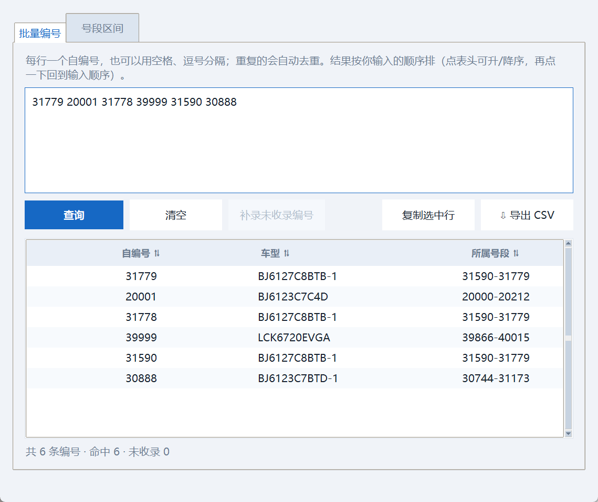
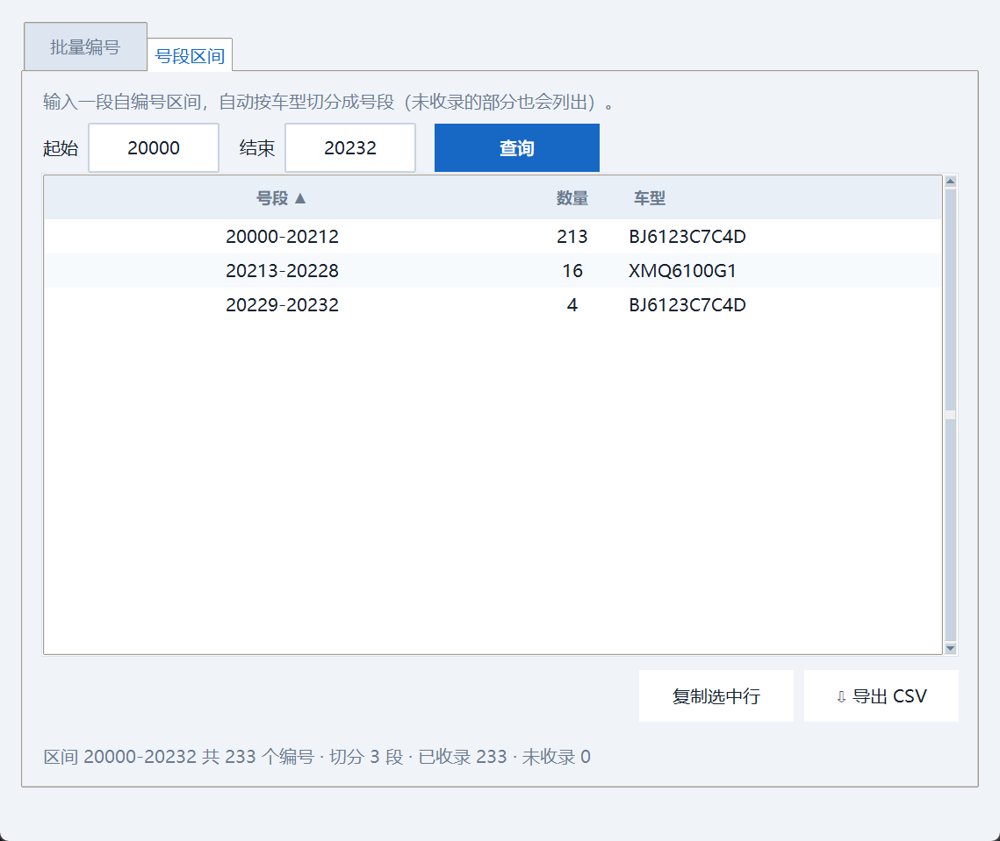
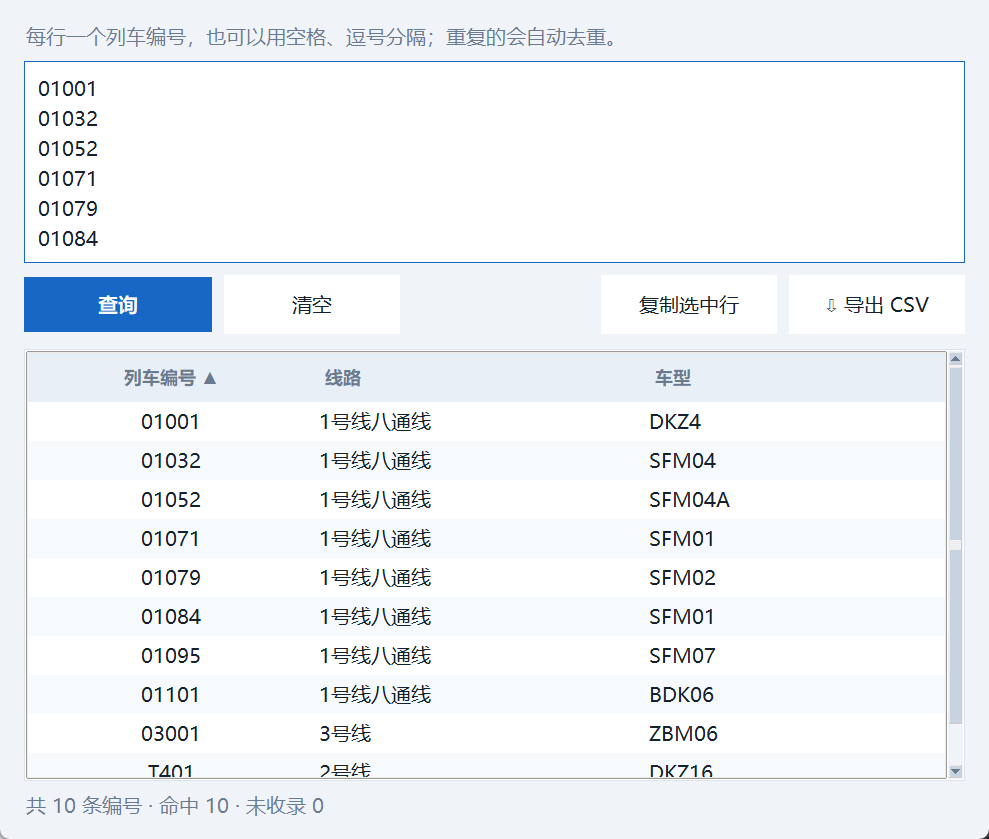
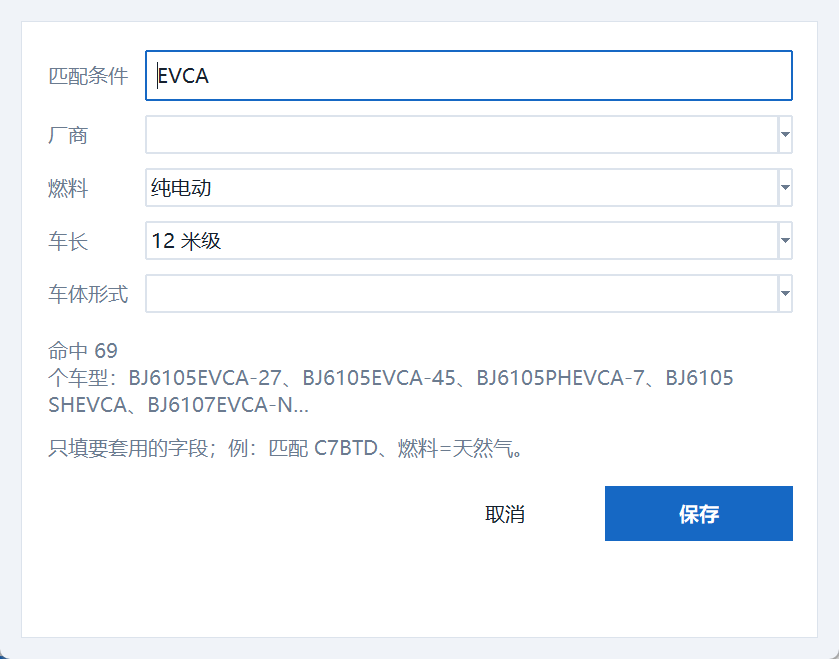
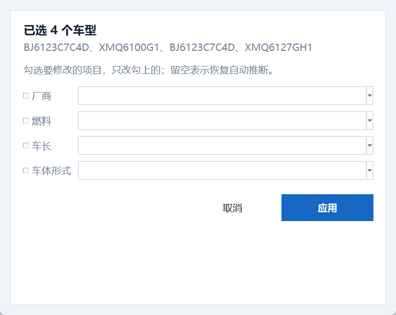
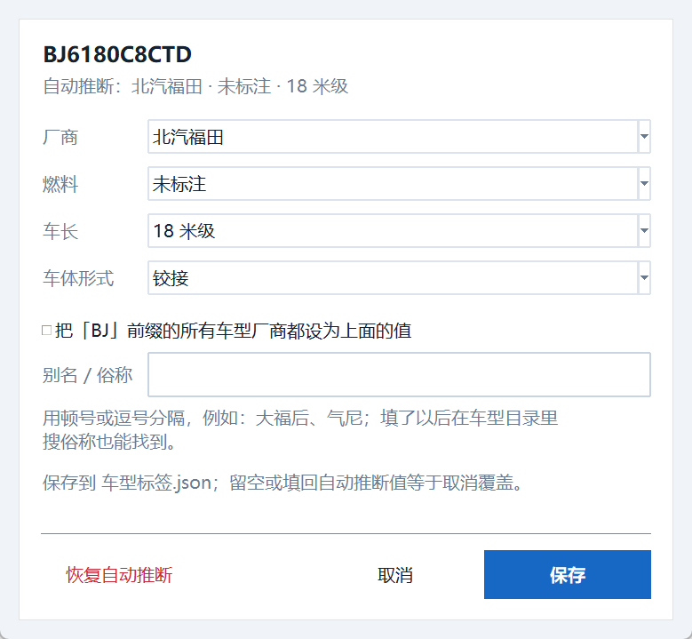

# 北京公交车型查询器

> 输入五位自编号立刻显示车型的 Windows 桌面工具；也包含车型目录、地铁编号、拍车日志，
> 以及可选的联网查询（查一辆车跑过哪些线、现在在哪，数据来自第三方、仅供参考）。


**下载 / 安装**：[Releases](https://github.com/KochiyaSrU/Beijing-bus-model-lookup/releases/latest)
里的 `Beijing-bus-model-lookup-1.0.zip` → 解压后双击 `install.bat`（装到用户目录，桌面/开始菜单有快捷方式），
或者直接双击里面的 `北京公交车型查询器.exe` 免安装运行。详细用法见 [使用说明.md](使用说明.md)。

---


> 📖 **第一次用请先看 [使用说明.md](使用说明.md)**：按「我要做什么」写的完整操作手册，含快捷键速查、常见问题和数据文件说明。本 README 偏技术向（源码结构、自检、打包）。

双击 `北京公交车型查询器.exe`，输入五位自编号即可——**边输边查，凑满五位立刻出结果**，也可以按 Enter 或点「查询」。查询到车型后：

- 「复制车型」把车型复制到系统剪贴板（焦点不在输入框时按 `Ctrl+C` 也可以）；
- 「查看车型详情」打开该车型的资料页面。

窗口标题栏和主界面使用内置的公交主题图标；重新构建 EXE 时 `build.bat` 会自动生成并嵌入该图标。

## 快查工具



「批量查询编号」用于一次查很多辆车：把自编号粘贴进文本框（换行、空格、逗号、顿号、分号都能当分隔符，重复的自动去重），点「查询」得到「自编号 → 车型 → 所属号段」的表格。未收录的行会标红，底部汇总命中/未收录数量，无效内容（例如 `20A00`）会被单独列出来。结果可以整体复制成 TSV（直接粘进 Excel）或导出 CSV（`utf-8-sig`，Excel 双击打开不乱码）。



「号段区间查询」输入一段区间（例如 `20000-20350`），自动按车型切成号段并给出每段数量；区间内**没有收录**的部分也会列成「未收录」行，方便看出数据缺口。

两种查询都可以顺手补数据：批量查询或区间查询之后点「**补录未收录编号**」，未收录的编号会**自动合并成连续区间**，在一个窗口里填好车型（「应用到全部」或「应用到选中」）一次写入 Excel；车型没填或与现有号段重叠的行会被逐条拦下并说明原因。区间查询里**双击某一段「未收录」**则是只补这一段（预填区间，填车型即可）。

## 拍车模式


主窗口右下角「设置」里可以打开三个开关（都存在 `界面设置.json`）：

| 开关 | 作用 |
| --- | --- |
| **复制自编号后自动查询** | 每 0.4 秒看一次剪贴板，出现新的五位自编号就自动查询，并把窗口提到最前——拍车时复制一下就够了 |
| **查询后朗读车型** | 用 Windows 自带语音念出车型代号，不用低头看屏幕（失败时静默跳过） |
| **启用全局热键 Ctrl+Alt+B** | 任何时候按一下就把输入框叫到最前并全选；热键被别的程序占用时会提示，但不影响其它功能 |

查询按钮旁边还有一个 **「连续录入」** 开关：打开后正式查询完 0.7 秒自动清空输入框、焦点回到输入框，**结果仍留在屏幕上**，可以一辆接一辆地录。

另外两件拍车时会用到的：

- **查询历史**：结果下面直接列出最近 5 条自编号，点一下就能再查；第 6 条起收在「更多…」里。只有"正式查询"（回车、按钮、热键、剪贴板、点历史）才记历史，边打字边查不会污染它。
- **拍车日志**：「记一笔」会打开一个小对话框，可以写备注、**选照片或直接 `Ctrl+V` 粘贴照片**（存进 `拍车照片\`）；日志窗口能按关键字 / 车型 / 日期筛选，**双击一条是编辑这条记录**（改备注、换照片），另有「查看车型详情」「看照片」「导出 CSV」，底部还会统计"一共拍到多少条、多少种车型、拍到最多的是哪些"。
- 网页版导出会带上「我的拍车记录」（可搜索、带照片缩略图），分享出去的页面里就有你的拍车清单。

## 分享给别人 / 在手机上看

「数据体检」→「**导出网页版（可分享）**」会把当前全部数据渲染成**一个自包含的 HTML 文件**（数据、样式、脚本都写在里面，不联网、不引用外部资源）。双击就能在浏览器里打开，也可以直接发到手机上离线看：

- 五位自编号查询（边输入边出结果，带厂商 / 燃料 / 车长和所属号段）；
- 车型目录：搜索、燃料与车长筛选、点表头排序；
- 地铁列车编号查询；
- 数据概况（多少号段、多少车型、覆盖多少编号）。

有主图的车型会把缩略图一起内嵌进去，所以一个文件就够了。当前数据导出来大约 100 KB 出头。

## 命令行用法

同一个 EXE 也能带参数运行（适合写进批处理或快捷方式）：

```
北京公交车型查询器.exe                          打开图形界面
北京公交车型查询器.exe 20000                    查一个自编号
北京公交车型查询器.exe --export-html 分享.html  直接导出网页版
北京公交车型查询器.exe --help
```

查询的退出码：`0` 命中、`1` 未收录、`2` 参数或数据有问题。在命令行里运行会把结果打印到当前终端；如果是双击运行（没有终端），结果会弹窗显示并自动复制到剪贴板。

## 线路维度（我记过的线路）

有一个可选的线路维度：记录「哪个车型跑过哪条线」。它刻意**不写成"所属"**——因为记录只能证明记录过，所以每条记录都带时间范围与状态（我记过 / 现在还在跑 / 已退出），界面上也一律念成「**我记过：886 路（2024.9–2026.8）**」。

- **「线路查询」**：按线路看记录过的车型、自编号、时间范围；
- **「线路管理」**：手工增删改，或从外部表格导入（通用：列名认「线路/车型」即可；同一「线路+车型」自动合并，时间与自编号取并集）；
- 查车时结果卡片会多一行「我记过…」，车型资料页多一块「记录过的线路」；
- 数据在 `线路.json`（**默认空，空着程序照常工作**），是你自己的数据，已在 `.gitignore` 里——**设计上不依赖任何个人文件**，别人拿到程序也能自己维护线路，或者干脆不用这个维度。

## 燃料待确认（有依据地补标签）

车型标签里「燃料未标注」的，可以用「数据体检 → 燃料待确认」一次处理：**有依据的自动勾好**，依据分两种——

- **查证来源**：公开的车辆公告 / 产品页（17vin 公告里有「燃料种类」，chinabuses 产品页标题直接写「天然气国五 24-63 座」），每条都带链接，选中一行能看到完整依据；
- **从你的标注学到**：只统计你手工标过的车型，归纳「后缀 → 燃料」，且**支持度 ≥2、同一后缀没出现过两个不同值**才采用（`BTD/TD`→天然气、`MJB/JB`→柴油…）；冲突或只有一台证据的一律不推断。

没有依据的按**后缀分组**（`BJ6127C8BTB` 与 `-1` 同组）一次定一组，提不出后缀的按厂商兜底；写入前自动备份 `车型标签.json`，可撤销。程序**不猜**：只查到"混合动力"这种对不上现有取值的，会标成「查到待你选」交给你决定。

## 我的记录（导入线路 + 对账）


「数据管理 → 我的记录（导入 / 对账）」读一次你在外面记的乘车记录（Excel，支持多张年度工作表一起读），一次给你三样（以前拆成「数据对账」和「线路管理」两个窗口，读同一份文件要点两次，已合并）：

1. **线路数据**：整理成「线路 ↔ 车型 / 自编号 / 时间范围」，一键**导入 / 更新**进 `线路.json`（同一「线路+车型」自动合并，导入后查车会多一行「我记过：…」）；笔误与外地记录也一起留着、只在备注里标注。另有 **「✕ 删除导入的」**（只删导入的，手工数据不动）和 **「✕ 清空全部线路」** 两个一键删除，都会先备份；
2. **对账差异**：**以自编号为准**跟号段表核对，分成六类：编号+型号一致 / 型号写法不一致 / 号段表缺的编号 / 没填编号的型号 / 地铁里没有的型号 / 外地记录（已排除）；
3. **号段表缺的编号**：单独拎出来，一键 **「去批量补录这些编号」**。

用自编号而不是车型名做比对，是因为车型是手写的、写法天然会飘（`ZK6105BEVG55（E10）` 与 `ZK6105BEVG55(E10)`、全角下标 `BJD-WG120N₂`、加了厂内代号 `BJ6906FCEVCH (HC9)`），自编号唯一才靠得住。这个功能第一次跑就抓出我们自己的一个错：号段表里写的 `BJ6127C8BTD-1` 其实不存在，正确写法是 **`BJ6127C8BTB-1`**（886/920/922 路那批车），已修正。地铁/铁路车型（`DKZ`/`SFM`/`25G`/`02A05`…）与外地线路（城市名、`G/D/K/T/Z` 车次）会被自动分拣出去。

**全程只读你的记录文件**：不写你的 Excel；对账结果每一类都能「⇩ 导出这一类 CSV」拿去补数据。

## 区属公交查询


北京区属公交跟公交集团**不是一套编号**：各区、各公司自己编，有的区只有车牌号没有自编。所以规则**挂在公司上**，一家一条，互不干扰。

已收录（用户提供）：**北京万佳通客运有限公司（昌平）** —— 8 位自编，`59` 是公司缩写，第 3-4 位是购车年份，第 5 位是购车批次，后三位是当年购买的第几辆车。共 **15 段 / 493 个编号 / 480 辆车**，其中 2022 年那两批**整批没编尾号 4 的号**（13 个，据说是觉得「4」不吉利）：

| 自编 | 年份 / 批次 | 车型 |
| --- | --- | --- |
| `59181001-59181030` | 2018 / 第 1 批，第 1-30 辆 | BJ6105EVCA-27 |
| `59192041-59192100` | 2019 / 第 2 批，第 41-100 辆 | BJ6105EVCA-27 |
| `59222046-59222133` | 2022 / 第 2 批，第 46-133 辆 | BJ6105EVCA-45 |
| `59251023` | 2025 / 第 1 批，第 23 辆 | BJ6859EVCA-N |

查 `59251023` 会告诉你：**北京万佳通客运有限公司 ｜ 2025 年 · 第 1 批 · 当年第 23 辆 ｜ 号段 59251023-59251023 ｜ BJ6859EVCA-N**；查 `59221004` 会说「**该批未编此号**」——2022 年那两批整批没编尾号 4，**这不是空号，是本来就没这个号**（程序按"整批未编的尾号"这条规则推，不是一个个列出来）；查不在范围里的会说「不在已整理的范围里」。

- 能按**车型筛选**看号段，表格里能看到每段的年份/批次、实车数与「未编」的尾号；
- **其他区（只有车牌、没有自编）→ 改成「自己坐一次记一条」**：窗口第二个页签「**车牌记录**」专门攒这个——「**＋ 记一辆**」填**车牌 + 车型**（线路、公司、日期、备注都能空着）；「**＋ 同一车型批量录**」先填车型、再把一批车牌贴进来（粘贴时实时预演"会新增几个 / 已有几个 / 哪几个已记成别的车型 / 批内重复几个"）；也能**批量粘贴**（每行 `车牌 车型 [线路]`）。攒起来后能**按车型汇总**（几个车牌是同款）、能反查（输车牌 → 车型/线路）。同一车牌同车型再记一次算**更新**（只补空字段），记成**不同车型会提醒冲突**、不悄悄覆盖；
- **「检查重复」**：查「同一车牌多条记录 / 同车牌不同车型 / 缺车型 / 缺车牌」四件事，有重复可**一键合并**（字段取并集、日期取新的、冲突车型写进备注，废记录原样保留）；
- **「批量设置公司/线路」**：表格支持多选（Ctrl / Shift），选中一批记录一次设成同一个公司或线路——**只填要改的项**，留空的不动（想清空某项就填个空格）；
- **只要车型？** 「更多 ▾」里有 **「复制车型」「复制车牌」**；另外**所有表格都能右键**（复制选中行 / 只复制某一列），想只拿车型不用再粘出来删；
- 查询框自编和车牌都能输（`京B·12345`、`京b-12345` 会自动统一化）；**还没有车牌记录时**查了会照实说「还没有车牌数据」，并把可能是哪家的前缀线索一起给出来（车牌前缀各区会重，所以**不用前缀猜公司**，只按你记的车牌查）；
- **换一家公司**只要在 `区属公交数据.json` 的 `companies` 里加一条（编号形态、前缀、位数，以及年份/批次/序号各占哪几位、年份按 20xx 还是 19xx），`ranges` 里加号段（`skip_tail` 写整批没编的尾号，例如 `["4"]`；真有空号再用 `empty_numbers`）；
- 「建立一个空的区属公交数据.json」会给一份带示例规则的模板；**没有这个文件时程序一切照常**。数据文件属于你自己的数据，已在 `.gitignore` 里。

## 联网查询（可选）


`https://bjbus.jinzihao.me` 是一台 **MCP 服务器**（不是网页），提供北京公交的实时与运营历史数据。程序里「数据管理 → **联网查询**」可以直接用它：

- 「**查这辆车**」：某自编号跑过哪些线路 + 每条线路的日期区间（实测一辆自编的历史能追到 2020 年，细到天）；
- 「**查这条线**」：线路的两个方向与首末站。

**设计取向**：联网是**可选增量**，本地功能零依赖 —— 只在你点查询时联网；连不上或被关掉时那一块按钮直接禁用并说明原因，其它功能完全照常；`BPT_NO_NETWORK=1` 可强制离线（离线启动已进自动冒烟测试）。

**性能（实测）**：网络本身极快（TCP 0.1s 级）。服务端快慢会变：早先建会话要 19~26 秒、每次查询 6.4 秒，后来实测变成**握手约 1 秒、单次查询 0.3~3.8 秒**。所以程序做了三件事——**全程序共享一个会话**（不每个窗口重握手）、**结果缓存**（`联网缓存.json`，重复查询直接 0 秒）、**打开窗口后台预热**——服务端以后再变慢也不至于难用；界面上**不写死时间**，只显示上次实际花了多久。

**写入线路数据（V2）**：查到一辆车的线路后可 **「写入线路数据」** → 预览确认 → 合并进 `线路.json`（自动备份）。每条记录带 `evidence` 证据链（哪辆车、哪段日期、哪天查的）；**来源按"谁更算数"取（我记过 > 表格导入 > 网上查的）**，网上查的**永远覆盖不了你自己记的**；线路查询可按来源筛选，「我的记录」有「✕ 删除网上查的」。

**线路资料（V3/V4）**：`线路资料（联网）` 窗口查一条线的**用过的车（按车型归并，886 路实测 319 辆）**、两个方向首末站、**站点表（站距/经纬度）**；①可一键并进线路数据，②③存进 `线路资料.json`（**离线可查**）。服务端的内部线路编号**不落盘**（它会变）；「现在在跑的车」接口偶尔不回包，按降级处理（只影响那一行提示）。体检新增「线路还没查过站点表」。

**实时与站名搜索（V5）**：`这辆车现在在哪（实时）`（跑哪条线、哪一站、距站多少米、拥挤度）；`④ 实时` 页签有某站**到站记录**、某线**时刻表概要**、**「这个站有哪些线」**、**「从这里到这里直达」**。**实时数据只在本次运行缓存 30 秒、绝不落盘**（把位置缓存 7 天是错的）；拓扑类查询按天缓存。设置窗口有「联网」分组（开关/超时/缓存天数/清空缓存/清空日志），保存即生效；`verify_exe.py` 默认跑**正常 + `BPT_NO_NETWORK=1` 离线**两次冒烟。

客户端只用标准库（`urllib` + `threading` + `queue`），在 `bpt_online.py` 里；真实回包（886 的线路号、31688 的车辆历史、805 的在跑车辆）已作为夹具写进测试，所以**测试不碰真网络**。

## 号段管理


「管理号段」可新增、修改或删除自编号号段。451 行靠滚很累，所以顶部有**搜索框**（编号或车型都能搜，例如输入 `BJ6123` 或 `20000`）和**车型下拉筛选**，两个可以叠加使用；被过滤掉的行不会影响编辑，双击任意一行改的仍是对应那条号段。

新增和修改都会检查整个现有清单，只要新范围与任一已存在号段有一个编号重叠就会拒绝保存。保存成功后会立即生效。

> ⚠️ 保存号段会**重写 `BPT_BusDigitalNumber.xlsx`**：只保留第一个工作表，单元格格式和列宽不保留。第 4 列之后的额外列（例如原来 D 列的说明）会**尽量保留**——整行（起止编号 + 车型）没变的沿用原值，号段改了但车型还在的沿用该车型原值，全新的车型留空。每次保存前会自动把原文件备份进 `备份` 文件夹（见下文「备份与恢复」）。

## 地铁编号查询

主界面「地铁编号查询」与公交功能相互独立。输入完整列车编号即可查询车型，结果可一键复制；「**批量查询列车编号**」可以一次粘贴一串编号（换行、空格、逗号都能分隔）；「地铁线路简介」按线路查看车型和全部号段；「管理地铁号段与车型」可新增、修改或删除映射（删除前会二次确认）。



地铁数据保存在 `北京地铁数据.json`，**不会**修改公交 Excel。`北京地铁车型.txt` 只在第一次启动、且 JSON 不存在时作为种子数据导入。

由于种子文件不会自动跟随数据更新，两边可能会对不上（数据体检的「地铁 · 种子文件不一致」会报出来）。地铁窗口里有两条按钮可以随时对齐，两个方向都支持：

- **把当前数据写回 txt 种子**：以程序里的数据为准，重写 txt；
- **重新从 txt 导入（覆盖当前数据）**：以 txt 为准，覆盖当前数据（原数据会先自动备份，按钮是红色的，也会二次确认）。

txt 的格式为「线路名独占一行，随后是该线路的号段」：

```
1号线八通线
01001-01031 DKZ4
01032-01051 SFM04
```

号段与车型之间必须有一个空格，号段之间必须是半角连字符，否则启动时会直接报错并指出行号（不再把格式错误的行当成线路名）。

## 车型目录与资料


「车型目录」列出 Excel 中所有车型，支持：

- **关键字搜索**（`Ctrl+F` 定位到搜索框）：车型代号、厂商、**俗称**、**拼音首字母**都能搜——`bqft` 或 `bqt` 都能找到「北汽福田」，`ft` 也行；命中俗称时车型列会显示 `BJ6123C7BTD（大福后）`；
- **厂商 / 燃料 / 车长 / 车体形式**四个下拉可以任意组合，例如「北汽福田 + 纯电动」，或者「车体形式 = 铰接」一次看全北京还在跑的铰接车；
- **点击表头排序**（车型、厂商、燃料、车长、车体形式、号段数量、是否有资料）；
- **Ctrl / Shift 多选后「批量设置标签」**：一次给一批车型设定厂商 / 燃料 / 车长 / 车体形式，适合刚导进一批新车时统一补标签。

这些标签是从型号代号自动推断的：前缀（`BJ`/`ZK`/`XMQ`…）→ 厂商，型号里的 `EV`/`PHEV`/`SHEV`/`FCEV` 等 → 燃料，类别号 `6` 后面的数字 → 车长级别。**车体形式**按长度和已核实清单推断：16/18 米级 → 铰接（16 台全对得上）、13/14 米级 → 三轴（BJ6140/BJ6147/ZK6140 那批）、已核实的双层型号（JNP6130GSC、安凯 HFF6xxxGS 系列）→ 双层，其余 → 单机。**不看型号字母**，因为 `GS`/`GSC` 在不同厂商含义不同（`DNC6107BEVGS1` 就是低入口单机），猜错比不猜更糟；遇到清单之外的双层车，在目录里多选后「批量设置标签」标一次即可（这个字段也能自己填别的分类，比如「双层铰接」）。推断不出来的会显示「未标注」，判断错了或想补全也可以改 `车型标签.json`，改完重启程序生效：

```json
{
  "manufacturers": { "HK": "黄海客车" },
  "models": {
    "BJ6123C7C4D": { "fuel": "柴油", "length": "12 米级", "body": "单机" }
  },
  "aliases": {
    "BJ6123C7BTD": ["大福后"]
  }
}
```

双击一行打开资料页面：


- 「简介」「技术参数」可直接编辑，底部固定显示保存状态；
- 顶部显示自动推断的「厂商 · 燃料 · 车长级别」，旁边的「编辑标签」可以修正；
- **多图相册**：可以「上传图片」，也可以截图后直接 `Ctrl+V` 粘贴；第一张是封面，能设为封面、上移下移、移除选中、给每张写一句说明。上传的图会自动转成压缩后的 JPEG（最长边 1600×1200）；
- **导出卡片**：生成单页静态 HTML（型号 + 四个标签 + 图片 + 简介 + 参数 + 完整号段表），图片内嵌、无脚本、可直接打印或发给别人；
- 图片和文字都**只在点击「保存」后才写入磁盘**：加图、换封面、移除图片后若直接关窗，不会破坏原有资料，关窗前会提示是否保存；**直接关主窗口也会先问一句**，不会静默丢掉改动；
- 车型详情会列出当前 Excel 中该车型的所有已知号段，内容较长时可滚动查看。

资料保存在同目录的 `车型资料.json`，主图存放在 `车型图片` 文件夹。

## 备份与恢复

数据体检窗口点「**备份与恢复**」：


- 每次保存（号段表 / 车型资料 / 车型标签 / 地铁数据）之前，程序都会把原文件复制一份到 `备份` 文件夹，文件名带时间戳，**每份数据保留最近 10 次**，更早的自动清理；
- 窗口里列出所有备份（包括早期版本留在根目录的 `*.bak`，标着「旧版 .bak」），双击或选中后点「恢复选中」即可回滚；
- **恢复本身也是可撤销的**：覆盖之前会先把当前状态也备份一次；
- 恢复完成后主窗口会自动重新读一遍数据。

> 顺带说一句：如果哪次"点了没反应"，先看根目录的 `错误日志.txt`——里面会记下时间和完整堆栈。

## 数据体检与批量维护

「数据体检」把"还缺什么"整理成一张待办清单：


共 9 类——公交 6 类（**厂商待确认**、**燃料未标注**、**车长未标注**、**还没有资料**、**主图文件丢失**、**号段空档**）加地铁 3 类（**种子文件不一致**、**号段重叠**、**号段空档**）。点上面一类，下面列出具体是哪些车型（或哪些区间），**双击车型**直接跳到它的资料页；底部提示栏会写清这一类该怎么处理。

明细支持 **Ctrl / Shift 多选**，选好之后点「**批量设置标签**」就能一次改完一批；改错了可以点「**撤销上次标签修改**」，它会从 `备份` 里最近一次的「车型标签」备份回滚（回滚前也会先备份当前状态）。

底部还有三个数据工具：

| 按钮 | 用途 |
| --- | --- |
| **增量导入 Excel** | 拿一份外部号段表与当前数据比对，先看清「新增 / 修改 / 删除 / 冲突」四类差异，再选「以导入表为准（含删除）」或「只增不改（保留现有数据）」，窗口底部实时显示保存后的号段数；两种方式都不会留下重叠 |
| **半自动建档** | 给没有资料的车型按模板起草简介与参数（模板可改、可重新生成），只填空字段、不覆盖已有内容，可多选后批量应用 |
| **统计面板** | 厂商 Top 8 / 燃料 / 车长三张分布图 + 按覆盖自编号数排序的车型排行，可导出 CSV |

「号段空档」那一类的每一行都可以**双击**：直接打开新增号段窗口并预填好区间，填上车型就能补录。

按你当前的数据，这份清单大约是：燃料未标注 79、还没有资料 207、号段空档 43、地铁种子不一致 4。

### 标签规则：把"重复的填法"变成规则

如果一批型号的规律很明显（例如 `C7BTD` 结尾的都是天然气、`C7BHD`/`C8MJB` 是柴油），不用一条条填——在数据体检窗口点「**标签规则**」，按型号里的子串或正则写规则：


新增/修改规则时，输入匹配条件会**实时预览会命中哪些车型**，避免误伤：



规则的三条约定：

- **从上往下匹配**，某个字段以**第一条定义了它的规则**为准（所以更特殊的规则要放在前面，可以用「上移 / 下移」调整顺序）；
- 规则**优先于前缀映射**，但**单车覆盖仍然最优先**（也就是：单车覆盖 > 规则 > 前缀映射 > 型号自动推断）；
- 只填要套用的字段即可——例如只写「燃料=天然气」，厂商和车长仍然按原来的方式推断；
- 正则写错了不会崩，只是这条规则被忽略，编辑时会提示「⚠ 正则写法有误」。

### 批量改标签的两种办法

**① 在程序里多选**（适合几十条）：



车型目录里按住 `Ctrl` / `Shift` 选中多个车型 → 「批量设置标签」→ 勾选要改的项目 → 应用。选中的车都是同一前缀时，还能顺手把整个前缀的厂商一次设好。

**② 用 Excel 批量改**（适合上百条）：

1. 数据体检窗口点「**导出带标签 Excel**」——导出的表带「厂商 / 燃料 / 车长」三列，一行一个号段；
2. 在 Excel 里按车型筛选、批量填充这三列（`Ctrl+D` 填充整列很快）；
3. 回到数据体检窗口点「**从 Excel 读回标签**」，选刚才那个文件——程序会按「车型」列把标签写进 `车型标签.json`。

读回时的两条规则：

- 表里**没有的车型**（比如你把别的表导进来）会被忽略，并在提示里告诉你忽略了多少个；
- 填的值如果**和自动推断结果一样**，那就等于不覆盖，不会在 `车型标签.json` 里留垃圾。

另外「导出待办 CSV」会把上面那份待办清单导成 CSV（`类别 / 对象 / 说明`），可以当成自己的维护进度表，边做边划掉。

## 买了新车、导入新型号之后怎么对标签

**标签不需要单独导入**：它是打开车型目录时按型号名现算的，新型号一进数据（改 Excel 的「车型」列，或在「管理号段」里新增一行）就自动有标签。能认出来的直接显示：

| 标签 | 依据 | 认不出的表现 |
| --- | --- | --- |
| 厂商 | 型号前缀（`BJ`→北汽福田、`ZK`→宇通客车…） | 显示前缀本身，如 `HK` |
| 燃料 | 型号里出现 `EV` / `PHEV` / `SHEV` / `FCEV` / `CNG` / `LNG`；`BJD`、`-WG` 视为无轨电车 | `未标注`（这批车多为柴油） |
| 车长 | 客车类别号 `6` 后面的数字（`6123`→12 米级、`6851`→8 米级） | `未标注` |

想快速找出没认出来的车：在车型目录的筛选里把「厂商 / 燃料 / 车长」选成「未标注」（或那个前缀代码）即可。

修正有三个入口，效果一样，都是写进 `车型标签.json`：

1. **车型详情里点「编辑标签」**（推荐）：改完立即生效，不用重启；
2. **车型目录里多选后「批量设置标签」**：适合一次补一批新车；
3. 直接编辑 `车型标签.json`：改完**需要重启程序**才生效。

想先看清楚"到底还缺哪些"，直接打开「数据体检」即可（见上一节）。



编辑器里的三种用法：

| 操作 | 写入文件的内容 | 适用场景 |
| --- | --- | --- |
| 改「厂商」+ 勾选「把 `BJ` 前缀的所有车型厂商都设为…」 | `manufacturers` | 新厂商的一整族车，一次搞定 |
| 只改某辆车的「燃料 / 车长」 | `models` | 个别型号代号不规范 |
| 点「恢复自动推断」 | 删掉该型号的覆盖 | 改错了想退回自动判断 |

留空、或把值填回和「自动推断」完全一样，都等于不覆盖。文件结构长这样，`manufacturers` 只对填了的前缀生效，其余继续用内置表：

```json
{
  "manufacturers": { "HK": "黄海客车" },
  "models": {
    "BJ6123C7C4D": { "fuel": "柴油", "length": "12 米级" }
  }
}
```

保存时同样会自动备份（见「备份与恢复」）。

## 数据文件一览

| 文件 | 作用 | 是否可由程序改写 |
| --- | --- | --- |
| `BPT_BusDigitalNumber.xlsx` | 公交号段 → 车型 | 是（号段管理） |
| `北京地铁数据.json` | 地铁号段 → 车型（实际生效数据） | 是 |
| `北京地铁车型.txt` | 地铁种子数据，仅首次导入 | 是（种子同步的两个按钮） |
| `车型资料.json` | 车型简介、参数、图片列表（第一张为封面） | 是 |
| `车型标签.json` | 厂商名称、单车标签、标签规则（可选） | 是（详情页「编辑标签」、批量设置、标签规则） |
| `车型图片\` | 车型图片（封面 + 相册） | 是 |
| `拍车日志.json` | 拍车记录（时间 / 自编号 / 车型 / 备注） | 是（「记一笔」、日志窗口） |
| `拍车照片\` | 拍车日志里你自己拍的照片 | 是（记一笔 / 编辑记录时选图或粘贴） |
| `历史记录.json` | 最近查询过的自编号（最多 20 条） | 是（每次正式查询自动写） |
| `备份\` | 每次保存前的自动备份，每份数据保留最近 10 次 | 否（在「备份与恢复」里回滚） |
| `界面设置.json` | 窗口位置与大小等界面偏好 | 是（自动写入，删掉即恢复默认） |
| `错误日志.txt` | 界面出错时的堆栈记录（超过 256 KB 轮转一次） | 否（只在出错时写） |

`BPT_BusDigitalNumber.xlsx` 必须与 EXE 放在同一文件夹。程序读取第一个工作表的前三列，表头必须依次为：`号段起始`、`号段结束`、`车型`。

## 运行环境与重新生成 EXE

需要 Python 3.10 或更高版本，并安装依赖：

```powershell
python -m pip install -r requirements.txt
```

重新生成 EXE：双击 `build.bat`（会先自动生成图标，再把源码打包成单文件 EXE 并复制到当前目录）。源码为 `BPT_BusDigitalNumber.py`。

## 源码结构

```
BPT_BusDigitalNumber.py   主入口：界面（主窗口 + 各对话框）+ 命令行入口
bpt_data.py               数据与文件层：常量、异常、备份、日志、xlsx 读写、号段与编号的解析查找
bpt_web.py                单文件网页版导出（只依赖标准库 + Pillow，不认识界面）
test_bpt_bus_digital_number.py   152 个自检用例
verify_exe.py             打包后冒烟测试
build.bat                 打包（加 folder 参数出文件夹版）
generate_icon.py          生成图标
归档/                      历史版本的单文件副本（拆分前的回滚点，已 gitignore）
```

`bpt_data.py` 不依赖 tkinter，可以单独导入使用，例如写个小脚本直接查号段：

```python
from bpt_data import load_ranges, find_model, application_dir, DATA_FILENAME

ranges = load_ranges(application_dir() / DATA_FILENAME)
print(find_model(20000, ranges))   # BJ6123C7C4D
```

主入口会把数据层的名字全部再导出，所以 `from BPT_BusDigitalNumber import load_ranges` 这种旧写法仍然可用。

## 常见问题

### 双击 EXE 弹出蓝色「Windows 已保护你的电脑」/ 提示发布者未知

这是 Windows Defender **SmartScreen 的应用信誉拦截**，不是病毒查杀（所以「保护历史记录」里通常没有威胁名）。它拦的是「未签名 + 刚编译出来、没有下载信誉」的程序，与程序本身有没有问题无关。以管理员身份启动会绕过这项检查，所以容易造成「只有管理员才能打开」的错觉。

处理方式按推荐度：

1. 点「更多信息」→「仍要运行」（通常同一个文件只需选一次；重新构建后文件变了会再问）；
2. 设置 → 隐私和安全性 → Windows 安全中心 → 应用和浏览器控制 → 基于声誉的保护 → 关闭「检查应用和文件」（代价：以后所有未识别程序都不再被拦；Defender 的病毒防护不受影响）；
3. 提交文件给微软做误报/信誉申诉：<https://www.microsoft.com/en-us/wdsi/filesubmission>；
4. 根本解法是购买代码签名证书。

### `build.bat` 输出乱码

`build.bat` 现在保存为 **UTF-8 + CRLF**。如果你的命令行不是 UTF-8 代码页（中文 Windows 默认 936），中文提示可能显示成乱码，**不影响打包结果**。

反过来的坑更要小心：**不要**用会把换行改成 LF 的编辑器保存 `.bat`。cmd 的批处理解析器在「LF 换行 + 中文多字节字符」的组合下会解析错位，把中文行片段当成命令去执行（表现为满屏「不是内部或外部命令」）。

## 自检

命令行有两档（不需要打开界面）：

```powershell
北京公交车型查询器.exe --self-test      # 号段表/重叠/标签/数据文件/写入权限/磁盘/版本，退出码 0 = 能正常用
北京公交车型查询器.exe --net-check      # 只看联网：域名解析 → 连接 → 接口握手
北京公交车型查询器.exe --self-test --deep   # 上面两样一起做
```

> 说明：`--self-test` 里"标签还没标完"只算**提示**（退出码仍是 0），不影响查车型。
> 如果程序拿不到终端（比如用快捷方式带参数启动），结果会写进程序目录的 `命令行输出-*.txt`。


### 给开发者

```powershell
python -m unittest -v test_bpt_bus_digital_number.py   # 295 项测试
python verify_exe.py                                   # 打包后冒烟（正常 + BPT_NO_NETWORK=1 离线，两次都要过）
python verify_exe.py --shot ok.png                     # 顺便截一张主窗口
```

测试分三层：纯逻辑（合成数据，改 Excel 也不会失败）、真实数据体检（只做范围检查，不写死条数）、
界面行为（在主窗口与各对话框上实测，窗口保持隐藏）。

```

### 打包成文件夹版（启动更快）

```powershell
build.bat            # 单文件：只产出 北京公交车型查询器.exe
build.bat folder     # 文件夹版：产出 dist\北京公交车型查询器\ 整个目录
```

单文件版胜在只有一个文件、方便拷贝（约 17.7 MB）；文件夹版省掉了每次启动解包到临时目录的过程，**实测启动更快**（1 秒粒度粗测：文件夹版约 1 秒，单文件版约 2 秒），适合放在固定位置长期使用。两种方式都只需要把数据文件放在 EXE 旁边。
