# 北京公交车型查询器 · 使用说明

一句话：**输入公交车自编号（或地铁列车编号），告诉你这是什么车型。**

不用安装，双击 exe 就能用；数据都在旁边的文件里，整个文件夹拷到 U 盘或另一台电脑上照样能用。

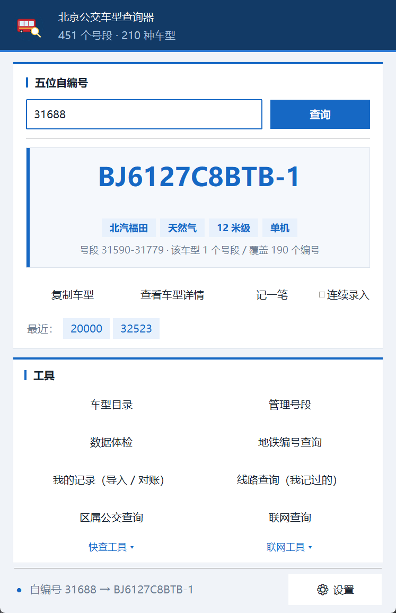

---

## 一、最常用的三件事

### 1. 查一辆车

在主窗口的输入框里敲五位自编号，**敲满五位就自动出结果**（不用点查询）：

- 结果显示车型代号（结果卡片会轻轻闪一下表示查到了），下面四个小标签是「厂商 · 燃料 · 车长 · 车体形式」；
- 再下面一行是「号段 20000-20212 · 该车型 3 个号段 / 覆盖 413 个编号」（刻意不写「属于」——号段只能说明号段表里是这段）；
- 如果这辆车在你线路数据里有记录，同一个提示行还会多一句「**我记过：886（2024.9–2026.8） · 现在还在跑**」（最多显示 3 条）；
- 想留个记录就点 **「记一笔」**，会打开一个小窗口：写备注、**选一张自己拍的照片或直接 `Ctrl+V` 粘贴**，照片存在 `拍车照片\` 里；
- 点 **「复制车型」** 把代号复制走（按钮会短暂变成「已复制 ✓」），点 **「查看车型详情」** 打开资料页。
- **它现在在哪里 / 最近跑哪条线**：输入完整的五位自编后，程序会在后台查一次第三方实时数据，结果显示在**车型正下方**
  （例如「现在 886 开往 北京蟒山森林公园 · 昌平西关环岛东 · 距站 11132 米 · 21:26:54　｜　最近跑 886」）。
  查不到就写一句「联网没查到（连接被拒绝）」。不想让它自动联网，去 **设置 → 联网** 关掉开关。

> 主界面只有一张**「工具」**卡：常用的两列排开（车型目录 / 管理号段 / 数据体检 / 地铁编号查询 /
> 我的记录 / 线路查询 / 区属公交 / 联网查询），少用的收在底部两个菜单里 —— **「快查工具 ▾」**（批量查询编号、
> 号段区间查询、拍车日志）和 **「联网工具 ▾」**（线路资料、联网查询）。

左下角有一个**状态点**：蓝色是操作提示（8 秒后自动回到「就绪」），绿色是就绪，橙色是警告，红色是出错——出问题时先看它旁边那句话。

输入框下面有一排 **「最近：」** 的编号（浅蓝色小块），点一下就能重查；超过五条时点最后的 **「更多…」** 看完整 20 条。

> 输入未收录的编号会明确显示 **「未收录」**；输错了会显示 **「格式不符」**。

### 2. 一次查一批 / 查一个区间

主窗口「工具」→ **快查工具 ▾** → **批量查询编号**（每行一个，空格逗号顿号都能分隔，重复自动去掉）或 **号段区间查询**（输入 20000 到 20350，自动按车型切成几段）。结果可以 **复制结果**（粘进 Excel 就是一张表）或 **导出 CSV**。

未收录的部分会标红，并且可以**就地补数据**：

- 点 **「补录未收录编号」**：这些编号会自动合并成连续区间，在一个窗口里填一次车型（「应用到全部」或选中几行后「应用到选中」），一次写入 Excel；
- 或者在区间结果里**双击某一段「未收录」**：只补这一段，区间已经帮你填好了。

### 3. 补数据 / 维护数据

主窗口「工具」→ **数据体检**，它会把「哪些数据还没弄好」列成 9 类待办，每一类都能点开看具体是哪些车型或哪段编号：

| 类别 | 意思是 | 怎么处理 |
| --- | --- | --- |
| 厂商待确认 | 厂商名还是前缀代码（如 BJ） | 详情页「编辑标签」，勾「同一前缀」可以一次改完整个厂商 |
| 燃料未标注 | 型号里没有新能源关键字 | 目录里多选后「批量设置标签」，或在标签规则里写一条 |
| 车长未标注 | 型号代号不符合常见规则 | 同上，手动填一次 |
| 还没有资料 | 简介、参数、图片都没有 | 「半自动建档」按模板起草，或逐条编辑 |
| 主图文件丢失 | 资料里记着图片名，但图片文件夹里没有 | 打开资料页重新上传或移除 |
| 号段空档 | 相邻号段之间有没收录的编号 | **双击那一行**，填车型补录 |
| 地铁三类 | 种子文件不一致 / 号段重叠 / 号段空档 | 用「地铁编号查询」里的同步按钮处理 |

底部那一排按钮就是维护工具，从左到右：批量设置标签、撤销上次标签修改、标签规则、备份与恢复、增量导入 Excel、半自动建档、统计面板、导出待办 CSV、导出网页版、导出带标签 Excel、从 Excel 读回标签。

---

## 二、拍车模式（在外面看车时用）

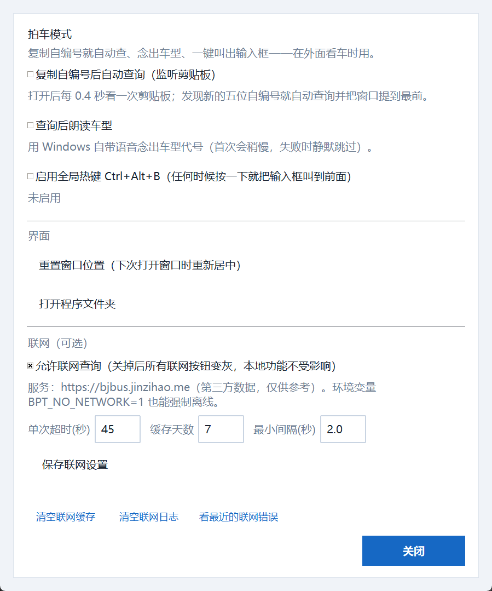

主窗口右下角 **「设置」** 里有三个开关：

| 开关 | 打开以后 |
| --- | --- |
| **复制自编号后自动查询** | 你复制一个自编号（比如从微信群、表格里），程序立刻自动查询并把窗口弹到最前 |
| **查询后朗读车型** | 用 Windows 自带语音把车型念出来，不用一直看屏幕 |
| **启用全局热键 Ctrl+Alt+B** | 任何时候按一下，主窗口跳到最前、输入框全选，接着敲号就行 |

三个开关默认都是关的，按需要打开。热键如果被别的软件占用了，程序会提示一声，其它功能不受影响。

**拍车日志**（主窗口「工具」→ **快查工具 ▾** → 拍车日志）：

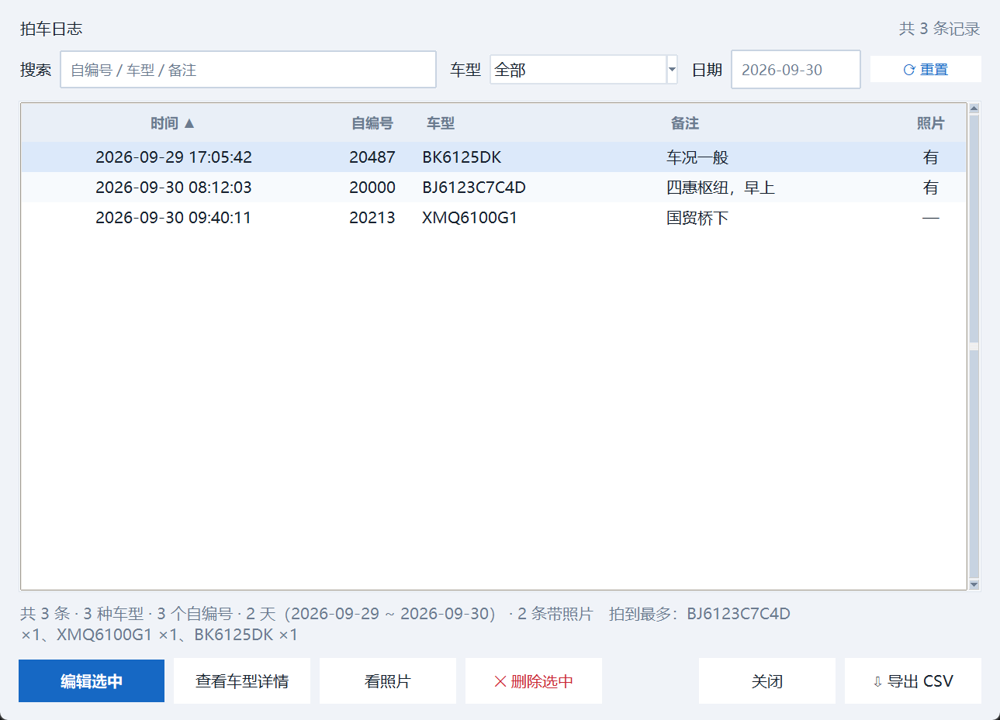

- 「记一笔」的记录都在这儿，可以按关键字、车型、日期筛选；
- **双击一条 = 编辑这条记录**（改备注、换照片）；想跳过车型资料页就点「查看车型详情」，「看照片」会用系统看图程序打开你拍的那张；
- 「照片」列显示这条记录有没有配照片；底部一行是统计：一共拍到多少条、多少种车型、拍了几天、拍到最多的是哪些车型；
- 可以「删除选中」「导出 CSV」。

**连续录入**：主窗口查询按钮旁边有个「连续录入」开关，打开后每查完一辆，输入框会在 0.7 秒后自动清空、焦点回到输入框，**结果仍然留在屏幕上**——在马路边一辆接一辆地录时最省事。

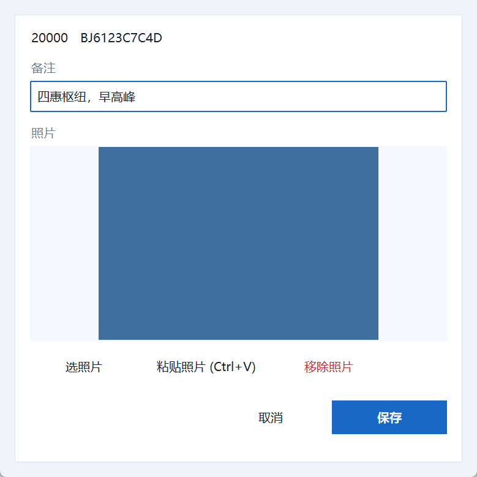

---

## 三、车型目录与资料
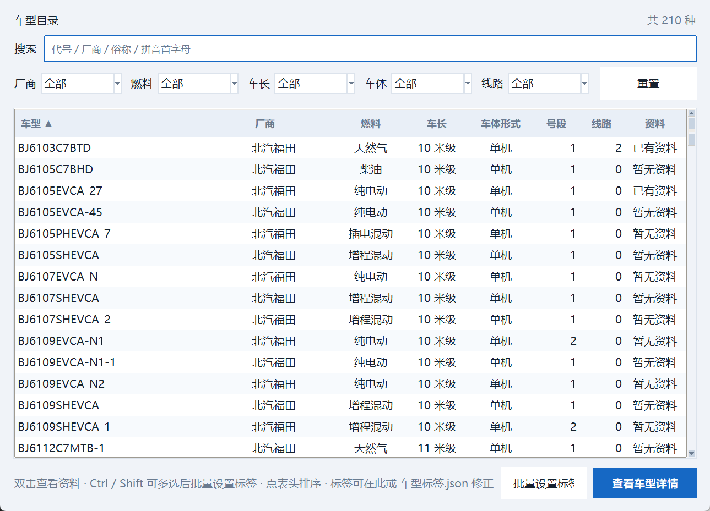

- **搜索框**支持车型代号、厂商、**俗称**、**拼音首字母**（`bqft`、`bqt`、`ft` 都能找到「北汽福田」，`xmjl` 找到「厦门金龙」；填了别名「大福后」之后搜它也能命中，命中时车型列会显示 `BJ6123C7BTD（大福后）`）；
- **厂商 / 燃料 / 车长 / 车体形式**四个下拉可以任意组合，比如「北汽福田 + 纯电动」，或者「车体形式 = 铰接」一次看全铰接车；
- **「线路」列 + 「线路」下拉**：「线路」列是这个车型在**你自己的线路数据**里跑过多少条线；下拉里直接列出你线路数据里的线路名，选中就只剩跑过这条线的车型 —— 也就是「**某条线用过哪些车型**」（线路数据变了会自动刷新）；
- **点表头排序**（车型、厂商、燃料、车长、车体形式、号段数量、线路数量、是否有资料）：点过之后表头会出现 **▲ / ▼**，一眼就知道现在按哪一列排、是升还是降；
- **Ctrl / Shift 多选**后点「批量设置标签」，可以一次给一批车型定好厂商 / 燃料 / 车长。

双击一行打开资料页：

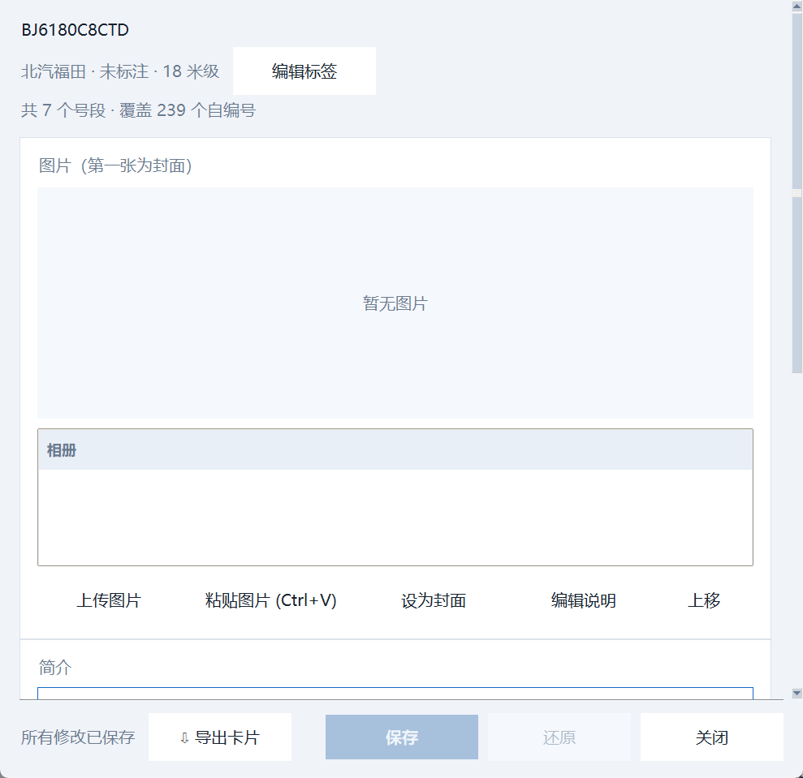

- 「简介」「技术参数」直接改；
- **图片可以放多张**：点「上传图片」选文件，或者截图之后直接按 **Ctrl+V** 粘贴；第一张是封面，可以「设为封面」「上移 / 下移」「移除选中」「**编辑说明**」（给每张图写一句"前脸 / 内饰 / 铭牌"）；
- **导出卡片**：生成一张单页 HTML（型号 + 四个标签 + 图片 + 简介 + 参数 + 完整号段表），图片内嵌、不含脚本、不联网，可以直接打印或者发给别人；
- **没点「保存」就不会写进文件**：改了没保存就关窗口，会问你一句；就算直接关主窗口，也会先提醒你有几个窗口没保存。

---

## 四、标签是怎么来的，怎么改

程序会自动从型号代号推断标签：前缀（`BJ` `ZK` `XMQ`…）→ 厂商，型号里的 `EV` `PHEV` `SHEV` `FCEV` `CNG` 等 → 燃料，类别号后面的数字 → 车长级别。**车体形式**（单机 / 铰接 / 双层 / 三轴）按长度和已核实清单推断：16 / 18 米级 → 铰接，13 / 14 米级 → 三轴，已核实的双层型号 → 双层，其余 → 单机。推断不出来的显示「未标注」。

> ⚠️ **两点留意**
> 1. **双层车**：型号里带 `GS` / `GSC` 并不等于双层——`DNC6107BEVGS1` 就是纯电动低入口单机（`BEVGS1` 是版本代号）。所以程序只把已核实的型号（JNP6130GSC、安凯 HFF6xxxGS 系列）判为双层，其余一律按长度规则走；你遇到清单之外的双层车，按下面第 2 条在目录里多选后标一次就行（标过之后数据体检不会再提示）。
> 2. **车体形式是自由文本**：除了上面四类，你还可以填别的分类（比如「双层铰接」），在「编辑标签」里直接输就行。

要改的话，优先级是：**单个车型的设置 > 标签规则 > 厂商前缀 > 自动推断**。

1. **改一个车型**：资料页 →「编辑标签」。留空或填回自动推断的值，就等于取消覆盖；勾上「同一前缀」能一次改完这个厂商的所有车型；这里还可以填 **别名 / 俗称**（用顿号分隔）。
2. **一次改一批**：车型目录里多选 →「批量设置标签」。
3. **按规律批量改**：「数据体检」→「标签规则」，写一条匹配条件（型号里的一段文字，或者正则），点「预览」看命中哪些车型，再保存：


改完立刻生效，不用重启。所有标签都存在 `车型标签.json` 里，也是纯文本，出问题可以自己打开看。

---

## 五、号段管理 · 地铁 · 数据工具

### 线路查询 / 线路管理（我记过的线路）

程序里可以记「哪个车型跑过哪条线」——**注意它记的是"我记过"，不是"这条线现在归它"**，所以每条记录都带时间范围和状态（我记过 / 现在还在跑 / 已退出）。

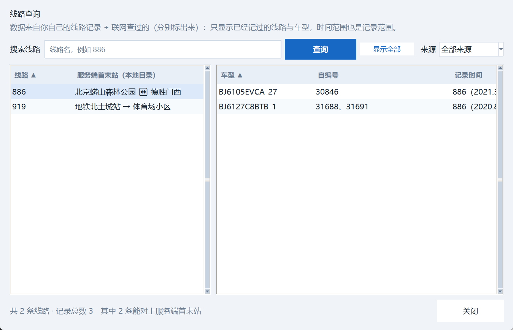

- **「线路查询」**：左边选线路，右边看这条线记录过的车型、自编号、时间范围和状态；双击车型直接打开资料。
  左表还有一列 **「服务端首末站（本地目录）」**——你记的线路号在服务端对应哪两站，**离线 0 秒**显示（上下行写 `A ↔ B`）；
  前提是在「线路资料（联网）」里点过一次「更新线路目录」；没有目录时这里会提示你去点一下，而不是留空。
  这个窗口还会**跟着数据自动刷新**：在别处（导入 / 联网写入 / 删除）改了线路数据，它立刻跟着变。
- **「线路管理」**：手工新增/修改/删除，也可以「**从外部表格导入**」——任何人的表只要列名认「线路」「车型」（可选「车辆编号」）就能导；同一「线路 + 车型」会自动合并（时间取并集、自编号取并集），保存前会告诉你新增几条、合并几条。
- 查车时如果这辆车有线路记录，结果卡片下面会多一行「**我记过：886 路（2024.9–2026.8） · 现在还在跑**」；车型资料页也会多一块「记录过的线路」。

> 这份数据存在 `线路.json` 里，**默认是空的**——空着程序也照常工作，只是不显示上面那些。它是**你自己的数据**，发布给别人时不会带出去（已在 `.gitignore` 里）。

### 燃料待确认（一次定一批）

「数据体检」里如果看到「燃料未标注」，点「**燃料待确认**」：

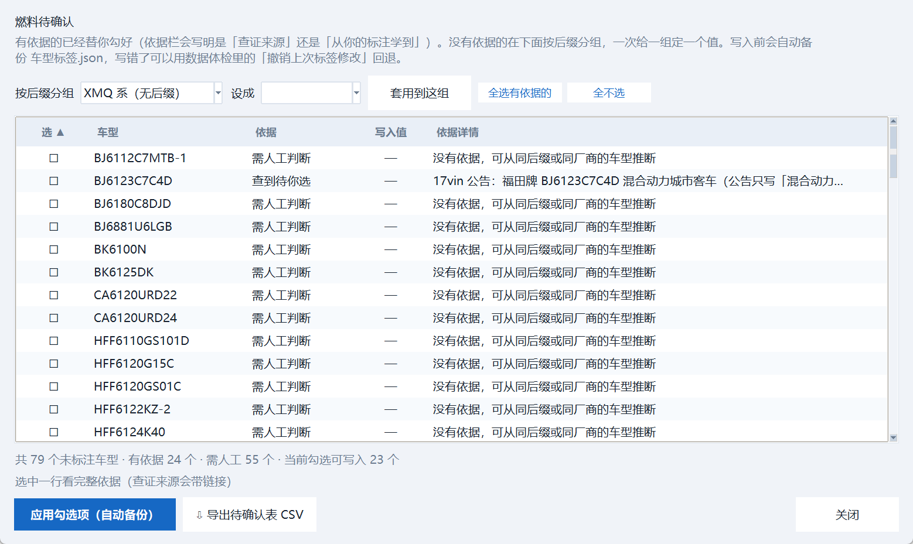

1. **有依据的已经替你勾好**——「依据」栏写明是「查证来源」（公开的车辆公告/产品页，选中一行在下面能看到完整依据和链接）还是「从你的标注学到」（从你自己标过的同后缀车型归纳出来的规律）；
2. **没有依据的按后缀分组**（例如 `BJ6127C8BTB` 与 `BJ6127C8BTB-1` 是同一组），选一组、填一个值、点「套用到这组」——79 条能压成 40 组，提不出后缀的按厂商兜底（`HFF 系（无后缀）`）；
3. 确认列表没问题后点「**应用勾选项（自动备份）**」，写入前自动备份 `车型标签.json`；
4. 写错了回数据体检点「撤销上次标签修改」；
5. 只查到「混合动力」这类**对不上现有取值**的，程序不替你决定，显示成「查到待你选」。

### 我的记录（导入线路 + 对账，一个窗口三件事）

如果你在别处记了自己的乘车/拍车记录（Excel），点「工具」→ **我的记录（导入 / 对账）**。以前这里是「数据对账」和「线路管理」两个窗口，读的是同一份文件却要给两次，所以合并成一个：

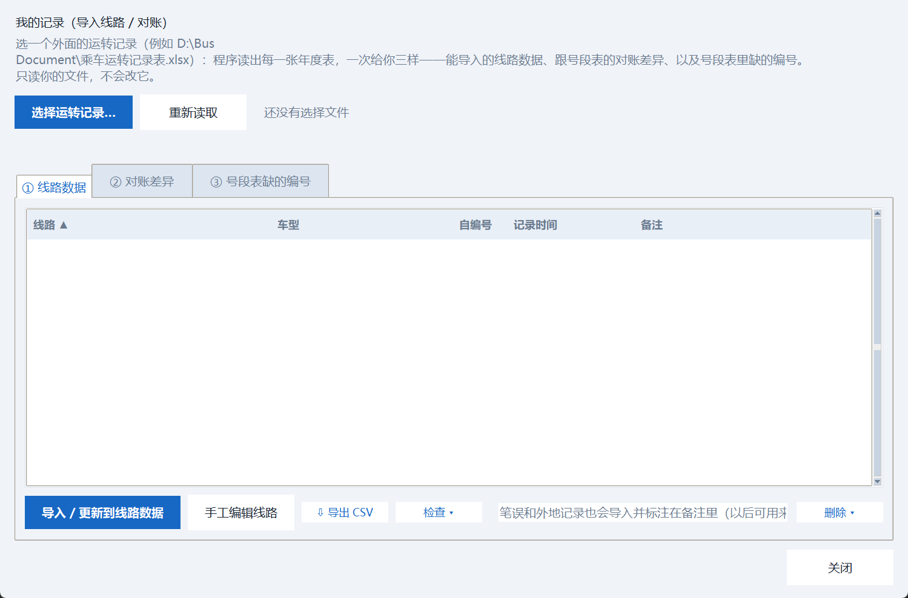

选一次文件（例如 `D:\Bus Document\乘车运转记录表.xlsx`），程序**读出里面每一张年度工作表**（自动找表头、识别年份，解析 日期/线路/车辆编号/车型/上车站/下车站/备注），然后一次给你三个页签：

**① 线路数据** —— 整理成「线路 ↔ 车型 / 自编号 / 时间范围 / 备注」

- 点 **「导入 / 更新到线路数据」** 写进 `线路.json`（同一「线路 + 车型」自动合并：时间与自编号都取并集），**写入前自动备份**；导入后查任一自编号，结果里会多一行「**我记过：886 路（2024.9–2026.8）**」；
- **笔误和外地记录也一起导入**，只是在备注里标出「车型不在号段表里（可能是外地/区属公交/笔误）」——留着以后做外地号、本地区属公交查询用；
- **一键删除**：**「✕ 删除导入的」**只删导入来的（手工加的不动）、**「✕ 删除网上查的」**只删联网写入的、**「✕ 清空全部线路」**清空整份数据。三个都会先备份，删错了能用「备份与恢复」找回来；
- **「⟳ 哪些网上查的该刷新了」**：联网写入的记录超过 30 天没更新就列出来（服务端数据在变，放着会变旧）；
- **「🔍 校验线路号」**：拿本地 `线路目录.json` 核对你记过的线路号，把**服务端目录里没有**的挑出来，并提示「你是不是想记：886」（要先在「线路资料（联网）」点过一次「更新线路目录」）；
- 想手工添几条就点「手工编辑线路」。

**② 对账差异** —— 拿记录里的自编号去号段表里核对（自编号是唯一的，才靠得住），分六类：

| 类别 | 意思 |
| --- | --- |
| 编号+型号一致 | 两边对得上，不用管 |
| **型号写法不一致** | 同一个自编号，号段表和记录里写的车型不同——多数是写法差异（少个字母、全角括号、加了厂内代号），也可能是记录笔误 |
| **号段表缺的编号** | 这些自编号在程序里查不到，是真正缺的号段，可以用记录里的车型去补录 |
| 没填编号的型号 | 这些记录没写自编号，只能用型号比，也拿不准 |
| 地铁数据里没有的型号 | 记录里有、但程序的地铁数据里没有 |
| 外地记录（已排除） | 线路名看着是外地的（城市名、`G/D/K/T/Z` 车次），不掺进公交对账 |

每一类都能点 **「⇩ 导出这一类的 CSV」** 拿去慢慢改。

**③ 号段表缺的编号** —— 上面那一类单独拎出来，点 **「去批量补录这些编号」** 直接进补录窗口（已经按号段合并好），补完查车就能出车型。

**它只读你的记录文件，不会改它。**

### 区属公交查询

北京区属公交跟公交集团**不是一套编号**：每个区、每家公司自己编，有的区甚至只有车牌号没有自编。所以规则是**一家一条**挂在公司上。

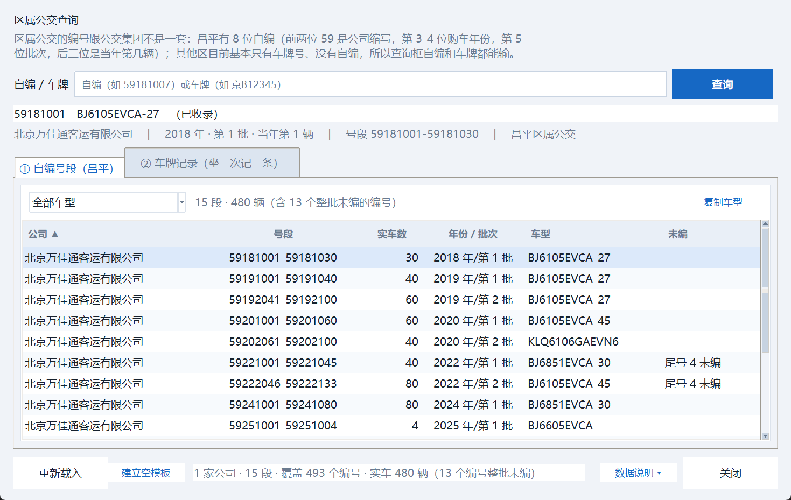

点「工具」→ **区属公交查询**，输入自编（8 位）按「查询」或回车：

- `59251023` → **北京万佳通客运有限公司 ｜ 2025 年 · 第 1 批 · 当年第 23 辆 ｜ 号段 59251023-59251023 ｜ BJ6859EVCA-N**
- `59221004` → **该批未编此号**（2022 年那两批整批没编尾号 4，这不是空号，是本来就没这个号）
- `59251051` → 不在已整理的范围里

下面那张表列出**每个号段的公司 / 号段 / 实车数 / 年份批次 / 车型 / 未编**，可按车型筛选；查一个编号时会自动跳到它所在的那一段。改完数据点「重新载入数据」就生效。

**已收录**：北京万佳通客运有限公司（昌平）—— 8 位自编：前两位 `59` 是公司缩写，第 3-4 位购车年份，第 5 位购车批次，后三位是当年购买的第几辆车。共 15 段 / 493 个编号 / **480 辆车**（2022 年那两批没编尾号 4，共 13 个编号）。

#### 数据文件 `区属公交数据.json`

现在长这样（`companies` 写编号规则，`ranges` 写号段与车型，`empty_numbers` 写空号）：

```json
{
  "companies": [
    {
      "name": "北京万佳通客运有限公司",
      "district": "昌平",
      "number_kind": "自编",                 // 自编 / 车牌 / 自编+车牌 / 无编号
      "number_rule": "8 位：前两位 59 是公司缩写，第 3-4 位是购车年份，第 5 位是购车批次，后三位是当年购买的第几辆车",
      "number_prefix": "59",                // 认哪家看前缀（可空）
      "number_length": 8,                   // 位数（0 = 不限）
      "plate_prefix": "",                   // 只有车牌的公司填，例如 京B
      "year_span": [2, 4],                  // 年份在编号里的位置（左闭右开）
      "batch_span": [4, 5],                 // 批次
      "serial_span": [5, 8],                // 序号
      "year_base": 2000,                    // 年份两位按 20xx 解释
      "note": ""
    }
  ],
  "ranges": [
    { "company": "北京万佳通客运有限公司", "start": "59221001", "end": "59221045",
      "model": "BJ6851EVCA-30",
      "skip_tail": ["4"],                              // 这一批整批没编的尾号（可空）
      "skip_reason": "2022 年这批没编尾号 4 的号（据说是觉得「4」不吉利）" }
  ],
  "empty_numbers": [],
  "entries": []
}
```

**换一家公司**：在 `companies` 里再加一条 —— 把 `year_span` / `batch_span` / `serial_span` 按他们的位数改（年份若是 19xx，把 `year_base` 改成 1900），再到 `ranges` 里加号段。

**其他区（基本只有车牌、没有自编）**：把公司写成 `number_kind: "车牌"` + `plate_prefixes: ["京B", "京G"]`（一家可以有多个前缀），车记在 `entries` 里：

```json
"entries": [
  { "company": "某某区公交", "plate": "京B12345", "line": "专1路", "model": "", "year": "", "note": "" }
]
```

查询框里**直接输车牌**就行（`京B12345`、`京B·12345`、`京b-12345` 都认）。现在还没有车牌数据，输了会照实说「还没有车牌数据」，并把**可能是哪家的前缀线索**一起告诉你；等录了车就能查到公司/线路/车型。车牌前缀各区会重（一个「京B」下面可能好几家），所以程序**不用前缀猜公司**，只按你录的车牌查。

> - **整批没编的尾号**写在该段的 `skip_tail` 里（例如忌「4」就写 `["4"]`），查到了会说「该批未编此号」——**这不是空号**，是本来就没这个号；表格里也会显示这一段实际有多少辆车；
> - 真的要记"有个编号空着没配车"，再用 `empty_numbers`（显示「空号（未配车）」）；
> - 自编与车牌**至少填一个**；
> - 这个文件属于你自己的数据，已在 `.gitignore` 里——发布给别人时不会带出去。

### 号段管理

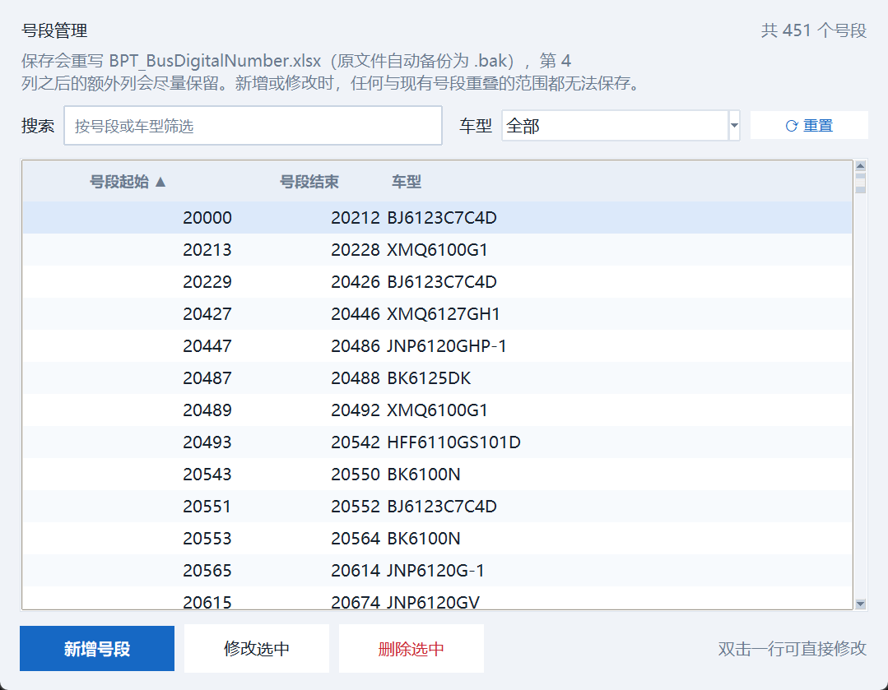

列出 Excel 里所有号段，可以搜索、按车型筛选、双击修改、新增、删除。**保存会重写 `BPT_BusDigitalNumber.xlsx`**（原文件自动备份为 `.bak`），Excel 里第 4 列之后的额外列会尽量保留。

### 地铁编号查询

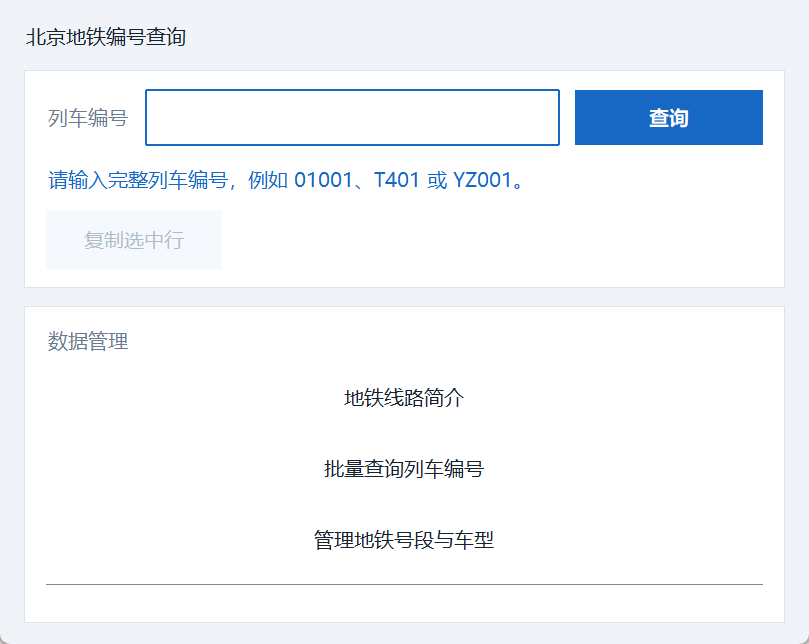

输入完整列车编号（例如 `01001`、`T401`、`YZ001`）查询所属线路与车型；右侧还能打开**地铁线路简介**、**批量查询列车编号**、**管理地铁号段与车型**。

底部两个按钮用于同步：**把当前数据写回 txt 种子**（把程序里的数据存回 `北京地铁车型.txt`）、**重新从 txt 导入（覆盖当前数据）**。

### 增量导入 Excel

拿一份外部号段表，先看清差异再决定怎么合：

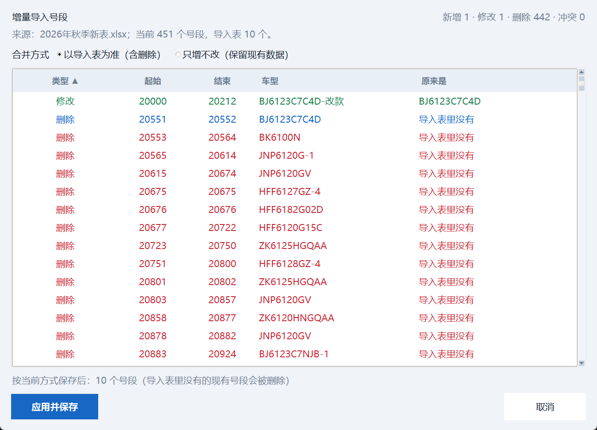

绿色=新增、蓝色=修改（同一区间换了车型）、红色=冲突（区间不同但有重叠）、红色=删除（导入表里没有的现有号段）。两种方式：

- **以导入表为准（含删除）**：新表就是最终结果；
- **只增不改（保留现有数据）**：只补新号段，不动、不删现有数据。

窗口底部会实时告诉你保存后会有多少个号段。**保存前自动备份**，两种方式都不会产生重叠。

### 半自动建档 / 统计面板

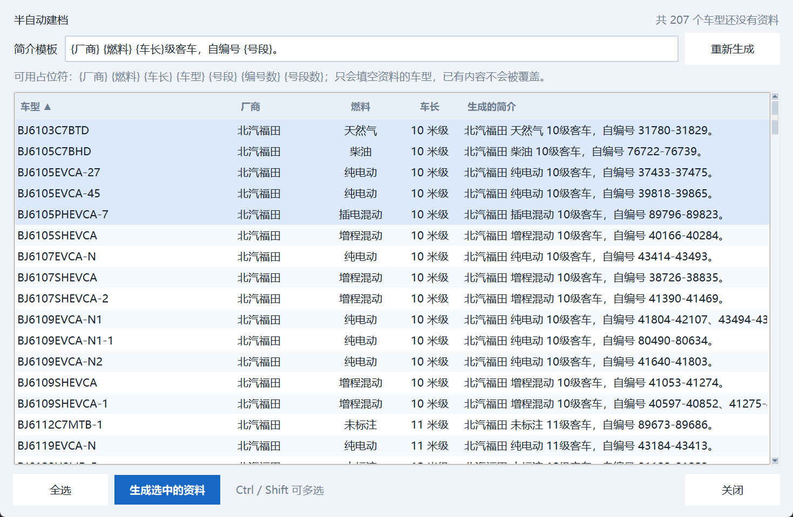

给没有资料的车型按模板起草简介和参数（模板能改，占位符有 `{厂商} {燃料} {车长} {车型} {号段} {编号数} {号段数}`），**只填空的地方，不会覆盖你写过的内容**。

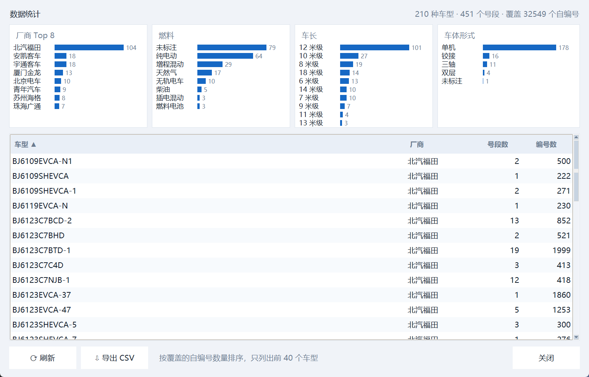

统计面板看整体分布：厂商 Top 8、燃料、车长三张图，加上按覆盖编号数排序的车型排行，可导出 CSV。

### 备份与恢复

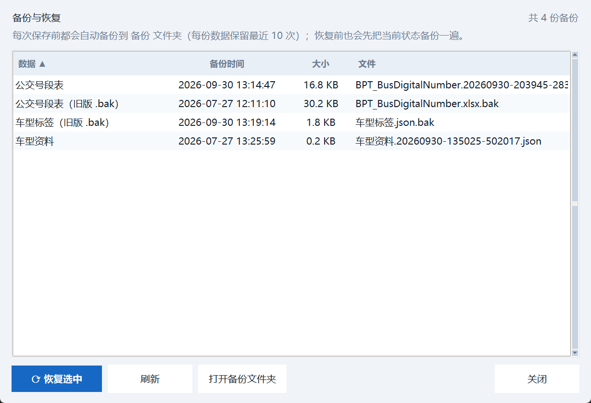

每次保存数据前，程序都会把旧版本备份到 `备份\` 文件夹，**每份数据保留最近 10 个版本**。这里可以「恢复选中」（恢复前还会先把当前状态也备份一份，不怕点错）、「打开备份文件夹」。

改标签改错了，还有一个更快的入口：数据体检里的 **「撤销上次标签修改」**。

---

## 六、分享给别人 / 在手机上看

数据体检 →「**导出网页版（可分享）**」会生成**一个 HTML 文件**（当前数据大约一百多 KB）：数据、样式、脚本全在里面，不联网也能用。

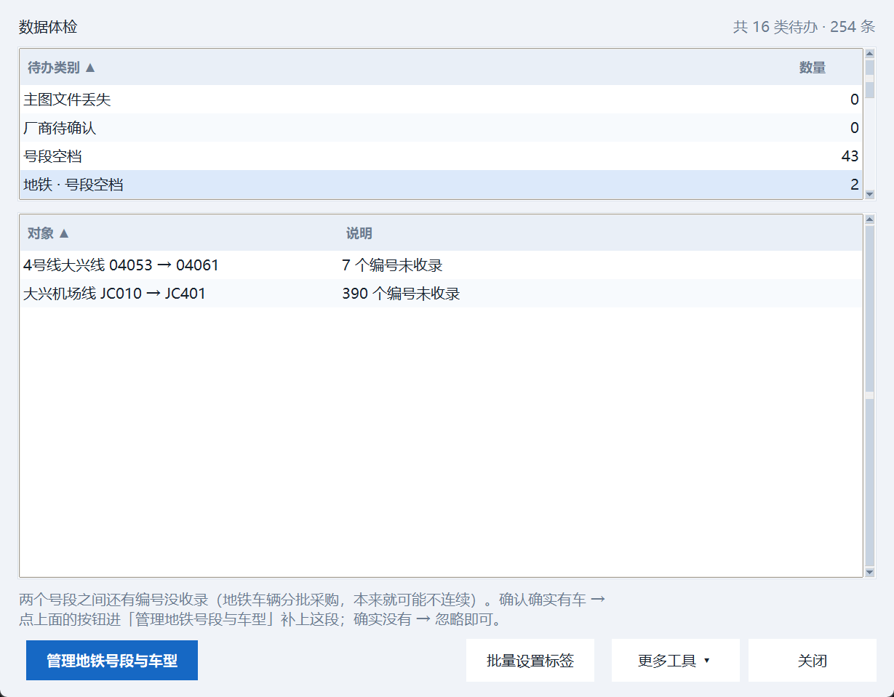

用手机浏览器打开就能查自编号、翻车型目录、查地铁编号——发给别人看也不用装任何东西。

---

## 七、命令行用法（可选）

同一个 exe 也认参数，适合写进批处理或做快捷方式：

```bat
北京公交车型查询器.exe                          打开界面
北京公交车型查询器.exe 20000                    查一个自编号
北京公交车型查询器.exe --export-html 分享.html  直接导出网页版
北京公交车型查询器.exe --help
```

退出码：`0` 命中、`1` 未收录、`2` 参数或数据有问题。在命令行里运行会把结果打印在当前窗口；如果是双击运行（没有终端），结果会弹窗显示并自动复制到剪贴板。

## 七点五、联网查询（可选）


点「工具」→ **联网查询**，输入**自编**或**线路号**：

- 「**查这辆车**」→ 这辆车跑过哪些线路、每条的日期区间、哪些最近还在跑；
- 「**查这条线**」→ 这条线的两个方向与首末站。

数据来自第三方实时服务（`bjbus.jinzihao.me`，一辆 8 位/5 位自编号的历史能追到 2020 年，且细到天），**不是本程序的数据，仅供参考**。

**关于联网功能，几件要说清的事**：

1. **只在你点查询时才联网**，程序启动路径完全不碰网络；
2. 联网在工作线程里跑、界面不会卡；**第一次连接会慢一点**（对方要建会话），之后通常一两秒。不同时间快慢差别可能很大，界面上会显示**上次实际花了多久**，不写死数字；
3. **连不上就只是这一块不能用**，本地查询、标签、号段、区属公交等全部照常（会在窗口里用一行灰字说明原因，不弹错误框）；
4. 想**彻底关掉**联网：设置里的「联网（可选）」把**开关取消**即可（保存后立刻生效，所有联网按钮变灰，本地功能照常）；也可以用环境变量 `BPT_NO_NETWORK=1` 强制离线（离线启动已经进自动冒烟测试）；
5. **查询结果会缓存**（`联网缓存.json`，默认 7 天）：同一辆车再查就是**瞬间出结果**，不再等 6 秒；窗口左下角有「清空缓存」；
6. **可以写进你的线路数据**：查到一辆车的线路后，点「**写入线路数据**」→ 确认 → 合并进 `线路.json`（写入前自动备份）。网上查来的记录**来源标成「网上查的」**，与你自己记的分开显示、分开删（「我的记录」里有「✕ 删除网上查的」），而且**不会覆盖你自己记过的记录**。

### 线路资料（联网）：这条线用过哪些车 / 有什么站

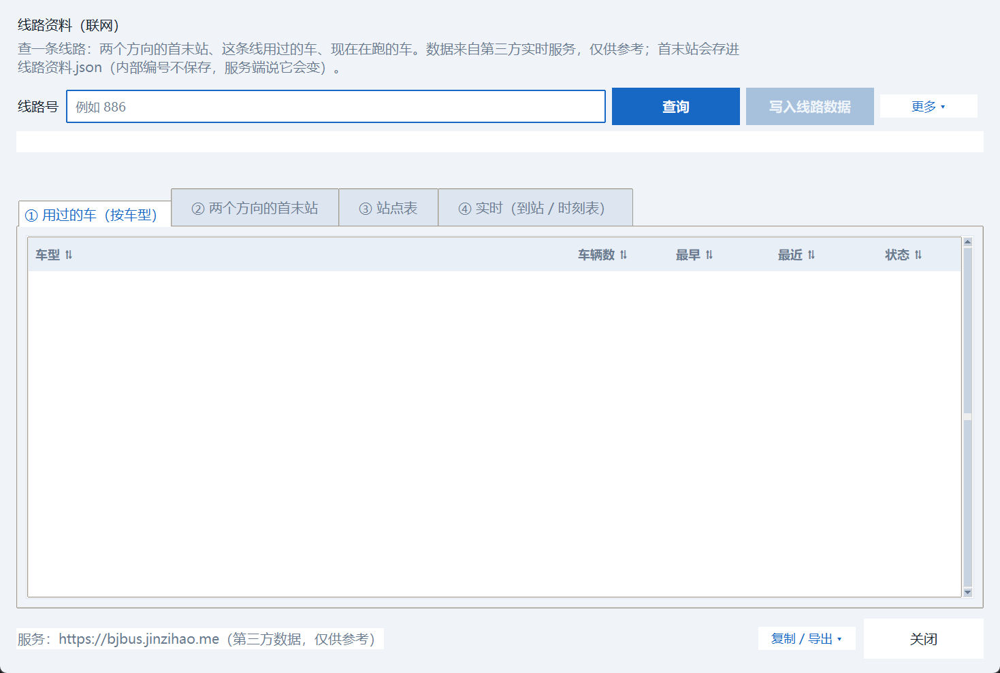

点「工具」→ **联网工具 ▾** → **线路资料**，输入线路号（例如 886）：

| 页签 | 内容 |
| --- | --- |
| ① 用过的车 | 按**车型**归并：车型 / 车辆数 / 最早 / 最近 / 状态（886 路实测用过 **319 辆**） |
| ② 两个方向的首末站 | 例如 德胜门西 ↔ 北京蟒山森林公园 |
| ③ 站点表 | 序号 / 站名 / 距上一站 / 经纬度（886 路 15 站） |

- 「**写入线路数据**」把①按车型并进 `线路.json`（来源=网上查的，可一键删）；
- 「**保存线路资料**」「**保存站点到线路资料**」把②③存进 `线路资料.json`——**存下来之后离线也能看这条线有什么站**；
- 「**更新线路目录**」（需要联网，一次就够）：把服务端的**全量线路目录**（实测 2830 条 / 1460 个线路号）存到 `线路目录.json`。
  之后**输入线路号会先在本地提示**：有这条线就顺带显示首末站；打错号（例如 `884`）会猜你可能想查 `886`；
  完全不存在的号（`9999`）直接告诉你"可能不在服务端数据集里"——**不用再为打错一个字白等 6 秒**；
- **断网也能看首末站**：有本地线路目录时，查询会**先把两个方向的首末站填上**（0 秒），联网只是去补更详细的数据；
  联网失败也不影响看和保存（存进 `线路资料.json` 时会记成"目录的更新日期"，不会把旧数据标成今天）；
- 服务端的内部线路编号**不保存**（它会变），只存线路号和站点信息；
- 「现在在跑的车」这个接口偶尔不回包，那时只在这一行说明"暂时用不了"，其它照常显示。

### 实时与站名搜索

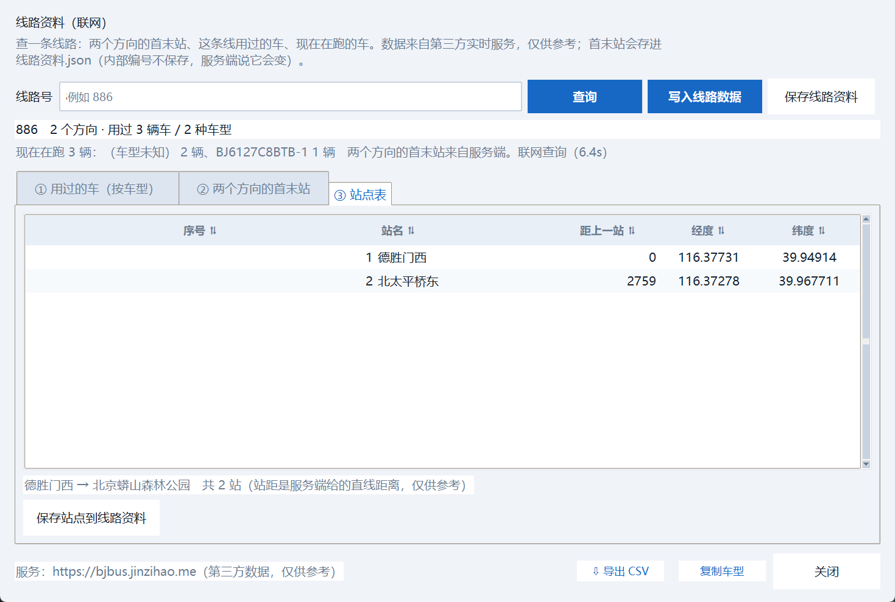

- **「这辆车现在在哪（实时）」**（联网查询窗口）：显示它现在跑哪条线、在哪一站、距站多少米、是否到站、拥挤度；
- **④ 实时（到站 / 时刻表）**页签：某站**到站记录**（自编号/时间/拥挤度）、某线**时刻表概要**（车号/始发/终点/站数）；
- **站名搜索**（同一个页签）：**「这个站有哪些线」**（例：德胜门西 → 345、886…）、**「从这里到这里直达」**（例：德胜门西 → 昌平东关 → 345快、886、快速直达专线124）；
- **「每辆车几点发车」**：这条线当天的班次（发车时间/站 → 到达时间/站；886 路实测 111 个班次）；
- **「车从哪个场站出车」**：每辆车从哪个场站、几点出车（886 路实测 40 条，车从**军都度假村/昌平东关**出车）——**去拍车时知道该去哪儿等**；
- **「从上面的站到「到」那站要多久」**：同一条线上两站之间的乘车耗时（实测 886「德胜门西 → 昌平东关」当天 9 趟，最快 1 小时 6 分）；
- 实时数据**只在本次运行里缓存 30 秒**（绝不落盘）；站名要和服务端的站名**完全一致**（站名可参考③站点表）。

### 联网设置（可选）


设置窗口最下面「联网（可选）」：**允许联网查询**开关、单次超时、缓存天数、最小间隔，外加**清空联网缓存 / 清空联网日志 / 看最近的联网错误**。保存后**立刻生效**，不用重启。


---

## 八、快捷键速查

| 按键 | 作用 |
| --- | --- |
| 直接输入五位数字 | 边输入边查（主窗口） |
| `Enter` | 主窗口：立即查询；列表里：打开选中项 |
| `Delete` | 表格里：删掉选中的行（号段管理、拍车日志、标签规则、区属公交车牌记录） |
| `Ctrl+F` | 跳到搜索框并清空（车型目录、号段管理、拍车日志、区属公交） |
| `Ctrl+C` | 不在输入框里时 = 复制当前车型 |
| `Ctrl+V` | 资料页：把剪贴板里的图片贴进相册 |
| `Ctrl+Enter` | 快查工具窗口：执行批量查询 |
| `Ctrl` / `Shift` + 点击 | 列表多选（批量设置标签、批量补录、删除记录、批量设置公司） |
| 双击 | 打开这一行的详情 / 编辑这一行 |
| **右键任意表格** | **复制选中行 / 只复制某一列（例如只要车型）** |
| `Esc` | 关闭当前对话框 |

---

## 九、文件说明

程序目录下这些文件，**前三个是核心数据，建议定期备份整个文件夹**：

| 文件 | 内容 | 能手动改吗 |
| --- | --- | --- |
| `BPT_BusDigitalNumber.xlsx` | 号段表（起始、结束、车型） | 可以，但用程序里的「号段管理」更安全 |
| `车型标签.json` | 厂商名称、单车标签、标签规则、别名 | 可以，纯文本 |
| `车型资料.json` + `车型图片\` | 简介、参数、图片 | 建议在资料页里改 |
| `北京地铁数据.json` / `北京地铁车型.txt` | 地铁号段与种子文件 | 用「地铁编号查询」里的按钮同步 |
| `拍车日志.json` / `历史记录.json` | 你的拍车记录 / 最近查过的编号 | 程序自动维护 |
| `界面设置.json` | 窗口位置等界面偏好 | 删掉就恢复默认 |
| `备份\` | 每次保存前的自动备份，每份保留 10 个 | 可按需清理 |
| `错误日志.txt` | 界面出错时的记录 | 只在出错时生成，报错时把它发我 |

---

## 十、常见问题

**双击打不开，或者杀毒软件提示有问题？**
这是 Windows SmartScreen 的**应用信誉**拦截（不是查杀病毒），因为程序没有代码签名、又是新编译出来的。点「更多信息」→「仍要运行」即可；不想再看到提示，可以在「Windows 安全中心 → 应用和浏览器控制 → 基于声誉的保护」里关掉「检查应用和文件」。**只有管理员模式才能打开**通常也是这个原因。

**提示「拒绝访问」、删不掉文件夹？**
如果这个文件夹是自动化工具创建的，可能带上了低完整性级别。双击 `修复权限.bat` 修一下（提示拒绝访问就右键以管理员身份运行），然后重新跑 `build.bat` 生成 exe。

**提示「无法保存 xxx，请确认程序文件夹可写入」？**
把程序文件夹从 `C:\Program Files` 之类的位置挪到桌面或 D 盘普通目录；或者右键 exe →「属性」→ 取消「只读」。

**数据改了但界面没变？**
保存类操作都会自动刷新所有打开着的窗口。如果某个窗口是很久以前打开的旧版行为，关掉重开一次即可。

**自编号查出来是「未收录」？**
说明 Excel 里没有覆盖这个号段。用「号段区间查询」看缺口，然后按第一节的方法补录。

**提示「数据文件不可用」？**
说明 Excel 里有重叠号段，或者某行的格式不对。这时主界面会直接给出三个自救入口（见下图）：**恢复最近的备份** 最省事；**忽略冲突强行加载** 会跳过错行、丢掉重叠行先让你用起来，之后在「管理号段」里保存一次就会把文件真正修好；也可以点「打开程序文件夹」自己用 Excel 改。


**想让界面更宽敞 / 窗口位置乱了？**
拖动窗口调整大小和位置，程序会记住。想恢复默认：主窗口「设置」→「重置窗口位置」。

**数据会丢吗？**
每次保存前都会自动备份到 `备份\`，保留最近 10 个版本，随时可以在「备份与恢复」里回滚。真要保险，定期把整个文件夹复制一份。

**出错了怎么办？**
程序会把详细信息写进 `错误日志.txt`，并把文件名告诉你。把这个文件发出来就能定位问题。

---

## 附：给维护/改代码的人

源码结构、测试与打包说明在 [README.md](README.md)（`bpt_data.py` 是数据层、`bpt_web.py` 负责网页版导出、`test_bpt_bus_digital_number.py` 有 152 个自检用例、`verify_exe.py` 是打包后的冒烟测试、`build.bat folder` 出启动更快的文件夹版——实测启动约 1 秒，单文件版约 2 秒）；每个版本改了什么记在 [CHANGELOG.md](CHANGELOG.md)。
